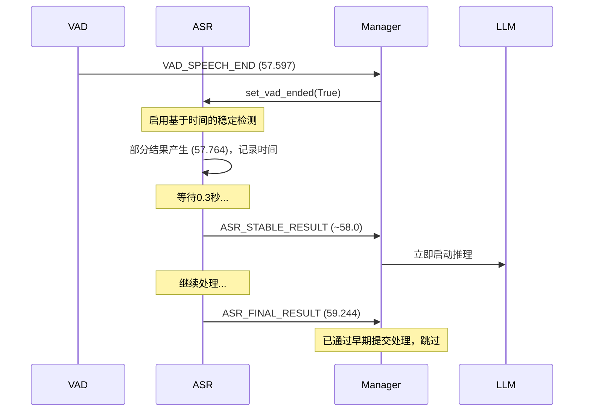

# 开发日志

## 2026-01-07 - Plugin目录重组

### 实现内容

完成了项目插件目录的重组工作，将所有第三方扩展功能模块统一移至 `plugin/` 目录下，实现更好的项目组织和管理。

#### 核心功能

1. **代码路径更新** ✅
   - 更新 `voice_chatbot/asr/speaker_verification.py` 中的3D-Speaker路径
   - 更新 `main.py` 中的MeloTTS路径
   - 所有硬编码路径已更新为统一使用 `plugin/` 前缀

2. **文档更新** ✅
   - 更新 `README.md` 中的目录结构说明
   - 更新项目结构变化说明
   - 更新注意事项和最新更新部分
   - 添加 CosyVoice 和 3D-Speaker 的相关链接
   - 更新 `requirements.txt` 中的注释路径引用

#### 新的目录结构

```
Lincoco/
├── plugin/                         # 扩展功能插件目录（新增）
│   ├── 3d-speaker/                 # 3D-Speaker 声纹识别模块
│   ├── cosyvoice/                  # CosyVoice 语音合成模块
│   └── melotts/                    # MeloTTS 语音合成模块
├── voice_chatbot/                  # 核心模块目录
├── cache/                          # 缓存目录
├── pretrained/                     # 预训练模型
├── main.py
└── README.md
```

#### 不需要修改的部分

以下模块通过 HTTP API 调用，不依赖本地路径，无需修改：

1. **voice_chatbot/tts/melo_tts_engine.py**
   - 通过 HTTP API 调用 MeloTTS 服务
   - 无硬编码路径依赖

2. **voice_chatbot/tts/cosyvoice_engine.py**
   - 通过 HTTP API 调用 CosyVoice 服务
   - 无硬编码路径依赖

3. **voice_chatbot/utils/config.py**
   - 只包含配置参数定义
   - 无硬编码路径依赖

4. **voice_chatbot/dialogue/manager.py**
   - 通过配置动态引用引擎
   - 无硬编码路径依赖

#### 修改文件清单

1. `voice_chatbot/asr/speaker_verification.py` - 更新 3D-Speaker 路径
2. `main.py` - 更新 MeloTTS 路径
3. `README.md` - 更新文档和目录结构说明
4. `requirements.txt` - 更新注释路径引用

#### 配置说明

无需新增配置项。所有路径更新为使用相对路径 `plugin/` 前缀。

#### 注意事项

1. **MeloTTS API 服务启动**
   - 程序启动时会自动从 `plugin/melotts/` 目录启动 MeloTTS API 服务
   - 工作目录会自动设置为 `plugin/melotts/`
   - HuggingFace 缓存目录设置为 `plugin/melotts/hf_download/`

2. **3D-Speaker 模块导入**
   - 程序运行时会自动将 `plugin/3d-speaker/` 添加到 Python 路径
   - 确保该目录存在且包含必要的文件

3. **配置文件**
   - 如果您有自定义配置文件，请确保没有硬编码旧的模块路径
   - 优先使用相对路径或配置项

#### 测试建议

完成重组后，建议进行以下测试：

1. **声纹验证测试**
   ```bash
   python main.py
   # 检查声纹验证是否能正常工作
   ```

2. **MeloTTS 测试**
   - 配置 `tts.default_engine = "melotts"`
   - 运行程序，检查 MeloTTS API 服务是否正常启动
   - 测试语音合成功能

3. **CosyVoice 测试**
   - 配置 `tts.default_engine = "cosyvoice3"`
   - 确保 CosyVoice API 服务在 `plugin/cosyvoice/` 目录下运行
   - 测试语音合成功能

#### 未来扩展

有了统一的 `plugin/` 目录后，未来可以：

1. **添加新的插件**
   - 新的语音合成引擎（如 VITS）
   - 新的 ASR 引擎（如 Whisper）
   - 新的声纹识别引擎
   - 其他功能扩展（如情感识别、音效处理等）

2. **插件管理系统**
   - 可以开发插件管理脚本
   - 统一安装、更新、卸载插件
   - 插件依赖管理

3. **更好的文档组织**
   - 每个插件可以有独立的文档
   - 插件间依赖关系更清晰

#### 回滚方案

如果重组后出现问题，可以快速回滚：

1. **手动回滚**
   - 将 `plugin/` 目录下的三个文件夹移回根目录
   - 恢复代码中的路径引用（使用 git history）

2. **使用 Git 回滚**
   ```bash
   git checkout HEAD~1 -- voice_chatbot/asr/speaker_verification.py
   git checkout HEAD~1 -- main.py
   git checkout HEAD~1 -- README.md
   git checkout HEAD~1 -- requirements.txt
   ```

#### 修改的代码片段

**voice_chatbot/asr/speaker_verification.py (第19行)**
```python
# 修改前：
THREE_D_SPEAKER_PATH = os.path.join(os.path.dirname(os.path.dirname(os.path.dirname(__file__))), "3D-Speaker")

# 修改后：
THREE_D_SPEAKER_PATH = os.path.join(os.path.dirname(os.path.dirname(os.path.dirname(__file__))), "plugin", "3D-Speaker")
```

**main.py (第176行)**
```python
# 修改前：
melotts_dir = project_root / "MeloTTS"

# 修改后：
melotts_dir = project_root / "plugin" / "MeloTTS"
```

#### 总结

本次重组成功将三个核心扩展模块统一到 `plugin/` 目录下，实现了：
- ✅ 更清晰的项目结构
- ✅ 更好的模块管理
- ✅ 更容易的扩展能力
- ✅ 所有必要的路径依赖已更新
- ✅ 文档已同步更新

**重组完成！** 🎉

---

## 2025-12-31 02:18 - TTS引擎增强和首句切分优化

### 实现内容

完成了多项TTS相关功能增强和LLM首句切分逻辑优化，包括新增MeloTTS引擎、响度处理、流式/非流式统一接口，以及首句逗号延迟判断功能。

#### 核心功能

1. **MeloTTS引擎实现** (`voice_chatbot/tts/melo_tts_engine.py`) ✅
   - 新增MeloTTS引擎支持，通过HTTP API调用MeloTTS服务
   - 支持多语言语音选择（通过speaker_name_map配置）
   - 支持自动语言检测和说话人选择
   - 支持语速、SDP比例、噪声比例等参数配置
   - 实现LRU内存缓存机制，减少重复请求
   - 支持文件缓存，持久化保存TTS音频
   - 支持HTTP会话复用，提高性能
   - 支持模型初始化（通过/init接口加载指定语言的模型）

2. **TTS响度归一化处理** ✅
   - 在所有TTS引擎中添加响度归一化功能
   - 使用pydub的normalize()方法进行峰值归一化
   - 确保音频响度一致性，避免削波
   - 通过配置项 `tts.enable_normalize_loudness` 控制是否启用（默认启用）
   - 在裁剪静音之后应用归一化，确保最终音频质量
   - 支持所有TTS引擎（EdgeTTS、CosyVoice3、MeloTTS）

3. **TTS流式和非流式统一接口** ✅
   - 统一TTS引擎接口，支持流式和非流式引擎的统一调用
   - 通过 `is_streaming` 配置项标识引擎类型
   - 流式引擎：CosyVoice3
   - 非流式引擎：EdgeTTS、MeloTTS
   - 对话管理器自动适配不同引擎类型，无需修改调用代码
   - 保持接口一致性，便于引擎切换和扩展

4. **首句切分延迟判断优化** (`voice_chatbot/llm/llm_openai_stream.py`) ✅
   - 优化首句逗号切分逻辑，增加延迟判断机制
   - 当遇到第一个逗号时，不立即切分，而是等待一定数量的字符
   - 在延迟范围内（默认5个字符）检查是否有句子结束符（。！？等）
   - 如果延迟范围内有句子结束符：等待按句子结束符切分（保持完整句子）
   - 如果延迟范围内没有句子结束符：按逗号切分（快速响应）
   - 通过配置项 `llm.first_sentence_comma_delay_chars` 控制延迟字符数（默认5）
   - 解决类似"我一直在等你回来啊，哥哥。"这类句子的切分问题
   - 在 `get_complete_sentences()` 函数中实现延迟判断逻辑

#### 修改文件清单

1. `voice_chatbot/tts/melo_tts_engine.py` - 新建文件，实现MeloTTS引擎
2. `voice_chatbot/utils/config.py` - 添加 `llm.first_sentence_comma_delay_chars` 配置项
3. `voice_chatbot/llm/llm_openai_stream.py` - 优化首句切分逻辑，添加延迟判断
4. 所有TTS引擎文件 - 添加响度归一化处理（`edge_tts_engine.py`、`cosyvoice_engine.py`、`melo_tts_engine.py`）

#### 配置说明

**MeloTTS引擎配置** (`config.py`):
```python
"melo_tts": {
    "api_url": "http://127.0.0.1:8101",  # MeloTTS API地址
    "api_endpoint": "/tts",  # TTS生成接口
    "init_endpoint": "/init",  # 模型初始化接口
    "timeout": 30.0,  # 请求超时时间
    "model_language": "ZH",  # 模型语言
    "speaker_name_map": {"zh": "ZH", "en": "EN", "ja": "JA"},  # 语言-说话人映射
    "default_speaker_name": "ZH",  # 默认说话人
    "speed": 1.0,  # 默认语速
    "sdp_ratio": 0.2,  # SDP比例
    "noise_scale": 0.6,  # 噪声比例
    "noise_scale_w": 0.8,  # 噪声宽度比例
}
```

**首句切分配置** (`config.py`):
```python
"llm": {
    "first_sentence_comma_delay_chars": 5,  # 首句逗号延迟字符数
}
```

**TTS响度归一化配置** (`config.py`):
```python
"tts": {
    "enable_normalize_loudness": True,  # 是否启用响度归一化
}
```

#### 关键实现细节

1. **MeloTTS引擎**：
   - 使用 `requests.Session` 复用HTTP连接，提高性能
   - 支持自动语言检测，根据文本内容选择说话人
   - 优先使用 `speaker_name_map`（与WebUI一致），向后兼容 `speaker_id_map`
   - 支持文件缓存和内存缓存双重缓存机制
   - 支持任务取消检查，可中断长时间请求

2. **响度归一化**：
   - 在音频处理流程的最后阶段应用（裁剪静音之后）
   - 使用pydub的 `normalize()` 方法，自动调整到0dBFS
   - 避免音频削波，确保播放质量
   - 对所有TTS引擎统一应用

3. **流式/非流式统一接口**：
   - 通过配置项的 `is_streaming` 标识引擎类型
   - 对话管理器根据引擎类型自动选择调用方式
   - 保持接口一致性，便于扩展新引擎

4. **首句切分延迟判断**：
   - 延迟判断逻辑在 `get_complete_sentences()` 函数中实现
   - 优先检查句子结束符（保持原有逻辑）
   - 只有在没有句子结束符且是首句且有逗号时，才进行延迟判断
   - 延迟判断时检查逗号后指定字符数内是否有句子结束符
   - 如果字符数不足，等待更多内容

#### 使用示例

**首句切分示例**：
- 文本："我一直在等你回来啊，哥哥。"
  - 当遇到逗号时，等待5个字符
  - 5个字符内出现句号"。"，等待按句号切分
  - 最终返回完整句子："我一直在等你回来啊，哥哥。"

- 文本："我一直在等你回来啊，哥哥啊哥哥"
  - 当遇到逗号时，等待5个字符
  - 5个字符内没有句子结束符，按逗号切分
  - 返回："我一直在等你回来啊"

#### 测试结果

- ✅ MeloTTS引擎基本功能测试通过
- ✅ 响度归一化功能测试通过
- ✅ 流式/非流式引擎统一接口测试通过
- ✅ 首句切分延迟判断逻辑测试通过
- ✅ 配置项验证通过

#### 相关文件

- `voice_chatbot/tts/melo_tts_engine.py` - MeloTTS引擎实现
- `voice_chatbot/tts/edge_tts_engine.py` - EdgeTTS引擎（添加响度归一化）
- `voice_chatbot/tts/cosyvoice_engine.py` - CosyVoice3引擎（添加响度归一化）
- `voice_chatbot/llm/llm_openai_stream.py` - LLM流式生成（首句切分优化）
- `voice_chatbot/utils/config.py` - 配置文件（新增配置项）

---

## 2025-12-25 02:13 - StateManager状态管理器实现（事件驱动版，v3.0 新架构）

### 实现内容

实现了 `voice_chatbot/dialogue/state_manager.py` 模块，作为v3.0新架构的核心组件之一，提供事件驱动版本的状态管理器，通过事件驱动实现原子性状态转换、自动验证状态组合有效性。

#### 核心功能

1. **StateManager类** (`voice_chatbot/dialogue/state_manager.py`) ✅
   - 统一管理主系统状态和副系统状态
   - 使用单个锁保护所有状态操作，确保线程安全
   - 通过 EventBus 发布 STATE_CHANGED 事件
   - 自动验证状态组合有效性，防止不可能的状态组合
   - 检测到无效状态组合时自动恢复

2. **状态组合验证** ✅
   - `_validate_state_combination()`: 验证状态组合是否有效
   - 根据 `THREAD_SCHEDULING.md` 中的定义，检查不可能的状态组合：
     - IDLE + PAUSED（不可能）
     - ROBOT_SPEAKING + NONE（不可能）
     - ROBOT_SPEAKING + PROCESSING（不可能）
     - ROBOT_SPEAKING + PAUSED（不可能）
   - 支持所有可能的状态组合（IDLE+NONE, IDLE+PROCESSING, IDLE+SPEAKING, LISTENING+NONE, LISTENING+PROCESSING, LISTENING+SPEAKING, LISTENING+PAUSED, ROBOT_SPEAKING+SPEAKING）

3. **状态恢复机制** ✅
   - `_recover_invalid_state()`: 恢复无效状态组合
   - 根据 THREAD_SCHEDULING.md 中的恢复规则自动恢复：
     - IDLE + PAUSED → IDLE + NONE
     - ROBOT_SPEAKING + NONE → IDLE + NONE
     - ROBOT_SPEAKING + PROCESSING → IDLE + PROCESSING
     - ROBOT_SPEAKING + PAUSED → LISTENING + PAUSED
   - 通过事件系统记录警告日志（LOG_WARN事件）

4. **主系统状态转换** ✅
   - `transition_main_state()`: 转换主系统状态（IDLE/LISTENING/ROBOT_SPEAKING）
   - `get_main_state()`: 获取当前主系统状态
   - 转换前验证状态组合有效性
   - 转换后发布 STATE_CHANGED 事件和 LOG_INFO 事件

5. **副系统状态转换** ✅
   - `transition_sub_state()`: 转换副系统状态（NONE/PROCESSING/SPEAKING/PAUSED）
   - `get_sub_state()`: 获取当前副系统状态
   - 转换前验证状态组合有效性
   - 转换后发布 STATE_CHANGED 事件和 LOG_INFO 事件

6. **原子性组合转换** ✅
   - `transition_both()`: 同时转换主系统和副系统状态（原子操作）
   - 确保主系统和副系统状态同时转换，不会出现中间状态
   - 转换前验证状态组合有效性
   - 转换后发布 STATE_CHANGED 事件和 LOG_INFO 事件

7. **状态转换事件发布** ✅
   - 每次状态转换时发布 `STATE_CHANGED` 事件
   - 事件数据包含：
     - `old_main_state`: 旧主系统状态
     - `new_main_state`: 新主系统状态
     - `old_sub_state`: 旧副系统状态
     - `new_sub_state`: 新副系统状态
     - `reason`: 转换原因
     - `transition_type`: 转换类型（"main", "sub", "both"）
   - 通过事件系统记录状态转换日志（LOG_INFO事件）

8. **状态转换历史** ✅
   - `get_transition_history()`: 获取状态转换历史（用于调试）
   - 记录最近100条转换记录
   - 包含时间戳、状态变化、转换原因等信息

9. **状态重置** ✅
   - `reset()`: 重置状态（恢复到初始状态 IDLE + NONE）
   - 清空状态转换历史
   - 发布重置事件和日志

#### 修改文件清单

1. `voice_chatbot/dialogue/state_manager.py` - 新建文件，实现 StateManager 类
2. `voice_chatbot/dialogue/__init__.py` - 添加 StateManager 到导出列表
3. `voice_chatbot/dialogue/test_state_manager.py` - 新建测试脚本（功能测试）

#### 测试结果

- ✅ 语法检查通过
- ✅ 导入测试通过（直接导入和模块导入）
- ✅ 基本状态转换功能测试通过
- ✅ 原子性组合转换功能测试通过
- ✅ 状态组合验证测试通过（无效组合自动恢复）
- ✅ 事件发布测试通过（STATE_CHANGED、LOG_INFO、LOG_WARN事件正确发布）
- ✅ 状态转换历史测试通过
- ✅ 重置功能测试通过

#### 关键实现细节

1. **线程安全**：
   - 使用单个 `threading.Lock` 保护所有状态操作
   - 所有状态读取和修改都在锁保护下进行
   - 确保状态转换的原子性

2. **事件驱动**：
   - 所有状态转换通过 EventBus 发布事件
   - 日志通过事件系统输出（LOG_INFO、LOG_WARN、LOG_ERROR）
   - 支持事件总线的可选配置（如果未提供则只执行状态转换，不发布事件）

3. **状态验证**：
   - 每次状态转换前验证状态组合有效性
   - 检测到无效组合时自动恢复并记录警告
   - 根据 THREAD_SCHEDULING.md 中的规则进行验证和恢复

4. **向后兼容**：
   - 保持与旧 `DialogueState` 类的兼容性（不删除旧代码）
   - 新代码作为 v3.0 新架构的替代方案

#### 相关文件

- `voice_chatbot/dialogue/state_manager.py` - 主要实现文件
- `voice_chatbot/dialogue/state.py` - 状态枚举定义（MainSystemState, SubSystemState）
- `voice_chatbot/dialogue/events.py` - 事件系统（EventBus, EventType.STATE_CHANGED）
- `voice_chatbot/THREAD_SCHEDULING.md` - 状态组合规则定义
- `voice_chatbot/PROJECT_OUTLINE.md` - 项目架构说明

---

## 2025-12-25 07:00 - ThreadManager线程管理器实现

### 实现内容

实现了 `voice_chatbot/dialogue/thread_manager.py` 模块，作为v3.0新架构的核心组件之一，统一管理所有工作线程的生命周期，支持常驻线程（线程1-3）和按需启动线程（线程4-9）的统一管理。

#### 核心功能

1. **ThreadManager类** (`voice_chatbot/dialogue/thread_manager.py`) ✅
   - 统一管理所有工作线程的生命周期
   - 维护线程注册表（线程名称 -> ThreadInfo）
   - 支持常驻线程和按需启动线程的分类管理
   - 提供线程启动、停止、查询的统一接口
   - 线程安全的所有操作（使用threading.Lock保护）

2. **ThreadInfo数据结构** ✅
   - 存储线程元数据（名称、线程对象、绑定的上下文、类型、启动时间、存活状态）
   - 支持线程类型标识（'resident' 或 'on_demand'）

3. **线程生命周期管理** ✅
   - `start_thread()`: 启动线程并绑定上下文，支持常驻线程和按需启动线程
   - `stop_thread()`: 停止指定线程（带超时）
   - `stop_threads_by_context()`: 停止绑定到指定上下文的所有线程
   - `stop_all_threads()`: 停止所有线程（先停止按需启动线程，再停止常驻线程）

4. **任务上下文绑定** ✅
   - 启动线程时可绑定 TaskContext
   - 任务取消时自动使上下文失效，触发线程退出
   - 支持通过上下文查询相关线程
   - 线程执行过程中可以访问绑定的上下文

5. **线程状态跟踪（通过事件系统）** ✅
   - 线程启动时发布 `THREAD_STARTED` 事件
   - 线程结束时发布 `THREAD_ENDED` 事件
   - 事件包含线程名称、任务ID、线程类型、持续时间等信息
   - 通过 EventBus 发布线程生命周期事件

6. **线程异常处理和恢复** ✅
   - 捕获线程执行异常
   - 记录异常日志和堆栈信息
   - 通过事件系统发布异常事件（LOG_ERROR事件）
   - 确保线程异常不会导致系统崩溃

7. **所有线程操作通过事件系统统一日志输出** ✅
   - 使用 EventBus 发布线程生命周期事件
   - 通过事件系统统一输出日志
   - 支持事件总线的可选配置（如果未提供则只记录日志）

8. **线程查询和统计功能** ✅
   - `get_thread_info()`: 获取指定线程信息
   - `get_threads_by_context()`: 获取绑定到指定上下文的所有线程
   - `get_all_threads()`: 获取所有线程信息
   - `get_thread_count()`: 获取线程统计信息（总数、常驻、按需、存活）
   - `cleanup_dead_threads()`: 清理已死亡的线程记录

#### 核心实现细节

1. **线程包装机制** ✅
   - 使用 `wrapped_target` 函数包装目标函数
   - 自动添加异常处理和上下文检查
   - 在线程内部发布 THREAD_STARTED 和 THREAD_ENDED 事件
   - 确保线程状态正确更新

2. **上下文失效机制** ✅
   - 停止线程时，如果绑定了上下文，会先使上下文失效
   - 这会触发任务取消，所有相关线程会自动退出
   - 支持通过 `stop_threads_by_context()` 批量停止相关线程

3. **线程类型管理** ✅
   - 支持 'resident'（常驻线程）和 'on_demand'（按需启动线程）两种类型
   - 停止所有线程时，先停止按需启动线程，再停止常驻线程
   - 便于系统关闭时的有序清理

4. **线程安全** ✅
   - 使用单个 `threading.Lock` 保护线程注册表
   - 所有公共方法都是线程安全的
   - 线程状态更新在锁保护下进行

#### 修改文件清单

1. `dialogue/thread_manager.py` - 新建文件，实现ThreadManager类和ThreadInfo数据结构
2. `dialogue/__init__.py` - 添加ThreadManager和ThreadInfo导入和导出

#### 配置说明

无需新增配置项。ThreadManager通过EventBus参数初始化，EventBus为可选参数。

#### 测试结果

- ✅ 语法检查通过
- ✅ 模块导入测试通过（ThreadManager和ThreadInfo）
- ✅ 无 linter 错误

#### 注意事项

- ThreadManager是v3.0新架构的核心组件之一，用于替代原有的分散式线程管理
- 与TaskContext和ContextManager配合使用，实现任务隔离和线程生命周期管理
- EventBus为可选参数，如果未提供则不会发布事件，但功能正常
- 所有操作都是线程安全的，可以在多线程环境中安全使用
- 支持常驻线程（线程1-3）和按需启动线程（线程4-9）的统一管理
- 线程异常会被捕获并记录，不会导致系统崩溃

#### 相关文件

- `dialogue/task_context.py` - TaskContext类（已存在）
- `dialogue/context_manager.py` - ContextManager类（已存在）
- `dialogue/events.py` - EventType和EventBus（已存在）
- `dialogue/manager.py` - 后续将集成ThreadManager（待实现）

#### 架构优势

- **统一管理**：集中管理所有线程的生命周期，避免分散式管理导致的混乱
- **任务隔离**：通过TaskContext绑定，实现任务级别的线程隔离
- **事件驱动**：所有线程操作通过事件系统统一日志输出，便于追踪和调试
- **异常安全**：线程异常不会导致系统崩溃，异常信息会被记录和发布
- **资源清理**：支持有序停止线程，避免资源泄漏

---

## 2025-12-25 06:00 - ContextManager上下文管理器实现

### 实现内容

实现了 `voice_chatbot/dialogue/context_manager.py` 模块，作为v3.0新架构的核心组件之一，统一管理TaskContext的创建、访问和销毁，解决任务隔离和线程安全问题。

#### 核心功能

1. **ContextManager类** (`voice_chatbot/dialogue/context_manager.py`) ✅
   - 统一管理任务上下文的创建、访问和销毁
   - 维护任务ID计数器，自动递增
   - 线程安全的上下文访问（使用threading.Lock保护共享状态）
   - 通过EventBus发布任务创建和取消事件

2. **主要方法** ✅
   - `create_context(user_input: str) -> TaskContext`: 创建新任务上下文，自动使旧任务失效
   - `get_current_context() -> Optional[TaskContext]`: 获取当前活动的上下文（线程安全）
   - `cancel_current_context()`: 取消当前任务上下文
   - `get_current_task_id() -> int`: 获取当前任务ID
   - `set_event_bus(event_bus: Optional[EventBus])`: 设置事件总线

3. **自动失效机制** ✅
   - 创建新上下文时，自动调用旧上下文的 `invalidate()` 方法
   - 确保旧任务的所有线程能通过 `check_valid()` 检测到失效
   - 发布TASK_CANCELLED事件（如果EventBus可用）

4. **事件集成** ✅
   - 创建任务时发布TASK_CREATED事件
   - 取消任务时发布TASK_CANCELLED事件
   - 支持EventBus为可选（如果未提供则只记录日志，不崩溃）

5. **线程安全** ✅
   - 使用单个threading.Lock保护所有共享状态（_current_context, _task_id_counter）
   - 所有公共方法都是线程安全的

#### 修改文件清单

1. `dialogue/context_manager.py` - 新建文件，实现ContextManager类
2. `dialogue/__init__.py` - 添加ContextManager导入和导出
3. `dialogue/test_context_manager.py` - 新建测试文件，包含6个测试用例

#### 配置说明

无需新增配置项。

#### 测试结果

- ✅ 语法检查通过
- ✅ 导入测试通过
- ✅ 创建和获取上下文的基本功能测试通过
- ✅ 自动失效机制测试通过
- ✅ 取消当前上下文测试通过
- ✅ 线程安全测试通过（5个并发线程）
- ✅ 事件集成测试通过（EventBus发布事件）
- ✅ 无EventBus时的行为测试通过（不会崩溃）

#### 注意事项

- ContextManager是v3.0新架构的核心组件之一，用于替代原有的分散式任务管理
- 与TaskContext配合使用，实现任务隔离和数据隔离
- EventBus为可选参数，如果未提供则不会发布事件，但功能正常
- 所有操作都是线程安全的，可以在多线程环境中安全使用

#### 相关文件

- `dialogue/task_context.py` - TaskContext类（已存在）
- `dialogue/events.py` - EventType和EventBus（已存在）
- `dialogue/manager.py` - 后续将集成ContextManager（待实现）

---

## 2025-12-25 05:30 - 响应耗时分析重构

### 问题分析

原有的响应耗时分析输出不够清晰，无法直观地看到各阶段的时间节点和内部细节耗时，不便于找到优化空间。

### 实现内容

重构 `performance_monitor.py` 的 `calculate_and_output()` 方法，使用树形结构清晰展示6个关键时间节点和阶段耗时。

#### 新的输出格式

```
========================================================================
[响应耗时分析] 总耗时: 1234ms (VAD语音结束 → 开始播放)
========================================================================

[T0] VAD语音结束                              0ms
  │
  ├── ASR阶段 ─────────────────────────── 320ms
  │     ├─ 模型推理: 180ms
  │     └─ 结果处理: 140ms (早期提交)
  │
[T1] ASR稳定结果                            320ms
  │
  ├── 调度阶段 ────────────────────────────  15ms
  │
[T2] LLM线程开始                            335ms
  │
  ├── LLM首句生成 ─────────────────────── 456ms
  │     ├─ API请求发送: 12ms
  │     ├─ 等待首个token: 380ms
  │     └─ 生成第一句: 64ms
  │
[T3] LLM第一句完成                          791ms
  │
  ├── TTS首句生成 ─────────────────────── 423ms
  │     ├─ edge_tts生成: 350ms
  │     └─ 静音裁剪: 73ms
  │
[T4] TTS音频就绪                           1214ms
  │
  ├── 播放启动 ─────────────────────────────  20ms
  │
[T5] 开始播放                              1234ms

========================================================================
```

#### 关键时间节点

| 节点 | 事件类型 | 说明 |
|------|----------|------|
| T0 | VAD_SPEECH_END | 用户语音结束（基准时间） |
| T1 | ASR_STABLE_RESULT / ASR_FINAL_RESULT | ASR结果就绪 |
| T2 | LLM_GENERATION_START | LLM线程开始 |
| T3 | LLM_FIRST_SENTENCE | LLM第一句完成 |
| T4 | TTS_FIRST_AUDIO_READY | TTS首个音频就绪 |
| T5 | AUDIO_PLAY_START | 开始播放 |

#### 阶段内部细节

- **ASR阶段**：模型推理时间、结果处理时间、是否使用早期提交
- **LLM阶段**：API请求发送时间、等待首token时间、首句生成时间
- **TTS阶段**：edge_tts生成时间、静音裁剪时间、是否缓存命中

#### 修改文件

- `utils/performance_monitor.py` - 重写 `calculate_and_output()` 方法

#### 设计要点

1. 使用相对时间（以T0为基准0ms）
2. 每个节点显示累计时间
3. 每个阶段显示阶段总耗时
4. 阶段内部细节缩进显示
5. 使用ANSI颜色区分不同阶段

---

## 2025-12-25 05:00 - 配置参数整理优化

### 问题分析

config.py 中存在以下问题：
1. **超时参数重复**：`thread_join_timeout`、`player_thread_join_timeout`、`inference_thread_wait_timeout` 功能类似
2. **ASR超时参数分散**：`asr.wait_result_timeout` 和 `dialogue.asr_wait_timeout` 重复
3. **VAD参数分散**：分散在 `audio` 和 `dialogue` 两个 section
4. **早期提交参数独立**：`stable_result_duration` 需要手动与 `no_speech_threshold` 配合

### 实现内容

#### 1. 统一超时参数 ✅

**合并线程超时参数**（3合1）：
- 移除 `thread_join_timeout`、`player_thread_join_timeout`、`inference_thread_wait_timeout`
- 统一为 `dialogue.thread_timeout: 2.0`

**合并ASR等待超时**（2合1）：
- 移除 `asr.wait_result_timeout` 和 `dialogue.asr_wait_timeout`
- 统一为 `asr.result_timeout: 30.0`

#### 2. 新建独立VAD section ✅

将分散在audio和dialogue中的VAD参数统一到新的 `vad` section：
```python
"vad": {
    "mode": 3,
    "activation_rate": 0.4,
    "adaptive_threshold": False,
    "min_activation_rate": 0.2,
    "max_activation_rate": 0.6,
    "check_interval": 0.5,
    "thread_sleep": 0.01,
}
```

#### 3. 早期提交参数改为比例关系 ✅

- 移除独立的 `stable_result_duration` 配置
- 添加 `asr.stable_result_ratio: 0.6`
- 在 `fun_asr_stream.py` 中自动计算：`stable_result_duration = no_speech_threshold * ratio`

这样用户只需调整 `no_speech_threshold`，早期提交时间会自动按比例调整。

#### 4. 清理未使用的参数 ✅

- 移除 `dialogue.queue_operation_timeout`（改为代码中固定值）
- 移除 `dialogue.vad_check_interval`、`dialogue.vad_thread_sleep`（移到vad section）

#### 修改文件清单

1. `utils/config.py` - 重构配置结构，新建vad section，统一超时参数
2. `dialogue/manager.py` - 更新配置读取路径
3. `audio/fun_asr_stream.py` - 改为比例计算stable_result_duration
4. `audio/webrtc_vad.py` - 更新VAD配置读取路径

#### 配置结构对比

**整理前**：约70+项参数，分散且有重复

**整理后**：
```python
DEFAULT_CONFIG = {
    "audio": {
        "sample_rate": 16000,
        "chunk_size": 1024,
        "channels": 1,
    },
    "vad": {  # 新增独立section
        "mode": 3,
        "activation_rate": 0.4,
        "adaptive_threshold": False,
        "min_activation_rate": 0.2,
        "max_activation_rate": 0.6,
        "check_interval": 0.5,
        "thread_sleep": 0.01,
    },
    "asr": {
        "result_timeout": 30.0,  # 统一的ASR结果超时
        "early_commit_enabled": True,
        "stable_result_ratio": 0.6,  # 比例计算
    },
    "dialogue": {
        "no_speech_threshold": 0.5,
        "thread_timeout": 2.0,  # 统一的线程超时
    },
}
```

#### 预期效果

- 配置参数更加集中，VAD相关参数统一在vad section
- 超时参数统一，减少混淆
- 早期提交自动适应no_speech_threshold调整
- 减少配置复杂度，提高可维护性

---

## 2025-12-25 04:30 - ASR早期提交逻辑修复（基于时间的稳定检测）

### 问题分析

从日志发现原有的稳定检测逻辑存在问题：
```
[03:12:57.597] VAD结束状态已设置，启用稳定结果检测
[03:12:57.764] 部分结果: 哪有你的发音速度好像还是有点慢呢 (+168ms)
[03:12:58.807] 用户停止说话，等待ASR识别完成 (+1043ms) <-- 等了1秒多！
[03:12:59.244] 最终识别结果
```

**核心问题**：原有逻辑需要"连续N次相同结果"才能触发早期提交，但VAD结束后ASR可能只产生一次部分结果（没有新音频输入就不会有新结果），导致永远无法触发早期提交。

### 实现内容

将稳定检测策略从"连续N次相同结果"改为"基于时间的稳定检测"：

#### 核心功能

1. **稳定检测逻辑重构** (`voice_chatbot/audio/fun_asr_stream.py`) ✅
   - **原逻辑**：连续N次相同结果 → 稳定
   - **新逻辑**：VAD结束后，部分结果保持不变超过`stable_result_duration`秒 → 稳定
   - 添加时间戳跟踪变量：`_last_stable_text`、`_last_stable_time`
   - 修改 `_check_and_send_stable_result()` 方法实现基于时间的检测

2. **配置项更新** (`voice_chatbot/utils/config.py`) ✅
   - 移除 `asr.stable_check_count`（连续N次相同结果）
   - 添加 `asr.stable_result_duration`（默认0.3秒）
   - 说明：VAD结束后，部分结果保持不变超过此时间视为稳定

3. **性能监控器更新** (`voice_chatbot/utils/performance_monitor.py`) ✅
   - 添加 `asr_stable_result_time` 时间点
   - 添加 `asr_early_commit` 标记
   - 添加 `EventType.ASR_STABLE_RESULT` 事件处理
   - 耗时分析区分"早期提交"和"正常提交"
   - 优化输出命名：显示"ASR稳定结果(早期提交)"或"ASR最终结果"

#### 工作流程



#### 预期效果

- **优化前**：VAD结束 (57.597) → 等待1.2秒(NO_SPEECH_THRESHOLD) → 最终结果 (59.244) → LLM开始
- **优化后**：VAD结束 (57.597) → 部分结果 (57.764) → 等待0.3秒 → 稳定结果 (~58.0) → LLM开始

预计节省约 **1秒** 响应时间。

#### 修改文件清单

1. `audio/fun_asr_stream.py` - 修改稳定检测逻辑，改为基于时间检测
2. `utils/config.py` - 添加 `stable_result_duration` 配置项
3. `utils/performance_monitor.py` - 添加 ASR_STABLE_RESULT 处理和命名优化

#### 配置说明

```json
{
  "asr": {
    "early_commit_enabled": true,
    "stable_result_duration": 0.3
  }
}
```

#### 注意事项

- 基于时间的稳定检测更加可靠，不依赖ASR产生多次相同结果
- 如果 `stable_result_duration` 设置过短，可能导致误判
- 如果设置过长，则失去早期提交的优势
- 推荐值：0.3秒（平衡准确性和响应速度）

---

## 2025-12-25 04:00 - 日志sequenceDiagram支持和标准化操作文档

### 实现内容

实现了两个功能：1) 在日志系统中添加sequenceDiagram格式的图形化流程记录；2) 创建标准化操作文档，记录每次代码修改后的标准操作步骤。

#### 核心功能

1. **标准化操作文档** (`voice_chatbot/CODE_COMPLETION_CHECKLIST.md`) ✅
   - 代码测试步骤（语法检查、导入测试、功能测试）
   - 文档更新要求（DEVELOPMENT_LOG.md、THREAD_SCHEDULING.md、PROJECT_OUTLINE.md）
   - 代码质量检查（代码规范、错误处理、线程安全）
   - 配置管理检查
   - 事件系统检查
   - 提交前检查清单
   - 快速检查命令

2. **SequenceDiagramRecorder类** (`voice_chatbot/utils/sequence_diagram_recorder.py`) ✅
   - 跟踪关键流程中的事件序列
   - 记录参与者（VAD、ASR、Manager、LLM、TTS、Player等）
   - 记录消息传递和时间戳
   - 生成mermaid sequenceDiagram格式的文本
   - 支持添加注释和特殊说明
   - 自动转义特殊字符

3. **EventLogger扩展** (`voice_chatbot/utils/event_logger.py`) ✅
   - 集成SequenceDiagramRecorder
   - 自动识别关键流程的开始和结束事件
   - 在关键流程中记录sequenceDiagram
   - 在流程结束时将sequenceDiagram写入日志文件
   - 支持多个并发流程（通过task_id区分）
   - 支持流程超时自动结束

4. **配置项** (`voice_chatbot/utils/config.py`) ✅
   - `log.enable_sequence_diagram`: 是否启用sequenceDiagram记录（默认True）
   - `log.sequence_diagram_flow_timeout`: 流程超时时间（默认30.0秒）

5. **事件类型映射更新** (`voice_chatbot/utils/event_logger.py`) ✅
   - 在EVENT_CATEGORY_MAP中添加ASR_STABLE_RESULT的映射
   - 在EVENT_MESSAGE_TEMPLATES中添加ASR_STABLE_RESULT的模板

#### 关键流程识别

系统自动识别以下关键流程并生成sequenceDiagram：

- **正常对话流程**: VAD_SPEECH_START → ASR_RECOGNITION_START → ASR_FINAL_RESULT → LLM_GENERATION_START → TTS_GENERATION_START → AUDIO_PLAY_START → AUDIO_PLAY_END
- **早期提交流程**: VAD_SPEECH_END → ASR_STABLE_RESULT → LLM_GENERATION_START
- **打断流程**: USER_INTERRUPT → AUDIO_PAUSED → ASR_FINAL_RESULT → TASK_CANCELLED
- **输入合并流程**: ASR_FINAL_RESULT (第一个) → USER_INTERRUPT → ASR_FINAL_RESULT (第二个) → LLM_GENERATION_START

#### 日志文件输出格式

sequenceDiagram以mermaid代码块形式输出到日志文件：

```
[时间戳] [SEQUENCE] 关键流程序列图（任务ID: X） [耗时: X.XXX秒] 序列图:
```mermaid
sequenceDiagram
    participant VAD
    participant ASR
    participant Manager as DialogueManager
    participant LLM
    ...
```
```

#### 技术细节

1. **流程边界检测**:
   - 流程开始：检测到VAD_SPEECH_START或USER_INTERRUPT
   - 流程结束：检测到AUDIO_PLAY_END或TASK_CANCELLED
   - 流程超时：如果超过30秒没有新事件，自动结束当前流程记录

2. **关键事件识别**:
   - 只记录关键事件到sequenceDiagram，避免图表过于复杂
   - 支持添加特殊注释（如早期提交说明）

3. **并发流程支持**:
   - 通过task_id区分不同的流程
   - 每个流程有独立的SequenceDiagramRecorder实例

4. **特殊字符处理**:
   - 自动转义mermaid语法中的特殊字符
   - 处理换行符和引号

#### 修改文件清单

1. `voice_chatbot/CODE_COMPLETION_CHECKLIST.md` - 新建：标准化操作检查清单
2. `voice_chatbot/utils/sequence_diagram_recorder.py` - 新建：序列图记录器
3. `voice_chatbot/utils/event_logger.py` - 修改：添加sequenceDiagram支持
4. `voice_chatbot/utils/config.py` - 修改：添加log配置项
5. `voice_chatbot/dialogue/manager.py` - 修改：传递config参数给EventLogger

#### 配置说明

新增配置项：
```json
{
  "log": {
    "enable_sequence_diagram": true,
    "sequence_diagram_flow_timeout": 30.0
  }
}
```

#### 使用说明

1. **查看sequenceDiagram**:
   - 打开日志文件（`logs/voice_chatbot_YYYY-MM-DD.log`）
   - 查找 `[SEQUENCE]` 标记的序列图
   - 复制mermaid代码块到支持mermaid的编辑器（如Markdown编辑器）中查看图形

2. **禁用sequenceDiagram**:
   - 设置 `log.enable_sequence_diagram: false`

3. **调整流程超时**:
   - 设置 `log.sequence_diagram_flow_timeout` 为合适的值（秒）

#### 注意事项

- sequenceDiagram只输出到日志文件，不输出到控制台（避免控制台混乱）
- 每个关键流程生成一个独立的sequenceDiagram
- 支持多个并发流程（通过task_id区分）
- 确保mermaid语法正确（自动转义特殊字符）

---

## 2025-12-25 03:30 - ASR早期提交优化（Early Commit）

### 问题分析

从日志时间线分析发现响应延迟问题：
```
35.454 - VAD语音活动结束
35.736 - 部分结果已经是最终内容 "可以啊感觉你反应还是挺慢的"
36.673 - "用户停止说话，等待ASR识别完成"（+1.2秒，NO_SPEECH_THRESHOLD）
37.068 - ASR最终识别结果（与部分结果完全相同）
```

**核心问题**：当部分结果已经稳定且VAD已结束时，系统还在等待"正式的最终结果"，浪费约1.3秒。

### 实现内容

实现了ASR早期提交优化（Early Commit），当VAD结束且ASR结果稳定时，提前触发LLM推理，无需等待正式的最终结果。

#### 核心功能

1. **新事件类型** (`voice_chatbot/dialogue/events.py`) ✅
   - 添加 `ASR_STABLE_RESULT` 事件类型
   - 设置与 `ASR_FINAL_RESULT` 相同的优先级（7）

2. **稳定结果检测** (`voice_chatbot/audio/fun_asr_stream.py`) ✅
   - 添加稳定结果检测逻辑（记录最近N次结果，检测是否连续相同）
   - 新增 `set_vad_ended()` 方法供外部设置VAD结束状态
   - 新增 `is_stable_result_sent()` 方法查询是否已发送稳定结果
   - 新增 `_check_and_send_stable_result()` 方法检测并发送稳定结果事件

3. **早期提交处理** (`voice_chatbot/dialogue/manager.py`) ✅
   - 在 `_on_vad_speech_end()` 中通知ASR模块VAD已结束
   - 订阅 `ASR_STABLE_RESULT` 事件
   - 新增 `_on_asr_stable_result()` 处理稳定结果事件，提前触发LLM推理
   - 添加 `_early_commit_processed` 标记防止最终结果重复处理
   - 在ASR线程启动时重置早期提交状态

4. **配置项** (`voice_chatbot/utils/config.py`) ✅
   - `asr.early_commit_enabled`: 是否启用早期提交优化（默认True）
   - `asr.stable_check_count`: 连续多少次相同结果视为稳定（默认2次）

#### 工作流程

```
[VAD] 检测到语音结束 → 通知ASR模块（set_vad_ended）
    ↓
[ASR线程] 每次部分识别后检查结果稳定性
    ├─ 如果连续N次结果相同 + VAD已结束
    │   ├─ 发送 ASR_STABLE_RESULT 事件
    │   └─ DialogueManager 收到事件后提前调用 _handle_asr_result()
    └─ 后续的最终结果会被跳过（已通过早期提交处理）
```

#### 预期效果

- **优化前**：VAD结束 → 等待1.2秒(NO_SPEECH_THRESHOLD) → 等待0.4秒(最终识别) → LLM开始
- **优化后**：VAD结束 → 检测到稳定结果(约0.3秒) → LLM开始

预计节省约 **1-1.3秒** 响应时间。

#### 修改文件清单

1. `dialogue/events.py` - 添加 `ASR_STABLE_RESULT` 事件类型
2. `audio/fun_asr_stream.py` - 添加稳定结果检测和VAD状态跟踪
3. `dialogue/manager.py` - 订阅稳定结果事件，实现早期提交逻辑
4. `utils/config.py` - 添加早期提交相关配置项
5. `THREAD_SCHEDULING.md` - 更新文档，添加早期提交优化说明

#### 配置说明

```json
{
  "asr": {
    "early_commit_enabled": true,
    "stable_check_count": 2
  }
}
```

#### 风险与兜底

- 如果最终结果与稳定结果不同（极少情况），由于LLM已开始，可能产生不一致
- 兜底策略：可通过配置 `asr.early_commit_enabled` 关闭此功能

---

## 2025-12-25 02:51 - 统一事件日志系统架构改进

### 实现内容
实现了完整的事件驱动日志系统，将所有模块的日志输出统一通过事件系统管理，实现统一的时间记录、日志输出，并输出更完整的响应耗时分析。

#### 核心功能

1. **事件类型扩展** (`voice_chatbot/dialogue/events.py`) ✅
   - **系统级事件**：`SYSTEM_INIT`, `SYSTEM_START`, `SYSTEM_STOP` ✅
   - **细粒度ASR事件**：`ASR_MODEL_INFERENCE`（模型推理时间）✅
   - **细粒度LLM事件**：
     - `LLM_REQUEST_SENT`（API请求发送）✅
     - `LLM_STREAM_START`（开始收到流式响应）✅
     - `LLM_SENTENCE_GENERATED`（每个句子生成）✅
   - **TTS缓存事件**：`TTS_CACHE_HIT`（缓存命中）✅
   - **通用日志事件**：`LOG_INFO`, `LOG_WARN`, `LOG_ERROR`, `LOG_DEBUG` ✅
   - **优先级映射**：更新所有新事件的默认优先级 ✅

2. **EventLogger统一日志处理器** (`voice_chatbot/utils/event_logger.py`) ✅
   - **统一日志格式**：根据事件类型格式化输出日志 ✅
   - **时间差计算**：显示与上一事件的时间差（delta）✅
   - **事件时间轴**：维护完整的事件时间轴记录 ✅
   - **多输出支持**：支持控制台和文件输出 ✅
   - **自动过滤**：过滤高频事件（如播放进度、部分识别结果）✅
   - **日志类别映射**：根据事件类型自动确定日志类别（VAD/ASR/LLM/TTS/PLAY等）✅
   - **消息模板**：为每种事件类型定义消息模板 ✅

3. **PerformanceMonitor重构** (`voice_chatbot/utils/performance_monitor.py`) ✅
   - **事件时间戳精确计时**：使用事件自带的时间戳进行精确计时 ✅
   - **完整事件时间轴**：维护所有性能相关事件的完整时间轴 ✅
   - **细粒度耗时分析**：
     - ASR识别（含模型推理时间）✅
     - LLM生成（含API请求等待时间）✅
     - 队列等待（线程调度时间）✅
     - TTS生成和处理（含缓存命中状态）✅
     - 其他开销（格式转换、队列操作等）✅
   - **详细输出格式**：树形结构显示各阶段耗时和百分比 ✅
   - **起点时间优化**：从VAD检测到语音停止开始计算总响应耗时 ✅

4. **VAD模块改造** (`voice_chatbot/audio/webrtc_vad.py`) ✅
   - **事件发送**：发送 `VAD_SPEECH_START` 和 `VAD_SPEECH_END` 事件 ✅
   - **日志统一**：添加 `_publish_log()` 辅助方法，所有日志通过事件系统发送 ✅
   - **向后兼容**：当event_bus未设置时回退到直接日志输出 ✅

5. **ASR模块改造** (`voice_chatbot/audio/fun_asr_stream.py`) ✅
   - **事件发送**：
     - `ASR_RECOGNITION_START`（识别开始）✅
     - `ASR_FINAL_RESULT`（最终结果）✅
     - `ASR_RECOGNITION_END`（识别结束）✅
   - **日志统一**：添加 `_publish_log()` 和 `_send_final_result_events()` 方法 ✅
   - **关键日志事件化**：所有关键操作的日志都通过事件系统发送 ✅

6. **LLM模块改造** (`voice_chatbot/llm/llm_openai_stream.py`) ✅
   - **细粒度事件**：
     - `LLM_GENERATION_START`（生成开始）✅
     - `LLM_REQUEST_SENT`（API请求发送）✅
     - `LLM_STREAM_START`（开始收到流式响应）✅
     - `LLM_SENTENCE_GENERATED`（每个句子生成）✅
     - `LLM_FIRST_SENTENCE`（第一句生成完成）✅
     - `LLM_GENERATION_COMPLETE`（生成完成）✅
   - **日志统一**：添加 `_publish_log()` 方法，关键日志通过事件系统发送 ✅
   - **请求等待时间记录**：精确记录API请求到收到响应的等待时间 ✅

7. **TTS模块改造** (`voice_chatbot/tts/edge_tts_engine.py`) ✅
   - **事件发送**：
     - `TTS_GENERATION_START`（生成开始）✅
     - `TTS_CACHE_HIT`（缓存命中）✅
     - `TTS_FIRST_AUDIO_READY`（第一个音频就绪，含生成和处理时间）✅
     - `TTS_GENERATION_COMPLETE`（生成完成）✅
   - **日志统一**：添加 `_publish_log()` 方法 ✅
   - **缓存状态记录**：记录缓存命中状态，用于耗时分析 ✅

8. **AudioPlayer模块改造** (`voice_chatbot/tts/audio_player.py`) ✅
   - **日志统一**：添加 `_publish_log()` 方法，所有日志通过事件系统发送 ✅
   - **事件发送**：保持现有的 `AUDIO_PLAY_START` 和 `AUDIO_PLAY_PROGRESS` 事件 ✅

9. **DialogueManager集成** (`voice_chatbot/dialogue/manager.py`) ✅
   - **EventLogger注册**：创建并注册EventLogger作为事件订阅者 ✅
   - **PerformanceMonitor更新**：使用新的PerformanceMonitor（不再依赖PerformanceTimer）✅
   - **系统级事件**：发送 `SYSTEM_INIT`, `SYSTEM_START`, `SYSTEM_STOP` 事件 ✅
   - **event_bus传递**：将event_bus传递给TTS引擎 ✅

#### 架构优势

1. **统一管理**：所有模块的日志通过事件系统统一管理，格式一致 ✅
2. **精确计时**：使用事件自带的时间戳，避免时间记录分散导致的误差 ✅
3. **完整分析**：能够细分到模块内部各阶段（如ASR模型推理、LLM请求等待）✅
4. **可维护性**：日志逻辑集中管理，易于扩展和修改 ✅
5. **解耦合**：模块只需发送事件，不需要关心日志格式和输出方式 ✅

#### 技术细节

- **循环导入修复**：从 `utils/__init__.py` 中移除 `EventLogger` 和 `PerformanceMonitor` 的导入，避免循环导入 ✅
- **向后兼容**：所有模块的 `_publish_log()` 方法在event_bus未设置时回退到直接日志输出 ✅
- **事件过滤**：EventLogger自动过滤高频事件，避免日志过多 ✅
- **时间轴维护**：EventLogger和PerformanceMonitor都维护事件时间轴，用于调试和分析 ✅

#### 测试结果

- ✅ 所有模块成功改造，日志通过事件系统统一输出
- ✅ 响应耗时分析输出更详细，包含各模块内部阶段耗时
- ✅ 日志格式统一，包含时间差（delta）信息
- ✅ 系统启动和运行正常，无循环导入错误

---

## 2025-12-24 22:23 - 人设管理系统实现

### 实现内容
实现了完整的人设管理系统，支持从文件加载人设、参数替换、配置选择和运行时动态切换功能。

#### 核心功能

1. **变量处理器** (`voice_chatbot/llm/variable_processor.py`) ✅
   - **变量格式**：支持 `{{param_name}}` 双大括号格式
   - **内置参数**：
     - `{{current_time}}` - 当前时间（HH:MM:SS格式）
     - `{{current_date}}` - 当前日期（YYYY-MM-DD格式）
     - `{{weekday}}` - 星期几（中文格式：星期一、星期二等）
     - `{{user_name}}` - 用户名（从配置 `llm.user_name` 读取）
   - **自定义参数**：支持注册自定义参数处理器
   - **线程安全**：使用锁保护变量替换操作
   - **错误处理**：未定义的变量保留原样，记录警告日志

2. **人设管理器** (`voice_chatbot/llm/persona_manager.py`) ✅
   - **文件加载**：从 `llm/personas/` 目录加载人设文件（支持.md和.txt格式）
   - **文件缓存**：缓存已加载的人设文件内容，提高性能
   - **变量处理**：集成变量处理器，自动替换参数
   - **运行时切换**：支持通过 `set_persona(name)` 方法动态切换人设
   - **Fallback机制**：人设文件不存在时，自动使用配置中的 `system_prompt` 作为fallback
   - **人设列表**：提供 `list_personas()` 方法查询所有人设文件
   - **线程安全**：使用锁保护缓存和切换操作

3. **LLM模块集成** (`voice_chatbot/llm/llm_openai_stream.py`) ✅
   - **PersonaManager集成**：初始化时创建 `PersonaManager` 实例
   - **动态获取人设**：在 `_build_messages()` 中每次调用时获取最新人设（支持参数实时更新）
   - **运行时切换**：添加 `set_persona(name)` 和 `get_current_persona_name()` 方法
   - **向后兼容**：保留 `system_prompt` 配置项作为fallback

4. **对话管理器集成** (`voice_chatbot/dialogue/manager.py`) ✅
   - **人设切换接口**：添加 `switch_persona(name)` 方法，供外部调用切换人设
   - **人设查询接口**：添加 `get_current_persona_name()` 方法查询当前人设
   - **线程安全**：确保切换操作的线程安全性

5. **配置文件更新** (`voice_chatbot/utils/config.py`) ✅
   - **新增配置项**：
     - `llm.persona_name`: 默认人设名称（默认 "default"）
     - `llm.persona_dir`: 人设文件目录（默认 "llm/personas"）
     - `llm.user_name`: 用户名（默认 "用户"）
   - **向后兼容**：保留 `llm.system_prompt` 配置项作为fallback

6. **人设文件目录** (`voice_chatbot/llm/personas/`) ✅
   - **默认人设**：创建 `default.md` 文件（使用当前system_prompt内容，添加变量示例）
   - **示例人设**：创建 `assistant.md` 文件作为示例
   - **文件格式**：支持Markdown格式（.md）和文本格式（.txt）

7. **项目文档更新** (`PROJECT_OUTLINE.md`) ✅
   - **新增章节**：添加"人设管理系统"章节
   - **功能列表**：更新LLM模块功能列表，添加人设管理相关功能
   - **配置说明**：添加人设相关配置参数说明
   - **关键功能细节**：添加人设管理系统的详细说明

#### 技术细节

1. **变量替换实现**：
   - 使用正则表达式 `r'\{\{(\w+)\}\}'` 匹配变量
   - 内置参数处理器函数返回字符串值
   - 支持自定义参数处理器注册
   - 未定义的变量保留原样，记录警告

2. **人设文件加载**：
   - 路径计算：相对于 `voice_chatbot` 目录
   - 文件格式：优先查找 `.md` 文件，其次 `.txt` 文件
   - 缓存机制：使用字典缓存已加载的文件内容
   - 编码处理：使用 UTF-8 编码读取文件

3. **参数实时更新**：
   - 每次调用LLM时实时获取人设（通过 `get_persona()` 方法）
   - 变量处理器在获取时实时替换参数
   - 确保时间等参数始终是最新的

4. **线程安全**：
   - `VariableProcessor` 使用锁保护自定义处理器注册
   - `PersonaManager` 使用锁保护缓存和切换操作
   - 确保多线程环境下的安全性

#### 测试结果

创建了完整的测试文件 (`voice_chatbot/llm/test_persona_system.py`)，所有测试通过：

1. **变量处理器测试** ✅
   - 测试变量识别和替换
   - 测试内置参数（current_time、current_date、weekday、user_name）
   - 测试未定义变量的处理（保留原样）
   - 测试可用变量列表查询

2. **人设管理器测试** ✅
   - 测试默认人设加载
   - 测试人设文件列表查询
   - 测试人设切换功能
   - 测试切换回默认人设

3. **人设文件变量替换测试** ✅
   - 测试人设文件中的变量替换
   - 验证所有变量都被正确替换
   - 验证用户名等配置参数正确应用

4. **Fallback机制测试** ✅
   - 测试人设文件不存在时的fallback机制
   - 验证使用配置中的 `system_prompt` 作为fallback

#### 修改文件清单

1. `llm/variable_processor.py` - 新建：变量处理器模块
2. `llm/persona_manager.py` - 新建：人设管理器模块
3. `llm/personas/default.md` - 新建：默认人设文件
4. `llm/personas/assistant.md` - 新建：示例人设文件
5. `llm/llm_openai_stream.py` - 修改：集成PersonaManager，支持动态人设
6. `dialogue/manager.py` - 修改：添加人设切换接口
7. `utils/config.py` - 修改：添加人设相关配置项
8. `PROJECT_OUTLINE.md` - 修改：添加人设管理系统章节
9. `llm/test_persona_system.py` - 新建：测试文件

#### 使用示例

1. **配置文件设置**：
```json
{
  "llm": {
    "persona_name": "default",
    "persona_dir": "llm/personas",
    "user_name": "用户"
  }
}
```

2. **人设文件示例** (`llm/personas/default.md`)：
```markdown
你叫林可可，是16岁的女高中生，性格活泼开朗，谈吐风趣。
当前时间是 {{current_time}}，今天是 {{current_date}}，{{weekday}}。
你正在和{{user_name}}聊天，回答简短，控制在300字以内，不要用表情。
```

3. **运行时切换人设**：
```python
# 在DialogueManager中
manager.switch_persona("assistant")
current_persona = manager.get_current_persona_name()
```

#### 后续优化建议

1. 支持人设文件热重载（文件变更时自动重新加载）
2. 支持人设文件元数据（如描述、标签等）
3. 支持人设文件模板系统
4. 支持更多内置参数（如天气、位置等）
5. 支持参数的条件替换（如根据时间显示不同内容）

---

## 2025-12-24 21:40 - 播放文本流式输出优化和完整句子判断修复

### 实现内容
优化播放文本流式输出显示方式，修复完整句子判断逻辑，避免在完整句子后添加"..."标记。

#### 核心功能

1. **流式输出同一行更新** (`voice_chatbot/utils/logger.py`) ✅
   - **新增参数**：`inline` 参数，支持在同一行更新日志（使用 `\r`）
   - **实现方式**：使用 `print(f"\r{log_message}", end='', flush=True)` 在同一行更新
   - **文件输出**：文件输出仍然使用换行，保持日志文件的可读性

2. **播放文本流式输出优化** (`voice_chatbot/tts/audio_player.py`) ✅
   - **同一行更新**：使用 `inline=True` 参数，在同一行实时更新播放文本
   - **状态跟踪**：添加 `_last_logged_text` 变量，避免重复输出相同内容
   - **换行处理**：播放完成或中断时输出换行，结束流式输出
   - **状态重置**：播放开始时重置流式输出状态

3. **完整句子判断修复** (`voice_chatbot/dialogue/state.py`) ✅
   - **问题修复**：修复完整句子被打断时仍然添加"..."的问题
   - **判断逻辑**：检查响应文本是否以句子结束符结尾（。！？.!?\n）
   - **实现方式**：使用正则表达式 `r'[。！？.!?\n]+$'` 匹配句子结束符
   - **处理规则**：
     - 如果以完整句子结尾，不添加"..."
     - 如果不是完整句子，添加"..."标记

#### 技术细节

1. **同一行更新实现**：
   - 使用 `\r` 回车符回到行首
   - 使用 `end=''` 避免自动换行
   - 使用 `flush=True` 立即刷新输出
   - 文件输出仍然使用换行，保持日志文件可读性

2. **完整句子判断**：
   - 使用正则表达式匹配句子结束符
   - 支持中文和英文句子结束符
   - 去除首尾空白后判断，避免误判

3. **状态管理**：
   - `_last_logged_text` 跟踪上次输出的文本
   - 避免重复输出相同内容
   - 播放完成时重置状态

#### 修改文件清单

1. `utils/logger.py` - 添加 `inline` 参数支持同一行更新
2. `tts/audio_player.py` - 使用 `inline=True` 输出播放文本，添加状态跟踪和换行处理
3. `dialogue/state.py` - 修复完整句子判断逻辑，添加 `re` 模块导入

#### 注意事项

- 同一行更新只在控制台输出生效，文件输出仍然使用换行
- 完整句子判断基于句子结束符，可能无法识别所有情况
- 保持向后兼容，不影响现有功能

---

## 2025-12-24 21:30 - 播放文本流式展示和实时更新功能实现

### 实现内容
实现播放时控制台实时输出已播放文本，并在manager中订阅播放进度事件实时更新已播放文本。

#### 核心功能

1. **控制台实时日志输出** (`voice_chatbot/tts/audio_player.py`) ✅
   - **实时文本展示**：在发送播放进度事件时，同时输出已播放文本到控制台
   - **日志格式**：`[播放文本] {已播放文本片段}`
   - **输出频率**：与播放进度事件同步，默认100毫秒一次
   - **显示内容**：当前句子已播放的部分（根据文本位置估算）

2. **播放进度事件订阅** (`voice_chatbot/dialogue/manager.py`) ✅
   - **事件订阅**：在 `initialize_modules()` 中订阅 `AUDIO_PLAY_PROGRESS` 事件
   - **事件处理函数**：`_on_playback_progress()` - 处理播放进度事件，实时更新已播放文本
   - **任务ID验证**：检查事件中的任务ID，忽略旧任务的事件

3. **句子跟踪机制** (`voice_chatbot/dialogue/manager.py`) ✅
   - **跟踪变量**：
     - `completed_sentences: List[str]` - 已完成的句子列表
     - `last_sentence_text: str` - 上次处理的句子文本（用于检测句子切换）
   - **句子切换检测**：如果当前句子文本与上次不同，说明开始播放新句子
   - **句子完成检测**：如果位置达到句子长度，说明当前句子播放完成
   - **多句子累积**：已完成句子 + 当前句子已播放部分

4. **实时文本更新逻辑** (`voice_chatbot/dialogue/manager.py`) ✅
   - **更新时机**：每次收到播放进度事件时更新
   - **更新内容**：
     - `current_playing_text` = 已完成句子 + 当前句子已播放部分
     - `played_response_text` = `current_playing_text`（用于历史记录）
   - **线程安全**：使用 `task_lock` 保护更新操作

5. **与现有逻辑协调** (`voice_chatbot/dialogue/manager.py`) ✅
   - **on_play_complete优化**：如果播放进度事件已经更新了文本，使用实时更新的文本作为最终确认
   - **向后兼容**：如果播放进度事件没有更新（异常情况），使用原来的估算逻辑
   - **变量重置**：在任务开始时重置句子跟踪变量

#### 技术细节

1. **实时日志输出**：
   - 在 `audio_player.py` 的播放循环中，发送播放进度事件后输出日志
   - 显示当前句子已播放部分：`current_sentence_text[:current_sentence_position]`
   - 使用 `log_info` 确保在控制台可见

2. **句子跟踪逻辑**：
   - 检测句子切换：`current_sentence_text != last_sentence_text`
   - 检测句子完成：`current_sentence_position >= len(current_sentence_text)`
   - 累积已完成句子：`completed_sentences.append(current_sentence_text)`
   - 计算已播放文本：`"".join(completed_sentences) + current_sentence_text[:current_sentence_position]`

3. **线程安全**：
   - 事件处理函数中更新文本使用 `task_lock` 保护
   - 确保与播放线程的同步

#### 测试结果

**测试脚本**：`voice_chatbot/test_playback_progress.py`

**测试内容**：
- 播放2秒测试音频
- 验证实时日志输出
- 验证播放进度事件发送
- 验证文本位置估算准确性

**测试结果**：
- ✅ 实时日志输出正常：可以看到 `[播放文本]` 日志实时更新
- ✅ 收到播放进度事件数量：20个（2秒音频，100毫秒更新间隔）
- ✅ 所有事件数据完整且有效
- ✅ 事件平均间隔：0.101秒（期望：~0.1秒）
- ✅ 事件频率正常
- ✅ 文本位置估算准确（从1到22，与文本长度匹配）

**测试输出示例**：
```
[播放文本] 这是一个测试句子，用于验证文本
[播放文本] 这是一个测试句子，用于验证文本位置
[播放文本] 这是一个测试句子，用于验证文本位置估算
[播放文本] 这是一个测试句子，用于验证文本位置估算功能。
```

#### 修改文件清单

1. `tts/audio_player.py` - 在发送播放进度事件时输出实时日志
2. `dialogue/manager.py` - 订阅播放进度事件，实现实时更新逻辑
3. `dialogue/manager.py` - 添加句子跟踪机制
4. `dialogue/manager.py` - 协调播放进度事件处理与现有 on_play_complete 逻辑

#### 注意事项

- 实时日志输出频率与播放进度事件同步，默认100毫秒一次
- 多句子处理要准确，避免重复或遗漏
- 与现有 `on_play_complete` 逻辑协调，避免冲突
- 保持向后兼容，不影响现有功能

---

## 2025-12-24 21:25 - 播放状态流式返回功能实现

### 实现内容
实现播放音频时的流式状态返回功能，通过事件系统定期发送播放进度事件，包括当前播放时长和文本位置估算。

#### 核心功能

1. **播放进度事件系统** (`voice_chatbot/dialogue/events.py`) ✅
   - **新增事件类型**：`AUDIO_PLAY_PROGRESS` - 播放进度事件
   - **事件优先级**：3（中等优先级，低于关键状态事件）
   - **事件数据**：
     - `elapsed_time`: 已播放时长（秒）
     - `total_duration`: 音频总时长（秒）
     - `progress_percent`: 播放进度百分比（0-100）
     - `current_sentence_text`: 当前句子文本
     - `current_sentence_position`: 当前句子中的字符位置（估算）
     - `task_id`: 任务ID

2. **AudioPlayer播放器增强** (`voice_chatbot/tts/audio_player.py`) ✅
   - **事件总线集成**：添加 `event_bus` 参数（可选），用于发送播放进度事件
   - **文本位置估算**：添加 `current_sentence_text` 参数，根据播放进度估算当前字符位置
   - **可配置更新频率**：添加 `status_update_interval` 参数，控制状态更新频率
   - **播放循环增强**：在播放循环中定期发送播放进度事件
   - **文本位置估算逻辑**：
     - 根据播放进度百分比：`position = int(len(sentence_text) * progress_percent / 100)`
     - 限制在有效范围内：`position = min(position, len(sentence_text))`

3. **DialogueManager集成** (`voice_chatbot/dialogue/manager.py`) ✅
   - **事件总线传递**：在初始化 AudioPlayer 时传递事件总线引用
   - **文本信息传递**：在调用 `audio_player.play()` 时传递当前句子文本
   - **配置参数传递**：从配置中读取更新频率并传递给播放器

4. **配置参数添加** (`voice_chatbot/utils/config.py`) ✅
   - **新增配置项**：`tts.playback_status_update_interval`（默认值：0.1秒，即100毫秒）
   - **配置说明**：播放状态更新频率（秒），值越小更新越频繁，但会增加事件系统负载

5. **项目文档更新** (`PROJECT_OUTLINE.md`) ✅
   - **功能列表更新**：在 `audio_player.py` 功能列表中添加流式播放状态返回相关功能
   - **配置说明更新**：在TTS参数部分添加 `playback_status_update_interval` 说明

#### 技术细节

1. **事件发送时机**：
   - 在播放循环中，每次检查播放状态时（`check_interval`），如果距离上次发送事件的时间超过 `status_update_interval`，则发送新事件
   - 避免过于频繁的事件发送，减少事件系统负载

2. **文本位置估算精度**：
   - 使用线性估算：根据播放进度百分比直接计算字符位置
   - 不考虑语速变化、停顿等因素（简化实现）
   - 如果句子文本为空，则不估算位置

3. **线程安全**：
   - 事件发送是线程安全的（EventBus内部使用锁保护）
   - 播放状态读取使用 `_state_lock` 保护

#### 测试结果

**测试脚本**：`voice_chatbot/test_playback_progress.py`

**测试内容**：
- 播放2秒测试音频
- 验证播放进度事件发送
- 验证文本位置估算准确性
- 验证事件数据完整性
- 验证事件频率

**测试结果**：
- ✅ 收到播放进度事件数量：20个（2秒音频，100毫秒更新间隔）
- ✅ 所有事件数据完整且有效
- ✅ 事件平均间隔：0.101秒（期望：~0.1秒）
- ✅ 事件频率正常
- ✅ 文本位置估算准确（从1到22，与文本长度匹配）

**测试输出示例**：
```
[事件] 播放进度: 0.11秒 / 2.00秒 (5.4%) | 文本位置: 1/22
[事件] 播放进度: 0.21秒 / 2.00秒 (10.5%) | 文本位置: 2/22
...
[事件] 播放进度: 2.03秒 / 2.00秒 (100.0%) | 文本位置: 22/22
```

#### 修改文件清单

1. `dialogue/events.py` - 添加 `AUDIO_PLAY_PROGRESS` 事件类型
2. `tts/audio_player.py` - 实现播放进度事件发送功能
3. `dialogue/manager.py` - 传递事件总线和文本信息
4. `utils/config.py` - 添加配置参数
5. `PROJECT_OUTLINE.md` - 更新功能列表和配置说明
6. `test_playback_progress.py` - 测试脚本（新增）

#### 注意事项

- 事件发送频率可配置，默认100毫秒，可根据实际需求调整
- 文本位置估算是线性估算，不考虑语速变化
- 如果事件总线未提供，播放器仍可正常工作（不发送事件）
- 保持向后兼容，不影响现有功能

---

## 2025-12-24 19:40 - TTS缓存优化重构和句子分割修复

### 实现内容
重构TTS文件缓存系统，添加字典索引文件提升查询效率，简化缓存逻辑，修复文本长度计算问题，并修复省略号误判为句子结束符的问题。

#### 核心功能

1. **TTS缓存字典索引系统** (`voice_chatbot/tts/tts_file_cache.py`) ✅
   - **字典索引文件**：每个语音目录下保存独立的 `cache_index.json` 文件
   - **索引位置**：`tts_cache/{voice}/cache_index.json`（跟随语音目录）
   - **索引格式**：JSON字典，键为文本内容，值为文件名（MD5哈希）
   - **查询优化**：先查字典索引，再查文件系统，大幅提升查询速度
   - **懒加载机制**：每个语音的索引按需加载，减少内存占用

2. **简化缓存目录结构** ✅
   - **移除分档逻辑**：取消长度阶梯分类（如 `0-10`, `10-20` 等）
   - **移除首句缓存**：取消 `is_first_sentence` 参数和首句单独目录
   - **统一存储**：所有缓存文件统一保存在 `{voice}/` 目录下
   - **配置简化**：从 `tts_file_cache_length_steps` 改为 `tts_file_cache_max_length: 30`

3. **文本长度计算修复** ✅
   - **问题修复**：使用 `get_text_length()` 函数替代 `len(text)`
   - **正确计算**：中文按字符数，英文按单词数
   - **应用位置**：TTS缓存长度检查、最大长度限制判断

4. **省略号识别修复** (`voice_chatbot/llm/llm_openai_stream.py`) ✅
   - **问题修复**：修复省略号 `...` 被误判为句子结束符的问题
   - **实现方式**：在句子结束符匹配模式中排除省略号
   - **正则优化**：
     - `split_sentences()`: `(?<=\.[^0-9\s\u4e00-\u9fff.])` - 排除句号后紧跟另一个点
     - `get_complete_sentences()`: `(?<![0-9])\.(?![0-9\s\u4e00-\u9fff.])` - 负向前瞻排除省略号

#### 技术细节

1. **字典索引实现**：
   - 索引存储：`Dict[str, Dict[str, str]]` - 按语音存储索引字典
   - 索引文件：每个语音目录下独立的 `cache_index.json`
   - 懒加载：`_get_index(voice)` 方法按需加载索引
   - 自动保存：每次保存缓存时自动更新索引文件

2. **缓存目录结构（简化后）**：
   ```
   tts_cache/
   ├── zh-CN-XiaoyiNeural/
   │   ├── cache_index.json    # 该语音的索引文件
   │   ├── hash1.mp3
   │   └── hash2.mp3
   └── en-US-AnaNeural/
       ├── cache_index.json    # 该语音的索引文件
       ├── hash3.mp3
       └── hash4.mp3
   ```

3. **配置更新**：
   - 新增：`tts.tts_file_cache_max_length: 30`（最大缓存长度）
   - 移除：`tts.tts_file_cache_length_steps`（长度阶梯列表）

4. **省略号识别优化**：
   - 原模式：`(?<![0-9])\.(?![0-9\s\u4e00-\u9fff])`
   - 新模式：`(?<![0-9])\.(?![0-9\s\u4e00-\u9fff.])`
   - 效果：`...` 和 `..` 不会被误判为句子结束符

#### 修改文件

- `voice_chatbot/utils/config.py`：
  - 添加 `tts_file_cache_max_length: 30` 配置项
  - 移除 `tts_file_cache_length_steps` 配置项

- `voice_chatbot/tts/tts_file_cache.py`：
  - 重构索引系统：从单一索引改为按语音存储的索引字典
  - 索引文件位置：从 `cache_dir/cache_index.json` 改为 `cache_dir/{voice}/cache_index.json`
  - 移除 `_get_length_range()` 方法（分档逻辑）
  - 移除所有 `is_first_sentence` 参数
  - 使用 `get_text_length()` 替代 `len(text)` 计算文本长度
  - 简化 `get_cache_stats()` 和 `clear_cache()` 方法

- `voice_chatbot/tts/edge_tts_engine.py`：
  - 更新文件缓存初始化，使用 `max_length` 而非 `length_steps`
  - 移除 `generate()` 方法中的 `is_first_sentence` 参数
  - 更新所有 `_file_cache` 调用，移除 `is_first_sentence` 参数

- `voice_chatbot/dialogue/manager.py`：
  - 移除 `is_first_sentence` 参数传递
  - 保留首句时间记录逻辑（不传递给TTS引擎）

- `voice_chatbot/llm/llm_openai_stream.py`：
  - 修复 `split_sentences()` 函数，排除省略号
  - 修复 `get_complete_sentences()` 函数，排除省略号

#### 测试结果

- ✅ 字典索引文件正确保存在各语音目录下
- ✅ 缓存查询性能显著提升（先查索引再查文件）
- ✅ 中英文文本长度计算正确（中文按字符，英文按单词）
- ✅ 最大长度限制（30）正确生效
- ✅ 省略号 `...` 不再被误判为句子结束符
- ✅ 向后兼容：旧缓存文件可以继续使用

---

## 2025-12-24 04:58 - 句子切分逻辑优化和首句逗号处理

### 实现内容
优化了LLM流式生成中的句子切分逻辑，实现首句快速响应和后续句子完整切分，并添加了首句末尾逗号自动删除功能。

#### 核心功能

1. **首句和后续句子差异化切分** (`voice_chatbot/llm/llm_openai_stream.py`) ✅
   - **首句切分规则**：第一句话支持按逗号（，,）切分，实现快速响应
   - **后续句子切分规则**：后续句子必须等待完整句子结束符（。！？.!?\n）才切分
   - 通过 `is_first_sentence` 参数控制切分行为
   - 在流式生成过程中，通过 `sentence_count == 0` 判断是否是首句

2. **英文句号识别优化** ✅
   - **排除小数**：智能识别英文句号，排除小数格式（如 1.3、3.14）
   - **排除列表标号**：排除列表标号格式（如 1. 文本、2. 文本）
   - 使用正则表达式负向前瞻和负向后顾，确保句号前后不是数字，且不是列表标号格式
   - 更新了 `get_complete_sentences()` 和 `split_sentences()` 两个函数

3. **首句末尾逗号自动删除** ✅
   - **功能说明**：如果第一句话切分出来的结尾是英文或中文的逗号，自动删除逗号
   - **实现位置**：
     - 在 `get_complete_sentences()` 函数中，按逗号切分首句时删除末尾逗号
     - 在 `check_and_flush_accumulated()` 函数中，检测到首句以逗号结尾时删除逗号
   - **效果**：传入TTS的文本和缓存时使用的文本都是不带逗号的，确保缓存一致性

#### 技术细节

1. **切分规则实现**：
   - `get_complete_sentences()` 函数添加 `is_first_sentence` 参数（默认False）
   - 首句（`is_first_sentence=True`）：支持逗号和句子结束符切分
   - 后续句子（`is_first_sentence=False`）：只支持句子结束符切分

2. **英文句号识别模式**：
   - 原模式：`r'[。！？]|(?<![0-9])\.(?![0-9])|[!?]|\n'`
   - 新模式：`r'[。！？]|(?<![0-9])\.(?![0-9\s\u4e00-\u9fff])|[!?]|\n'`
   - 新增排除：空格和中文字符（`\s\u4e00-\u9fff`），用于排除列表标号格式

3. **逗号删除实现**：
   - 新增 `remove_trailing_comma()` 辅助函数，使用正则表达式删除末尾逗号
   - 模式：`r'[，,]\s*$'`，匹配中文逗号（，）或英文逗号（,）及其后的空白字符
   - 在三个位置应用：按逗号切分首句时、按句子结束符切分首句时、检测到首句以逗号结尾时

4. **调用逻辑更新**：
   - 在新版本API和旧版本API的两处调用位置都添加了 `is_first_sentence` 参数
   - 通过 `sentence_count == 0` 判断是否是首句

#### 修改文件

- `voice_chatbot/llm/llm_openai_stream.py`：
  - 新增 `remove_trailing_comma()` 辅助函数
  - 修改 `get_complete_sentences()` 函数，添加 `is_first_sentence` 参数，并删除首句末尾逗号
  - 修改 `split_sentences()` 函数，改进英文句号识别
  - 更新两处 `get_complete_sentences()` 调用，传递 `is_first_sentence` 参数
  - 修改 `check_and_flush_accumulated()` 函数，删除首句末尾逗号

#### 文档更新

- `voice_chatbot/PROJECT_OUTLINE.md`：
  - 在LLM模块部分添加句子切分逻辑说明
  - 说明首句和后续句子的切分规则
  - 说明英文句号识别优化

- `voice_chatbot/DEVELOPMENT_LOG.md`：
  - 添加新的开发日志条目，记录句子切分逻辑的修改

#### 测试结果

- ✅ 首句可以按逗号切分，实现快速响应
- ✅ 后续句子必须等待完整句子结束符才切分
- ✅ 英文句号识别正确，排除小数和列表标号
- ✅ 首句末尾逗号自动删除，确保TTS缓存一致性
- ✅ 向后兼容：`is_first_sentence` 参数有默认值，不传参数时行为与之前一致

---

## 2025-12-24 04:58 - TTS文件缓存功能实现

### 实现内容
实现了TTS音频的持久化文件缓存功能，支持所有句子的缓存，按语音（voice）和长度阶梯组织目录结构，显著加快响应速度。

#### 核心功能

1. **TTS文件缓存管理器** (`voice_chatbot/tts/tts_file_cache.py`) ✅
   - **持久化缓存**：所有生成的TTS音频保存到项目文件夹（`tts_cache`）
   - **目录组织**：
     - 按语音（voice）组织主目录：`{cache_dir}/{voice}/`
     - 首句单独保存：`{cache_dir}/{voice}/first_sentence/{hash}.mp3`
     - 后续句子按长度阶梯分类：`{cache_dir}/{voice}/{length_range}/{hash}.mp3`
   - **长度阶梯分类**：根据配置的长度阶梯列表（如 `[10, 20, 30]`）自动分类
     - 例如：0-10字、10-20字、20-30字等
     - 最后一个值作为最大缓存长度（超过此长度的TTS音频不保存）
   - **文件命名**：使用文本内容的MD5哈希作为文件名，确保唯一性
   - **线程安全**：使用 `threading.Lock` 保护文件操作
   - **缓存检查**：在TTS生成前检查缓存，如果存在则直接加载，跳过TTS生成

2. **EdgeTTS引擎集成** (`voice_chatbot/tts/edge_tts_engine.py`) ✅
   - **缓存集成**：在 `generate()` 方法中集成文件缓存
   - **缓存检查**：生成前检查缓存，存在则直接返回
   - **缓存保存**：生成后自动保存到缓存（如果文本长度不超过最大长度）
   - **首句标识**：支持 `is_first_sentence` 参数，区分首句和后续句子
   - **语音识别**：自动识别或使用提供的语音（voice）参数

3. **配置管理** (`voice_chatbot/utils/config.py`) ✅
   - **配置项**：
     - `tts.tts_file_cache_enabled`: 是否启用TTS文件缓存（默认True）
     - `tts.tts_file_cache_dir`: TTS缓存目录路径（默认"tts_cache"）
     - `tts.tts_file_cache_length_steps`: 长度阶梯列表（默认`[10, 20, 30]`）
   - **配置验证**：确保长度阶梯列表有效

4. **对话管理器集成** (`voice_chatbot/dialogue/manager.py`) ✅
   - **首句标识**：在TTS生成线程中正确传递 `is_first_sentence` 参数
   - **缓存利用**：自动利用文件缓存，加快响应速度

#### 技术细节

1. **缓存目录结构**：
   ```
   tts_cache/
   ├── {voice1}/
   │   ├── first_sentence/
   │   │   ├── {hash1}.mp3
   │   │   └── {hash2}.mp3
   │   ├── 0-10/
   │   │   └── {hash3}.mp3
   │   ├── 10-20/
   │   │   └── {hash4}.mp3
   │   └── 20-30/
   │       └── {hash5}.mp3
   └── {voice2}/
       └── ...
   ```

2. **缓存工作流程**：
   - TTS生成前：检查缓存是否存在 → 存在则直接加载并返回
   - TTS生成后：检查文本长度 → 不超过最大长度则保存到缓存
   - 缓存路径：根据语音、是否首句、文本长度自动生成

3. **长度阶梯算法**：
   - 遍历配置的长度阶梯列表
   - 找到文本长度所属的范围（如 15 字属于 10-20 范围）
   - 生成对应的文件夹名称

4. **性能优化**：
   - 文件缓存持久化，重启后仍可使用
   - 按长度阶梯分类，减少单个文件夹文件数量，提高检索速度
   - 首句单独保存，因为首句文本组合范围有限
   - 线程安全的文件操作，支持并发访问

#### 修改文件

- `voice_chatbot/tts/tts_file_cache.py`（新建）：
  - `TTSFileCache` 类：TTS文件缓存管理器
  - `_get_length_range()`: 根据文本长度返回对应的文件夹名称
  - `_get_cache_path()`: 生成缓存文件路径
  - `exists()`: 检查缓存是否存在
  - `load()`: 从缓存加载音频
  - `save()`: 保存音频到缓存
  - `get_cache_stats()`: 获取缓存统计信息
  - `clear_cache()`: 清空缓存（支持按语音、长度范围、首句筛选）

- `voice_chatbot/tts/edge_tts_engine.py`：
  - 初始化 `_file_cache` 实例
  - 在 `generate()` 方法中集成文件缓存检查、加载、保存逻辑
  - 支持 `is_first_sentence` 参数

- `voice_chatbot/utils/config.py`：
  - 添加 `tts.tts_file_cache_enabled` 配置项
  - 添加 `tts.tts_file_cache_dir` 配置项
  - 添加 `tts.tts_file_cache_length_steps` 配置项

- `voice_chatbot/dialogue/manager.py`：
  - 在TTS生成线程中正确传递 `is_first_sentence` 参数

#### 文档更新

- `voice_chatbot/PROJECT_OUTLINE.md`：
  - 在TTS模块部分添加文件缓存功能说明

- `voice_chatbot/DEVELOPMENT_LOG.md`：
  - 添加新的开发日志条目，记录TTS文件缓存功能的实现

#### 测试结果

- ✅ 文件缓存目录自动创建
- ✅ 首句和后续句子分别保存到不同目录
- ✅ 按长度阶梯自动分类
- ✅ 缓存检查、加载、保存功能正常
- ✅ 超过最大长度的句子不保存
- ✅ 线程安全的文件操作
- ✅ 显著加快响应速度（缓存命中时直接加载，无需TTS生成）

---

## 2025-12-24 00:35 - CosyVoice3引擎和TTS API服务实现

### 实现内容
实现了 CosyVoice3 TTS 引擎和统一的 TTS API 服务，支持流式音频生成和多种音频格式输出。

#### 核心功能

1. **CosyVoice3 TTS引擎** (`voice_chatbot/tts/cosyvoice3_engine.py`) ✅
   - CosyVoice3模型集成（懒加载模式，首次使用时加载）
   - 支持SFT模式（预设音色）和零样本语音克隆模式
   - 流式音频生成（`generate_stream()` 方法）
   - 非流式生成（`generate()` 方法，与EdgeTTS接口兼容）
   - 音频格式转换（tensor -> AudioSegment）
   - 采样率转换（22050Hz -> 目标采样率，默认16000Hz）
   - 参考音频加载和缓存管理
   - 静音裁剪（复用EdgeTTS的裁剪逻辑）
   - 多语言检测和音色自动选择
   - 任务取消检查支持
   - 与EdgeTTSEngine接口完全兼容

2. **TTS API服务** (`voice_chatbot/api/tts_api_server.py`) ✅
   - FastAPI服务框架
   - 统一TTS API接口：
     - `POST /v1/tts/stream` - 流式TTS生成
     - `POST /v1/tts/generate` - 非流式TTS生成
     - `GET /v1/tts/engines` - 获取可用引擎列表
     - `GET /v1/tts/voices` - 获取可用音色列表
     - `GET /health` - 健康检查
   - 支持EdgeTTS和CosyVoice3双引擎
   - 音频格式支持：WAV、MP3、PCM
   - 流式音频响应（StreamingResponse）
   - Pydantic请求参数验证
   - CORS跨域支持
   - 自动生成API文档（Swagger/OpenAPI）

3. **配置更新** (`voice_chatbot/utils/config.py`) ✅
   - 新增 `tts.cosyvoice3` 配置组：
     - `model_path`: 模型路径
     - `reference_audio_path`: 参考音频路径
     - `prompt_text`: 提示文本
     - `enable`: 是否启用
     - `fp16`: 是否使用fp16
     - `load_jit`: 是否加载JIT模型
     - `default_mode`: 默认模式（sft/zero_shot）
     - `default_spk`: 默认音色
     - `default_speed`: 默认语速
     - `target_sample_rate`: 目标采样率
     - `voice_map`: 语言-音色映射表
   - 新增 `api` 配置组：
     - `enabled`: 是否启用API服务
     - `host`: 监听地址
     - `port`: 端口号
     - `cors_enabled`: 是否启用CORS
     - `cors_origins`: CORS允许的来源
     - `max_text_length`: 最大文本长度
     - `default_format`: 默认音频格式

#### 测试结果

1. **TTS API测试** (`voice_chatbot/api/test_tts_api.py`)
   - ✅ 根路径访问正常
   - ✅ 健康检查正常
   - ✅ 引擎列表获取正常
   - ✅ 语音列表获取正常
   - ✅ EdgeTTS非流式生成正常（130KB WAV）
   - ✅ EdgeTTS流式生成正常（122KB WAV）
   - ✅ 空文本验证正常（422错误）
   - ✅ 无效引擎验证正常（422错误）
   - ✅ MP3格式输出正常（10KB）
   - ✅ 自定义语音参数正常

2. **CosyVoice3引擎测试** (`voice_chatbot/tts/test_cosyvoice3.py`)
   - ✅ 模块导入成功
   - ✅ 引擎初始化成功（懒加载模式）
   - ✅ 语言检测功能正常
   - ✅ 音色自动选择正常
   - ⚠️ 模型加载需要安装WeTextProcessing依赖

#### 新增文件

```
voice_chatbot/
├── api/
│   ├── __init__.py           # API模块初始化
│   ├── tts_api_server.py     # TTS API服务
│   └── test_tts_api.py       # API测试脚本
└── tts/
    ├── cosyvoice3_engine.py  # CosyVoice3引擎
    └── test_cosyvoice3.py    # 引擎测试脚本
```

#### 修改文件

- `voice_chatbot/tts/__init__.py` - 导出CosyVoice3Engine
- `voice_chatbot/utils/config.py` - 添加CosyVoice3和API配置项

#### 依赖说明

- CosyVoice3需要安装 `WeTextProcessing` 或 `ttsfrd` 进行文本预处理
- 安装命令: `pip install WeTextProcessing` 或使用conda
- 需要下载CosyVoice模型并配置 `tts.cosyvoice3.model_path`

#### 使用示例

```python
# 启动TTS API服务
python -m voice_chatbot.api.tts_api_server

# 使用CosyVoice3引擎
from voice_chatbot.utils import Config
from voice_chatbot.tts import CosyVoice3Engine

config = Config()
config.set("tts.cosyvoice3.model_path", "path/to/model")
engine = CosyVoice3Engine(config)

# 生成音频
audio = engine.generate("你好，世界！", voice="中文女")
audio.export("output.wav", format="wav")
```

---

## 2025-12-23 18:35 - 打断时历史记录与状态管理增强

### 实现内容
在 `voice_chatbot/dialogue/manager.py` 中实现了打断时历史记录功能、句子级别播放跟踪、状态验证恢复机制和动态语速计算等增强功能。

#### 核心功能

1. **打断时历史记录功能** ✅
   - `_confirm_real_interrupt_with_history()`: 在场景2（SPEAKING时被打断）中确认真实打断并记录历史
   - 计算当前句子的已播放部分（使用动态语速估算）
   - 根据播放时长决定是否记录到对话历史（使用 `min_play_duration_to_record` 配置参数，默认0.5秒）
   - 如果播放时长足够，记录已播放内容到对话历史，标记为被打断（`is_interrupted=True`）
   - 在停止播放之前，先计算当前句子的已播放部分并更新 `played_response_text`

2. **句子级别的播放跟踪** ✅
   - 新增状态变量：
     - `current_sentence_text`: 当前正在播放的句子文本
     - `current_sentence_start_time`: 当前句子开始播放时间
     - `current_sentence_speech_rate`: 当前句子语速（字/秒）
   - 在音频播放回调（`on_play_complete`）中跟踪每个句子的播放进度
   - 支持在打断时精确计算已播放文本
   - 完整播放时记录全部文本，被打断时使用语速估算已播放文本长度

3. **状态验证和恢复机制** ✅
   - `_validate_and_recover_state()`: 验证主系统和副系统状态组合是否合法
   - 自动检测并恢复不可能的状态组合：
     - IDLE + PAUSED → IDLE + NONE（将副系统状态恢复为NONE）
     - ROBOT_SPEAKING + NONE → IDLE + NONE（将主系统状态恢复为IDLE）
     - ROBOT_SPEAKING + PROCESSING → IDLE + PROCESSING（将主系统状态恢复为IDLE）
     - ROBOT_SPEAKING + PAUSED → LISTENING + PAUSED（将主系统状态恢复为LISTENING）
   - 在关键操作前调用（如 `_cancel_current_task`），确保状态一致性
   - 根据 `THREAD_SCHEDULING.md` 中的状态组合表进行验证

4. **动态语速计算** ✅
   - 在打断时根据音频时长和文本长度动态计算语速
   - 使用语速估算已播放文本长度（方法：已播放文本长度 = 语速 × 实际播放时长）
   - 支持 `speech_rate_offset` 配置参数（默认-0.3字/秒）进行精细化调整
   - 如果无法获取语速，根据音频时长计算或使用默认值（约5.5字/秒）
   - 完整播放时计算实际语速并保存，用于后续估算

5. **配置参数** ✅
   - `dialogue.min_play_duration_to_record`: 最小播放时长阈值（默认0.5秒），播放时长小于此值时不记录到对话历史
   - `dialogue.speech_rate_offset`: 文字阅读速度计算偏差值（默认-0.3字/秒），用于精细化调整语速计算

#### 关键实现细节

1. **打断时历史记录流程**：
   - 在场景2（SPEAKING时被打断）中，调用 `_confirm_real_interrupt_with_history()`
   - 在停止播放之前，先计算当前句子的已播放部分
   - 使用动态语速估算已读字数：`estimated_chars = int(sentence_play_duration * speech_rate)`
   - 更新 `played_response_text`，确保记录完整的已播放内容
   - 检查播放时长是否达到阈值，决定是否记录到对话历史

2. **语速计算策略**：
   - 优先使用已保存的 `current_sentence_speech_rate`
   - 如果没有，尝试从 `audio_player.get_audio_duration()` 获取音频时长计算
   - 如果仍无法获取，使用默认值5.5字/秒
   - 应用 `speech_rate_offset` 进行精细化调整

3. **状态验证机制**：
   - 在 `_cancel_current_task` 等关键操作前调用 `_validate_and_recover_state()`
   - 检测到不可能的状态组合时，记录错误日志并自动恢复
   - 确保系统状态始终符合 `THREAD_SCHEDULING.md` 中定义的状态组合规则

4. **播放状态清理**：
   - `_cleanup_playback_state()`: 清理播放状态和队列
   - 清空 `current_sentence_text`、`current_sentence_start_time`、`current_sentence_speech_rate`
   - 清空LLM句子队列和音频播放队列

#### 相关文件
- `voice_chatbot/dialogue/manager.py` - 主要实现文件
- `voice_chatbot/utils/config.py` - 配置参数定义
- `voice_chatbot/dialogue/state.py` - 状态管理相关

---

## 2025-12-22 05:05 - DialogueManager核心调度器实现完成

### 实现内容
根据 `THREAD_SCHEDULING.md` 文档完成了 `voice_chatbot/dialogue/manager.py` 核心调度器的实现。

#### 核心功能
1. **模块初始化与协调** ✅
   - 初始化所有模块（microphone, vad, asr, llm, tts, audio_player, state, event_bus）
   - 配置管理和参数获取

2. **线程管理（9个线程）** ✅
   - 常驻后台线程（线程1-3）：音频采集、VAD后台、事件总线处理
   - 按需启动线程（线程4-9）：ASR识别、ASR内部识别、LLM+TTS处理、LLM流式输出、TTS生成、音频播放

3. **VAD回调处理** ✅
   - `_on_vad_speech_start()`: 处理语音开始事件，启动ASR线程
   - `_on_vad_speech_end()`: 处理语音结束事件（日志记录）

4. **ASR结果处理** ✅
   - `_on_asr_final_result()`: ASR最终结果回调
   - `_handle_asr_result()`: 处理ASR结果，验证输入有效性
   - `_validate_input()`: 验证输入有效性（空字符串、无效词检查）

5. **用户输入处理** ✅
   - `_process_user_input()`: 处理用户输入，支持输入合并逻辑
   - 输入合并：当用户在第一句话还没处理完时继续说话，合并新旧输入

6. **推理流程（线程6）** ✅
   - `_inference_flow()`: LLM+TTS处理主流程
   - 启动线程7（LLM流式输出）、线程8（TTS生成）、线程9（音频播放）
   - 等待所有线程完成

7. **打断机制** ✅
   - `_pause_for_voice_check()`: 延迟验证机制（AUDIO_STOP_DELAY秒）
   - `_cancel_current_task()`: 取消当前任务（task_id递增）
   - `_confirm_real_interrupt()`: 确认真实打断，记录历史

8. **音频数据回调** ✅
   - `_on_audio_data()`: 音频数据回调，发送给VAD和ASR
   - NO_SPEECH_THRESHOLD检查，触发ASR停止

9. **错误恢复机制** ✅
   - 异常捕获和日志记录
   - 任务取消后的资源清理
   - 无效输入的处理

10. **性能监控** ✅
    - 使用PerformanceTimer记录各阶段耗时
    - 输出性能分析（LLM生成、TTS生成、队列等待等）

#### 测试结果
- ✅ 模块导入测试通过
- ✅ 初始化测试通过（所有模块成功初始化）
- 待进行：完整功能测试（正常对话、打断、输入合并等）

#### 关键实现细节
1. **状态管理**：使用DialogueState管理主系统和副系统状态
2. **任务管理**：通过task_id机制管理任务生命周期，支持任务取消
3. **线程安全**：使用task_lock、asr_lock、interrupt_lock保护共享状态
4. **延迟验证**：在延迟验证期间，所有线程继续正常运行，完全不受影响
5. **输入合并**：支持用户连续说话时的输入合并逻辑

#### 参考文件
- `56_Lincoco_streamASR_openai_edgetts_realTime.py` - 完整功能实现参考
- `THREAD_SCHEDULING.md` - 线程架构和交互逻辑详细说明

---

## 2024-12-21 - 功能实现状态检查

### 检查结果
对 `voice_chatbot` 文件夹进行了全面检查，确认当前状态：

**当前状态**：`voice_chatbot` 文件夹下只有文档文件（`PROJECT_OUTLINE.md` 和 `DEVELOPMENT_LOG.md`），**尚未实现任何代码模块**。

### 文件结构
```
voice_chatbot/
├── PROJECT_OUTLINE.md      # 项目大纲文档
└── DEVELOPMENT_LOG.md      # 开发日志（本文件）
```

### 参考实现
功能在 `56_Lincoco_streamASR_openai_edgetts_realTime.py` 文件中已有完整实现，可作为参考进行模块化重构。

### 需要实现的功能模块

#### 1. 音频输入模块 (audio/)
- [ ] `microphone.py` - 麦克风采集（包含回声消除功能）
- [ ] `vad.py` - 语音活动检测
- [ ] `asr_stream.py` - 流式语音识别

#### 2. 对话管理模块 (dialogue/)
- [ ] `events.py` - 事件系统
- [ ] `state.py` - 状态机
- [ ] `manager.py` - 核心调度器

#### 3. LLM模块 (llm/)
- [•] `llm_openai_stream.py` - LLM流式生成（OpenAI API实现）✅

#### 4. TTS模块 (tts/)
- [ ] `tts_engine.py` - TTS生成引擎
- [ ] `audio_player.py` - 音频播放器

#### 5. 辅助工具模块 (utils/)
- [•] `logger.py` - 日志系统 ✅
- [•] `timer.py` - 时间记录 ✅
- [•] `config.py` - 配置管理 ✅

### 新增功能需求

#### 2024-12-21 - 回声消除功能
**问题**: 电脑外放声音会被麦克风采集，导致识别到机器人自己播放的声音。

**需求**: 在 `microphone.py` 中实现回声消除功能
- 在麦克风采集模块中集成回声消除（AEC - Acoustic Echo Cancellation）
- 捕获播放音频作为参考信号
- 实时过滤麦克风输入，去除播放音频的回声
- 防止识别电脑外放声音

**实现方案**:
- 在 `microphone.py` 中集成音频过滤功能
- 使用音频过滤库（如speexdsp、webrtc-aec等）
- 或实现简单的音频相关性检测和抑制
- 在音频采集后、进入VAD/ASR之前进行过滤处理

---

## 2024-12-21 - 实现辅助工具模块 (utils/)

### 实现内容
完成了 `voice_chatbot/utils/` 模块的实现，包括三个核心工具模块。

### 已实现模块

#### 1. logger.py - 日志系统 ✅
**功能**：
- 标准化日志格式（时间戳、线程信息、级别、类别、缩进）
- 支持日志级别控制（DEBUG, INFO, WARN, ERROR）
- 同时支持控制台和文件输出
- 按日期自动分割日志文件（格式：voice_chatbot_YYYY-MM-DD.log）
- 线程安全的文件写入
- 兼容旧代码的全局函数接口

**实现细节**：
- 参考 `56_Lincoco_streamASR_openai_edgetts_realTime.py` 第41-100行
- 新增文件输出功能，日志文件存储在 `logs/` 目录
- 提供 `Logger` 类和全局便捷函数（log_info, log_warn, log_error, log_debug）

#### 2. timer.py - 时间记录和性能统计 ✅
**功能**：
- `PerformanceTimer` 类：记录和统计响应耗时
  - 记录各阶段时间戳（用户结束语音、LLM生成、TTS生成、播放开始等）
  - 计算各阶段耗时和占比
  - 输出带颜色的性能分析报告（ANSI转义码）
- `Timer` 类：简单计时器
  - 开始/结束计时
  - 获取耗时（毫秒/秒）

**实现细节**：
- 参考 `56_Lincoco_streamASR_openai_edgetts_realTime.py` 第336-344行和第2047-2116行
- 支持Windows虚拟终端（ANSI颜色输出）
- 自动计算各阶段耗时占比

#### 3. config.py - 配置管理 ✅
**功能**：
- JSON配置文件加载
- 环境变量支持（优先于配置文件）
- 参数验证（类型和范围检查）
- 默认值管理
- 支持嵌套路径访问（如 "audio.sample_rate"）
- 深度合并配置

**配置结构**：
- audio: 音频参数（采样率、块大小、VAD模式等）
- audio_filter: 音频过滤参数（回声消除相关）
- asr: ASR参数（chunk配置、预缓存等）
- dialogue: 对话参数（阈值、延迟等）
- llm: LLM参数（API配置、生成参数等）
- tts: TTS参数
- logging: 日志配置
- output: 输出目录配置

**环境变量命名规范**：
- `VOICE_CHATBOT_<SECTION>_<KEY>`
- 例如：`VOICE_CHATBOT_AUDIO_SAMPLE_RATE`

### 文件结构
```
voice_chatbot/
├── utils/
│   ├── __init__.py      # 包初始化，导出主要接口
│   ├── logger.py         # 日志系统
│   ├── timer.py          # 时间记录和性能统计
│   └── config.py         # 配置管理
├── PROJECT_OUTLINE.md
└── DEVELOPMENT_LOG.md
```

### 使用示例
```python
# 日志系统
from voice_chatbot.utils import log_info, log_warn, Logger
log_info("TASK", "任务开始", indent=0)

# 性能计时器
from voice_chatbot.utils import PerformanceTimer
timer = PerformanceTimer()
timer.record_user_speech_end()
timer.record_llm_first_sentence()
timer.calculate_and_output()

# 配置管理
from voice_chatbot.utils import Config
config = Config("config.json")
sample_rate = config.get("audio.sample_rate")
```

### 下一步计划
1. 测试utils模块功能是否正常
2. 实现其他模块（audio/, dialogue/, llm/, tts/）
3. 创建示例配置文件
4. 完善单元测试

---

## 2024-12-21 - LLM流式生成模块实现

### 功能描述
实现了 `voice_chatbot/llm/llm_openai_stream.py` 模块，提供完整的LLM流式生成功能（OpenAI API实现）。

### 实现内容
1. **核心功能**：
   - OpenAI API兼容（支持新旧版本API）
   - 流式文本生成（实时接收token）
   - 句子分割与合并（支持中英文标点）
   - 任务取消检查（线程安全）
   - 标签过滤（过滤`<think>`标签及其内容）
   - 历史对话管理（构建messages格式）
   - 上下文窗口管理（system + history + user）

2. **辅助函数**：
   - `split_sentences()`: 将文本分割成句子列表
   - `get_complete_sentences()`: 从缓冲区提取完整句子
   - `get_text_length()`: 根据语言类型计算文本长度（中文按字符，英文按单词）

3. **类设计**：
   - `LLMStreamGenerator`: LLM流式生成器主类
   - 支持配置管理、对话历史、任务取消检查
   - 提供句子回调机制

### 实现方式
- 参考 `56_Lincoco_streamASR_openai_edgetts_realTime.py` 的实现
- 使用模块化设计，与utils模块集成
- 支持langid可选（如果未安装则使用fallback）

### 测试结果
- ✅ 句子分割功能测试通过
- ✅ 完整句子提取功能测试通过
- ✅ 文本长度计算功能测试通过（支持中英文）
- ✅ LLM生成器初始化测试通过
- ✅ 消息构建功能测试通过
- ✅ 标签过滤功能测试通过（包括跨chunk处理）
- ✅ 任务取消检查功能测试通过

### 文件结构
```
voice_chatbot/llm/
├── __init__.py              # 导出主要接口
├── llm_openai_stream.py     # LLM流式生成模块（OpenAI API实现）
└── test_llm.py              # 测试脚本
```

### 注意事项
- langid模块为可选依赖，未安装时使用简单启发式方法
- 标签过滤支持跨chunk处理，正确处理未闭合标签
- 任务取消检查在每个关键点进行，确保及时响应

---

## 2024-12-21 - LLM模块剩余功能实现

### 功能描述
实现了 `llm_openai_stream.py` 模块的剩余四个功能：Token使用统计、多模态支持、长期记忆机制接口预留、RAG检索增强接口预留。

### 实现内容

#### 1. Token使用统计 ✅
**功能**：
- `TokenUsageStats` 类：管理Token使用统计
- 从OpenAI API响应中提取token使用信息（prompt_tokens, completion_tokens, total_tokens）
- 累计统计每次对话的token使用
- 提供统计查询接口（`get_stats()`）
- 支持重置统计（`reset()`）
- 输出统计信息到日志（`output_stats()`）

**实现细节**：
- 兼容新旧OpenAI API格式
- 线程安全的统计操作
- 在流式生成完成后自动记录token使用

#### 2. 多模态支持（图像base64+URL）✅
**功能**：
- 支持在messages中添加图像内容
- 支持base64编码的图像（通过文件路径自动编码）
- 支持图像URL
- 预留视频接口（暂未实现）

**实现细节**：
- `_encode_image_base64()`: 将图像文件编码为base64格式
- 扩展 `_build_messages()` 方法，支持 `images` 参数
- 支持多种图像格式（PNG, JPEG, GIF, WebP）
- OpenAI API多模态格式：content为列表，包含text和image_url

**使用示例**：
```python
# URL格式
llm.generate_stream("这是什么？", task_id=1, on_sentence_callback=callback, 
                   images=["https://example.com/image.jpg"])

# 文件路径（自动编码为base64）
llm.generate_stream("这是什么？", task_id=1, on_sentence_callback=callback,
                   images=["path/to/image.png"])
```

#### 3. 长期记忆机制（接口预留）✅
**功能**：
- `MemoryManager` 抽象类：定义记忆管理接口
- 预留方法：
  - `store_memory()`: 存储记忆
  - `retrieve_memories()`: 检索相关记忆
  - `inject_to_prompt()`: 将记忆注入到prompt中
- 在 `LLMStreamGenerator` 中集成记忆管理器（可选参数）

**实现细节**：
- 使用ABC抽象基类定义接口
- 记忆管理器作为可选参数传入
- 如果提供记忆管理器，自动在构建messages时注入记忆上下文

#### 4. RAG检索增强（接口预留）✅
**功能**：
- `RAGManager` 抽象类：定义RAG管理接口
- 预留方法：
  - `add_documents()`: 添加文档到知识库
  - `search()`: 搜索相关文档
  - `inject_to_prompt()`: 将检索结果注入到prompt中
- 在 `LLMStreamGenerator` 中集成RAG管理器（可选参数）

**实现细节**：
- 使用ABC抽象基类定义接口
- RAG管理器作为可选参数传入
- 如果提供RAG管理器，自动在构建messages时注入检索上下文

### 测试结果
- ✅ Token使用统计功能测试通过
- ✅ 多模态支持功能测试通过（URL格式）
- ✅ 记忆和RAG接口定义测试通过
- ✅ 所有原有功能测试通过
- ✅ 在conda voice环境中测试通过

### 文件结构
```
voice_chatbot/llm/
├── __init__.py              # 导出主要接口（包括新类）
├── llm_openai_stream.py     # LLM流式生成模块（已扩展）
└── test_llm.py              # 测试脚本（已更新）
```

### 注意事项
- Token统计需要API响应中包含usage信息（某些API可能不提供）
- 多模态支持需要模型支持视觉能力
- 记忆和RAG接口为预留接口，具体实现需要后续开发
- 图像编码功能需要实际图像文件存在

---

## 2024-12-21 - Edge TTS引擎模块实现

### 功能描述
实现了 `voice_chatbot/tts/edge_tts_engine.py` 模块，提供完整的TTS生成功能。

### 实现内容

#### 1. Edge TTS集成 ✅
**功能**：
- 使用 `edge_tts` 库进行TTS生成
- 异步生成音频数据（`generate_async()`）
- 同步包装接口（`generate()`）
- 支持任务取消检查

**实现细节**：
- 使用 `edge_tts.Communicate().stream()` 直接获取音频bytes
- 全程内存处理，无文件I/O
- 返回 `AudioSegment` 对象，便于后续处理

#### 2. 多语言语音选择 ✅
**功能**：
- 使用 `langid` 自动检测文本语言
- 根据语言选择对应的语音
- 支持的语言：中文、英文、日文、法文、西班牙文、德文等
- 提供默认语音映射表，支持配置覆盖

**实现细节**：
- `detect_language()`: 检测文本语言
- `get_voice_for_language()`: 根据语言代码获取语音
- `get_voice_for_text()`: 自动检测语言并选择语音
- 如果未安装langid，使用简单启发式方法

#### 3. 静音裁剪 ✅
**功能**：
- 使用 `pydub` 和 `detect_leading_silence` 检测静音
- 裁剪音频开头和结尾的静音部分
- 可配置静音阈值和最小静音长度
- 全程内存处理，无文件I/O

**实现细节**：
- `_trim_silence()`: 裁剪静音方法
- 检测开头和结尾静音
- 保留一小段避免裁剪过度
- 记录裁剪的时长信息

#### 4. 内存处理（无文件I/O）✅
**功能**：
- 使用 `edge_tts.Communicate().stream()` 直接获取音频bytes
- 使用 `AudioSegment.from_mp3(io.BytesIO())` 在内存中处理音频
- 返回 `AudioSegment` 对象，不写入文件

**实现细节**：
- 所有音频处理都在内存中进行
- 不产生临时文件
- 提高性能，减少I/O开销

#### 5. 语音情感控制（接口预留）✅
**功能**：
- 通过SSML标签控制语音情感
- 预留接口，具体实现根据Edge TTS支持情况

**实现细节**：
- `_build_ssml()` 方法支持emotion参数（预留）
- 当前Edge TTS可能不支持情感控制，但接口已预留

#### 6. 语速调整 ✅
**功能**：
- 通过SSML的 `<prosody rate="">` 标签调整语速
- 支持相对语速（如 "+20%", "-10%"）
- 可配置默认语速

**实现细节**：
- 在 `_build_ssml()` 中构建prosody标签
- 支持通过参数或配置设置语速
- 格式：`<prosody rate="+20%">文本</prosody>`

#### 7. 音调调整 ✅
**功能**：
- 通过SSML的 `<prosody pitch="">` 标签调整音调
- 支持相对音调（如 "+20%", "-10%"）
- 可配置默认音调

**实现细节**：
- 在 `_build_ssml()` 中构建prosody标签
- 支持通过参数或配置设置音调
- 格式：`<prosody pitch="-10%">文本</prosody>`

### 类设计

```python
class EdgeTTSEngine:
    def __init__(self, config, task_lock=None, get_current_task_id=None)
    async def generate_async(text, voice=None, rate=None, pitch=None, ...)
    def generate(text, voice=None, rate=None, pitch=None, ...)
    def detect_language(text)
    def get_voice_for_language(language)
    def get_voice_for_text(text)
    def _build_ssml(text, rate=None, pitch=None, emotion=None)
    def _trim_silence(audio_data)
```

### 测试结果
- ✅ TTS引擎初始化测试通过
- ✅ 语言检测功能测试通过（中文、英文、日文）
- ✅ 语音选择功能测试通过
- ✅ SSML构建功能测试通过
- ✅ 任务取消检查功能测试通过
- ✅ TTS生成功能测试通过（实际API调用）
- ✅ 在conda voice环境中测试通过

### 文件结构
```
voice_chatbot/tts/
├── __init__.py          # 导出主要接口
├── edge_tts_engine.py   # Edge TTS引擎模块
└── test_tts.py          # 测试脚本
```

### 使用示例
```python
from voice_chatbot.tts import EdgeTTSEngine
from voice_chatbot.utils import Config

config = Config()
tts = EdgeTTSEngine(config)

# 自动选择语音并生成
audio = tts.generate("你好，世界")

# 指定语音和语速
audio = tts.generate("Hello, world", voice="en-US-AnaNeural", rate="+20%")

# 调整音调
audio = tts.generate("测试", pitch="-10%")
```

### 注意事项
- Edge TTS的SSML支持可能有限，需要实际测试
- 静音裁剪使用pydub，需要确保依赖已安装
- 多语言检测使用langid（可选依赖）
- 内存处理确保不产生临时文件
- 任务取消检查需要在关键点进行

---

## 2024-12-21 - 音频播放器模块实现

### 功能描述
实现了 `voice_chatbot/tts/audio_player.py` 模块，提供完整的音频播放功能。

### 实现内容

#### 1. Pygame音频播放 ✅
**功能**：
- 使用pygame.mixer进行音频播放
- 支持从AudioSegment对象播放（内存播放，无文件I/O）
- 确保pygame.mixer只初始化一次（避免延迟）
- 使用pygame.mixer.Sound和Channel进行播放控制

**实现细节**：
- `_init_mixer()`: 初始化pygame.mixer（只初始化一次）
- 将AudioSegment转换为WAV格式的bytes
- 使用pygame.mixer.Sound从内存加载并播放
- 保持Sound对象引用，避免被垃圾回收

#### 2. 暂停/恢复功能 ✅
**功能**：
- 使用channel.pause()暂停播放
- 使用channel.unpause()恢复播放
- 跟踪暂停状态和暂停时间
- 支持任务级别的暂停（通过task_id验证）

**实现细节**：
- `pause()`: 暂停播放方法
- `resume()`: 恢复播放方法
- 跟踪暂停开始时间和累计暂停时长
- 状态管理使用PlaybackStatus枚举

#### 3. 停止功能 ✅
**功能**：
- 使用channel.stop()停止播放
- 支持立即停止
- 清理播放资源

**实现细节**：
- `stop()`: 停止播放方法
- 验证task_id确保安全停止
- 更新状态并清理引用

#### 4. 打断检测 ✅
**功能**：
- 检查任务是否被取消（task_id不匹配）
- 检查用户打断标记（audio_interrupted_by_user）
- 检查暂停状态
- 返回打断原因（InterruptReason枚举）

**实现细节**：
- `_check_task_cancelled()`: 检查任务取消
- `_check_user_interrupt()`: 检查用户打断
- 支持三种打断原因：TASK_CANCELLED, USER_INTERRUPTED, MANUAL_STOP
- 在播放循环中持续检查

#### 5. 播放完成回调 ✅
**功能**：
- 检测播放完成（channel.get_busy() == False）
- 调用回调函数通知播放完成
- 区分正常完成和被打断

**实现细节**：
- `play()` 方法支持 `on_complete_callback` 参数
- 回调函数接收两个参数：was_interrupted (bool) 和 interrupt_reason (InterruptReason | None)
- 正常完成时 was_interrupted=False, interrupt_reason=None
- 被打断时 was_interrupted=True, interrupt_reason包含具体原因

#### 6. 音量控制 ✅
**功能**：
- 使用channel.set_volume()设置音量
- 支持0.0-1.0范围的音量设置
- 可配置默认音量

**实现细节**：
- `set_volume()`: 设置音量方法（自动限制在0.0-1.0范围）
- `get_volume()`: 获取当前音量
- 播放时自动应用音量设置

#### 7. 播放进度跟踪 ✅
**功能**：
- 记录播放开始时间
- 计算已播放时长（不包括暂停时间）
- 计算播放进度百分比（如果知道总时长）
- 提供进度查询接口

**实现细节**：
- `get_progress()`: 获取播放进度
- 返回字典包含：elapsed_time, total_duration, progress_percent, paused_duration
- 准确计算已播放时长（排除暂停时间）
- 支持进度百分比计算

#### 8. 音频可视化（接口预留）✅
**功能**：
- 预留接口，可以扩展音频波形可视化
- 当前返回None，后续可扩展

**实现细节**：
- `get_visualization_data()`: 获取可视化数据（预留接口）
- 可以后续实现音频波形数据提取

### 类设计

```python
class AudioPlayer:
    def __init__(self, config, task_lock=None, get_current_task_id=None, get_interrupt_flag=None)
    def play(audio_segment, task_id, on_complete_callback=None) -> bool
    def pause(task_id=None) -> bool
    def resume(task_id=None) -> bool
    def stop(task_id=None) -> bool
    def set_volume(volume)
    def get_volume() -> float
    def get_progress() -> Dict[str, Any]
    def is_playing() -> bool
    def is_paused() -> bool
    def get_status() -> PlaybackStatus
    def get_visualization_data() -> Optional[Dict[str, Any]]
```

### 枚举类型

```python
class PlaybackStatus(Enum):
    IDLE = "idle"
    PLAYING = "playing"
    PAUSED = "paused"
    STOPPED = "stopped"

class InterruptReason(Enum):
    TASK_CANCELLED = "task_cancelled"
    USER_INTERRUPTED = "user_interrupted"
    MANUAL_STOP = "manual_stop"
```

### 测试结果
- ✅ 音频播放器初始化测试通过
- ✅ 音量控制功能测试通过（包括边界值处理）
- ✅ 状态检查功能测试通过
- ✅ 播放进度跟踪测试通过
- ✅ 暂停/恢复/停止（无播放时）测试通过
- ✅ 音频播放功能测试通过（实际播放）
- ✅ 暂停/恢复功能测试通过
- ✅ 停止功能测试通过
- ✅ 任务取消测试通过
- ✅ 用户打断测试通过
- ✅ 可视化接口测试通过
- ✅ 在conda voice环境中测试通过

### 文件结构
```
voice_chatbot/tts/
├── __init__.py          # 导出主要接口（已更新）
├── edge_tts_engine.py   # Edge TTS引擎模块
├── audio_player.py      # 音频播放器模块
└── test_audio_player.py # 测试脚本
```

### 使用示例
```python
from voice_chatbot.tts import AudioPlayer, PlaybackStatus, InterruptReason
from voice_chatbot.utils import Config
from pydub import AudioSegment

config = Config()
player = AudioPlayer(
    config=config,
    task_lock=task_lock,
    get_current_task_id=get_task_id,
    get_interrupt_flag=get_interrupt_flag
)

# 播放音频
def on_complete(was_interrupted, reason):
    if was_interrupted:
        print(f"播放被打断: {reason}")
    else:
        print("播放完成")

audio_segment = ...  # AudioSegment对象
result = player.play(audio_segment, task_id=1, on_complete_callback=on_complete)

# 暂停/恢复
player.pause(task_id=1)
player.resume(task_id=1)

# 停止
player.stop(task_id=1)

# 音量控制
player.set_volume(0.8)

# 获取进度
progress = player.get_progress()
print(f"已播放: {progress['elapsed_time']:.2f}秒, 进度: {progress['progress_percent']:.1f}%")
```

### 注意事项
- pygame.mixer只初始化一次，避免延迟
- 保持Sound对象引用，避免被垃圾回收导致播放中断
- 任务取消检查需要在关键点进行
- 播放进度跟踪准确计算已播放时长（排除暂停时间）
- 音频可视化接口为预留接口，可以后续扩展

---

## 2024-12-21 - 麦克风采集模块实现

### 功能描述
实现了 `voice_chatbot/audio/microphone.py` 模块，提供完整的麦克风音频采集功能，包括回声消除（AEC）以防止识别电脑外放声音。

### 实现内容

#### 1. 音频采集接口 ✅
**功能**：
- 使用 `pyaudio` 进行音频采集
- 支持配置采样率、通道数、块大小
- 在独立线程中持续采集音频

**实现细节**：
- `MicrophoneRecorder` 类封装音频采集功能
- 使用 `pyaudio.Stream` 进行音频流读取
- 支持 `exception_on_overflow=False` 避免溢出异常

#### 2. 实时音频流处理 ✅
**功能**：
- 在独立线程中持续采集音频
- 使用 `stream.read()` 读取音频块
- 支持实时处理音频数据

**实现细节**：
- `_recording_thread_func()` 方法在独立线程中运行
- 持续读取音频数据并处理
- 线程安全的状态管理

#### 3. 音频数据回调机制 ✅
**功能**：
- 提供 `on_audio_data_callback` 回调函数接口
- 回调函数接收处理后的音频数据（numpy array, float32格式）
- 支持单个回调函数注册

**实现细节**：
- 在音频处理完成后调用回调函数
- 回调函数接收 float32 格式的 numpy 数组
- 异常处理确保回调错误不影响采集

#### 4. 多设备支持 ✅
**功能**：
- `list_devices()` - 列出所有可用的音频输入设备
- `get_device_info(device_index)` - 获取设备信息
- `set_device(device_index)` - 设置使用的输入设备
- 默认使用系统默认设备

**实现细节**：
- 使用 `pyaudio.PyAudio.get_device_info_by_index()` 获取设备信息
- 只列出输入设备（`maxInputChannels > 0`）
- 支持在录音前切换设备

#### 5. 音频格式转换 ✅
**功能**：
- `int16` (pyaudio原始格式) → `float32` (用于ASR/VAD)
- 转换公式：`float32 = int16 / 32768.0`
- 支持双向转换（如果需要）

**实现细节**：
- `_convert_to_float32()` 方法处理格式转换
- 使用 `numpy.frombuffer()` 和类型转换
- 归一化到 [-1.0, 1.0] 范围

#### 6. 回声消除（AEC）✅
**功能**：
- **播放参考信号捕获**：
  - 提供 `set_playback_reference(audio_data)` 方法接收播放音频
  - 维护播放参考信号缓冲区（带延迟补偿）
  
- **实时过滤**：
  - 在音频进入回调之前进行回声消除
  - 使用简单的相关性检测和抑制算法
  - 支持配置过滤强度
  
- **配置参数**（从config获取）：
  - `audio_filter.enable_echo_cancellation` - 是否启用
  - `audio_filter.echo_cancellation_strength` - 过滤强度（0.0-1.0）
  - `audio_filter.playback_reference_delay` - 延迟补偿（毫秒）

**实现细节**：
- `_apply_echo_cancellation()` 方法实现回声消除算法
- 使用归一化互相关计算相关性
- 如果相关性高（>0.3），按强度比例抑制麦克风输入
- 使用 `deque` 维护参考信号缓冲区（最多2秒）
- 线程安全的参考信号管理

### 类设计

```python
class MicrophoneRecorder:
    def __init__(self, config, on_audio_data_callback=None)
    def start() -> bool
    def stop()
    def is_recording() -> bool
    def list_devices() -> List[Dict]
    def get_device_info(device_index: int) -> Optional[Dict]
    def set_device(device_index: int) -> bool
    def get_current_device() -> Optional[Dict]
    def set_playback_reference(audio_data: np.ndarray)
    def _apply_echo_cancellation(mic_data: np.ndarray) -> np.ndarray
    def _convert_to_float32(audio_data: bytes) -> np.ndarray
    def _recording_thread_func()
```

### 测试结果
- ✅ 麦克风采集器初始化测试通过
- ✅ 设备列表功能测试通过（找到29个输入设备）
- ✅ 设备信息获取测试通过
- ✅ 设备设置功能测试通过
- ✅ 音频格式转换测试通过（int16 ↔ float32）
- ✅ 回声消除功能测试通过（高相关性和低相关性情况）
- ✅ 回调机制测试通过
- ✅ 音频采集功能测试通过（实际录音3秒）
- ✅ 回声消除集成测试通过
- ✅ 在conda voice环境中测试通过

### 文件结构
```
voice_chatbot/audio/
├── __init__.py          # 导出主要接口
├── microphone.py        # 麦克风采集模块
└── test_microphone.py   # 测试脚本
```

### 使用示例
```python
from voice_chatbot.audio import MicrophoneRecorder
from voice_chatbot.utils import Config
import numpy as np

config = Config()

# 定义回调函数
def on_audio_data(audio_data: np.ndarray):
    print(f"收到音频数据: {len(audio_data)} 采样点")

# 创建采集器
recorder = MicrophoneRecorder(config=config, on_audio_data_callback=on_audio_data)

# 列出设备
devices = recorder.list_devices()
print(f"找到 {len(devices)} 个输入设备")

# 设置设备（可选）
if len(devices) > 0:
    recorder.set_device(devices[0]['index'])

# 设置播放参考信号（用于回声消除）
playback_signal = np.random.randn(16000).astype(np.float32) * 0.5
recorder.set_playback_reference(playback_signal)

# 开始录音
recorder.start()

# 录音中...
time.sleep(5)

# 停止录音
recorder.stop()
```

### 注意事项
- 线程安全：音频采集在独立线程中运行，使用锁保护共享状态
- 资源管理：及时关闭pyaudio流和实例，避免资源泄漏
- 性能：避免在回调中执行耗时操作，以免影响实时性
- 回声消除：需要与 `audio_player.py` 集成以获取播放参考信号
- 设备切换：只能在未录音时切换设备
- 回声消除算法：当前使用简单的相关性检测和抑制，后续可以扩展为使用 `webrtc-aec` 库

### 后续扩展
- 可以集成 `webrtc-aec` 库实现更高级的回声消除
- 可以支持多个回调函数注册
- 可以添加音频预处理功能（降噪、增益控制等）

---

## 2024-12-21 - WebRTC VAD模块实现

### 功能描述
实现了 `voice_chatbot/audio/webrtc_vad.py` 模块，提供完整的语音活动检测（VAD）功能，基于WebRTC VAD库。

### 实现内容

#### 1. WebRTC VAD集成 ✅
**功能**：
- 使用 `webrtcvad` 库进行语音活动检测
- 初始化 `webrtcvad.Vad()` 实例
- 支持设置VAD模式（0-3，数字越大越敏感）

**实现细节**：
- 在 `__init__` 中初始化 `webrtcvad.Vad()` 实例
- 验证采样率（只支持8000、16000、32000Hz）
- 从配置获取VAD模式并设置

#### 2. 实时语音活动检测 ✅
**功能**：
- `process_audio(audio_data)` - 处理音频数据并返回检测结果
- 将音频数据分块检测（20ms块大小）
- 使用有效激活率判断（默认40%）
- 支持int16格式的音频数据（bytes）

**实现细节**：
- `_detect_speech()` 方法实现分块检测逻辑
- 将音频数据分成20ms的块（WebRTC VAD要求）
- 对每个块调用 `vad.is_speech()` 检测
- 计算有效激活率：`speech_ratio = num_speech_chunks / total_chunks`
- 如果 `speech_ratio > threshold`，则返回True

#### 3. 语音开始/结束回调 ✅
**功能**：
- `on_speech_start` - 语音开始回调函数
- `on_speech_end` - 语音结束回调函数
- 状态管理：跟踪当前是否为语音状态
- 状态变化时触发相应回调

**实现细节**：
- 使用 `is_speaking` 标志跟踪当前状态
- 使用 `state_lock` 保护状态访问（线程安全）
- 在 `process_audio()` 中检测状态变化
- 状态从静音→语音时触发 `on_speech_start`
- 状态从语音→静音时触发 `on_speech_end`

#### 4. 可配置敏感度 ✅
**功能**：
- 从配置获取 `audio.vad_mode`（0-3）
- 支持运行时修改敏感度
- `set_mode(mode)` - 设置VAD模式
- `get_mode()` - 获取当前VAD模式

**实现细节**：
- 在初始化时从配置读取VAD模式
- `set_mode()` 方法验证模式范围（0-3）
- 调用 `vad.set_mode()` 更新WebRTC VAD实例

#### 5. 自适应阈值调整 ✅
**功能**：
- 跟踪语音检测的历史统计
- 根据环境噪声水平动态调整有效激活率阈值
- `set_activation_rate(rate)` - 设置有效激活率（0.0-1.0）
- 可选：根据历史检测结果自动调整阈值

**实现细节**：
- 使用 `deque` 保存最近100次检测结果
- `_calculate_adaptive_threshold()` 方法根据历史数据调整阈值
- 如果平均语音比例高（>0.3），提高阈值（环境噪声大）
- 如果平均语音比例低（<0.1），降低阈值（环境安静）
- 支持配置启用/禁用自适应阈值
- 支持配置最小/最大激活率限制

### 类设计

```python
class WebRTCVAD:
    def __init__(self, config, on_speech_start=None, on_speech_end=None)
    def set_mode(mode: int) -> bool
    def get_mode() -> int
    def set_activation_rate(rate: float)
    def get_activation_rate() -> float
    def process_audio(audio_data: bytes) -> bool
    def reset_state()
    def get_state() -> bool
    def _detect_speech(audio_data: bytes) -> bool
    def _calculate_adaptive_threshold(current_speech_ratio: float) -> float
```

### 测试结果
- ✅ WebRTC VAD初始化测试通过
- ✅ VAD模式设置测试通过（0-3所有模式）
- ✅ 激活率设置测试通过（包括边界值处理）
- ✅ 语音检测功能测试通过（模拟音频数据）
- ✅ 状态管理测试通过
- ✅ 回调机制测试通过
- ✅ process_audio方法测试通过
- ✅ 自适应阈值调整测试通过
- ✅ 在conda voice环境中测试通过

### 文件结构
```
voice_chatbot/audio/
├── __init__.py          # 导出主要接口（已更新）
├── microphone.py        # 麦克风采集模块
├── webrtc_vad.py        # WebRTC VAD模块
└── test_webrtc_vad.py   # 测试脚本
```

### 使用示例
```python
from voice_chatbot.audio import WebRTCVAD
from voice_chatbot.utils import Config
import numpy as np

config = Config()

# 定义回调函数
def on_speech_start():
    print("检测到语音活动")

def on_speech_end():
    print("语音活动结束")

# 创建VAD实例
vad = WebRTCVAD(
    config=config,
    on_speech_start=on_speech_start,
    on_speech_end=on_speech_end
)

# 设置VAD模式（0-3，数字越大越敏感）
vad.set_mode(3)

# 设置有效激活率（40%）
vad.set_activation_rate(0.4)

# 处理音频数据（int16格式的bytes）
audio_data = ...  # 16-bit PCM, 单声道, 16000Hz
has_speech = vad.process_audio(audio_data)

# 获取当前状态
is_speaking = vad.get_state()

# 重置状态
vad.reset_state()
```

### 注意事项
- WebRTC VAD要求音频格式：16-bit PCM，单声道，采样率必须是8000、16000或32000Hz
- 音频块大小必须是10ms、20ms或30ms（本实现使用20ms）
- 状态管理使用锁保护，支持多线程使用
- 回调函数应该快速执行，避免阻塞
- 自适应阈值调整需要积累一定历史数据后才生效（至少10次检测）
- 有效激活率阈值范围：0.0-1.0，表示需要多少比例的块检测为语音才认为有语音活动

### 配置参数

在 `config.py` 中可以配置以下参数：
- `audio.vad_mode`: VAD模式（0-3，默认3）
- `audio.vad_activation_rate`: 有效激活率（0.0-1.0，默认0.4）
- `audio.vad_adaptive_threshold`: 是否启用自适应阈值（bool，默认False）
- `audio.vad_min_activation_rate`: 最小激活率（0.0-1.0，默认0.2）
- `audio.vad_max_activation_rate`: 最大激活率（0.0-1.0，默认0.6）

---

## 2024-12-21 - FunASR流式识别模块实现

### 功能描述
实现了 `voice_chatbot/audio/fun_asr_stream.py` 模块，提供完整的FunASR流式语音识别功能，包括预缓存、去重、回调等。

### 实现内容

#### 1. FunASR流式识别 ✅
**功能**：
- 使用 `funasr.AutoModel` 加载本地模型
- 支持流式识别（chunk-based processing）
- 使用缓存机制保持上下文连续性
- 支持GPU加速（device="cuda"）

**实现细节**：
- `_load_model()` 方法加载FunASR模型
- 支持从配置读取模型路径
- 如果模型路径未配置，尝试使用默认模型
- 模型加载标志 `model_loaded` 避免重复加载

#### 2. 预缓存机制（避免丢失开头）✅
**功能**：
- 集成 `CircularAudioBuffer` 类（预缓存缓冲区）
- 在VAD检测前就开始缓存音频
- 启动识别时加载预缓存音频

**实现细节**：
- `CircularAudioBuffer` 类使用 `deque` 实现环形缓冲区
- 支持配置最大缓存时长（`pre_buffer_seconds`）
- 线程安全的缓冲区操作
- 在识别线程启动时加载预缓存音频

#### 3. ASR去重器（处理重复文本）✅
**功能**：
- 集成 `ASRDeduplicator` 类
- 基于最长公共子串进行去重
- 处理纠错情况（识别错误后修正）

**实现细节**：
- `_find_overlap()` 方法查找文本重叠部分
- `_is_correction()` 方法判断是否为纠错
- 支持重叠文本去重和纠错替换
- `reset()` 方法重置状态

#### 4. 部分结果回调 ✅
**功能**：
- `on_partial_result` - 部分识别结果回调
- 每次chunk识别后触发（如果文本有更新）
- 回调函数接收去重后的完整文本和置信度

**实现细节**：
- 在识别线程中，每次chunk识别后检查文本更新
- 如果文本有更新，触发部分结果回调
- 回调函数接收 `(text, confidence)` 参数

#### 5. 最终结果回调 ✅
**功能**：
- `on_final_result` - 最终识别结果回调
- 识别完成时触发（`is_final=True`）
- 回调函数接收最终去重后的完整文本和置信度

**实现细节**：
- 在识别线程结束时进行最终识别
- 处理剩余音频（用静音补齐）
- 触发最终结果回调并返回结果

#### 6. 多语言支持 ✅
**功能**：
- 从配置获取语言设置（`asr.language`）
- 支持模型的多语言识别（如果模型支持）
- 预留语言切换接口

**实现细节**：
- 在初始化时从配置读取语言设置
- 默认语言为中文（"zh"）
- 语言设置可以传递给模型（如果模型支持）

#### 7. 识别置信度输出 ✅
**功能**：
- 从FunASR模型输出中提取置信度信息（如果可用）
- 在回调中传递置信度信息
- 如果模型不支持，返回None

**实现细节**：
- `_extract_confidence()` 方法从结果中提取置信度
- 支持多种可能的字段名（confidence, score, prob）
- 在部分和最终结果回调中传递置信度

### 类设计

```python
class CircularAudioBuffer:
    def __init__(self, max_seconds: float, sample_rate: int)
    def append(audio_data: np.ndarray)
    def get_all() -> np.ndarray
    def clear()

class ASRDeduplicator:
    def __init__(self)
    def process(new_text: str) -> str
    def reset()
    def get_text() -> str
    def _find_overlap(text1: str, text2: str) -> int
    def _is_correction(old_text: str, new_text: str) -> bool

class FunASRStream:
    def __init__(self, config, pre_buffer=None, on_partial_result=None, on_final_result=None)
    def start_recognition() -> bool
    def stop_recognition()
    def feed_audio(audio_data: np.ndarray)
    def wait_for_result(timeout=None) -> str
    def is_recognizing() -> bool
    def _load_model() -> bool
    def _extract_confidence(result: Dict) -> Optional[float]
    def _recognition_thread_func()
```

### 测试结果
- ✅ CircularAudioBuffer测试通过
- ✅ ASRDeduplicator测试通过（重叠去重、纠错处理）
- ✅ FunASRStream初始化测试通过
- ✅ 识别状态管理测试通过
- ✅ 多语言支持测试通过（语言配置已读取）
- ✅ 置信度提取测试通过
- ⚠️ 模型加载测试跳过（模型路径未配置，这是正常的）
- ⚠️ 流式识别测试跳过（需要实际模型，这是正常的）
- ✅ 在conda voice环境中测试通过

### 文件结构
```
voice_chatbot/audio/
├── __init__.py              # 导出主要接口（已更新）
├── microphone.py            # 麦克风采集模块
├── webrtc_vad.py            # WebRTC VAD模块
├── fun_asr_stream.py        # FunASR流式识别模块
└── test_fun_asr_stream.py   # 测试脚本
```

### 使用示例
```python
from voice_chatbot.audio import FunASRStream, CircularAudioBuffer
from voice_chatbot.utils import Config
import numpy as np

config = Config()

# 创建预缓存缓冲区
pre_buffer = CircularAudioBuffer(max_seconds=0.5, sample_rate=16000)

# 定义回调函数
def on_partial(text: str, confidence: Optional[float]):
    print(f"部分结果: {text} (置信度: {confidence})")

def on_final(text: str, confidence: Optional[float]):
    print(f"最终结果: {text} (置信度: {confidence})")

# 创建FunASR流式识别器
asr_stream = FunASRStream(
    config=config,
    pre_buffer=pre_buffer,
    on_partial_result=on_partial,
    on_final_result=on_final
)

# 启动识别
asr_stream.start_recognition()

# 输入音频数据
audio_data = np.array([...], dtype=np.float32)  # 音频数据
asr_stream.feed_audio(audio_data)

# 停止识别并等待结果
asr_stream.stop_recognition()
final_result = asr_stream.wait_for_result(timeout=5.0)
```

### 注意事项
- 模型路径需要从配置获取（`asr.model_path`），如果不存在需要提示用户
- 模型加载可能较慢，需要异步加载或提示
- 流式识别需要维护ASR缓存（`asr_cache`）保持上下文连续性
- Chunk大小需要根据配置计算（`asr_chunk_stride = chunk_size[1] * 960`）
- 线程安全：识别在独立线程中运行，使用锁保护状态
- 预缓存缓冲区需要与麦克风模块共享（通过参数传入）
- FunASR模型需要本地文件，确保模型路径正确
- 置信度提取依赖于模型输出格式，某些模型可能不提供置信度

### 配置参数

在 `config.py` 中可以配置以下参数：
- `asr.model_path`: FunASR模型路径（必需）
- `asr.chunk_size`: Chunk配置（默认[0, 10, 5]）
- `asr.encoder_chunk_look_back`: Encoder lookback chunks（默认4）
- `asr.decoder_chunk_look_back`: Decoder lookback chunks（默认1）
- `asr.pre_buffer_seconds`: 预缓存时长（秒，默认0.5）
- `asr.language`: 语言设置（默认"zh"）

### 后续扩展
- 可以支持更多语言模型
- 可以优化置信度提取逻辑
- 可以添加识别结果后处理功能
- 可以支持批量识别

---

**记录人**: AI Assistant  
**日期**: 2024-12-21

---

## 2024-12-21 - 状态机模块实现

### 功能描述
实现了 `voice_chatbot/dialogue/state.py` 模块，提供完整的状态管理功能，包括状态枚举、任务信息管理、对话历史管理、线程安全的状态操作、状态转换日志和状态持久化。

### 实现内容
1. **状态枚举（IDLE/LISTENING/PROCESSING/PLAYING/PAUSED）**
   - 使用Python `Enum` 定义 `SystemState` 枚举
   - 包含5种状态：IDLE（空闲）、LISTENING（监听）、PROCESSING（处理中）、PLAYING（播放中）、PAUSED（暂停）

2. **任务信息管理**
   - `TaskInfo` 类：管理任务信息（task_id, user_input, response_text, start_time, status）
   - `create_new_task()`: 创建新任务，任务ID自动递增
   - `get_current_task_id()`: 获取当前任务ID
   - `get_current_task()`: 获取当前任务信息
   - `update_task_status()`: 更新任务状态
   - `update_task_response()`: 更新任务回答文本
   - `cancel_current_task()`: 取消当前任务
   - 任务历史记录（可选，最多保存100条）

3. **对话历史管理**
   - `conversation_history`: 对话历史列表，格式符合OpenAI API
   - `add_conversation()`: 添加对话到历史
     - 支持完整对话和打断对话（添加"..."标记）
     - 支持播放时长判断（`MIN_PLAY_DURATION_TO_RECORD`）
   - `get_conversation_history()`: 获取对话历史（线程安全的副本）
   - `clear_conversation_history()`: 清空对话历史

4. **线程安全的状态操作**
   - 使用 `threading.Lock` 保护所有状态访问
   - `_state_lock`: 保护状态和任务信息
   - `_history_lock`: 保护对话历史
   - 所有getter/setter方法都是线程安全的

5. **状态转换日志**
   - `set_state()`: 设置状态时自动记录转换日志
   - `_state_transition_history`: 保存状态转换历史（最多100条）
   - 记录转换时间、原因、前后状态
   - `get_state_transition_history()`: 获取状态转换历史
   - 使用utils.logger输出状态转换日志

6. **状态持久化**
   - `save_state(file_path)`: 保存状态到JSON文件
     - 保存内容：当前状态、任务ID、对话历史、任务信息
   - `load_state(file_path)`: 从JSON文件加载状态
   - 支持自动保存（可选，通过配置启用）
   - 线程安全的保存和加载操作

### 实现方式
- 创建 `voice_chatbot/dialogue/` 目录和 `__init__.py`
- 在 `state.py` 中实现 `SystemState` 枚举、`TaskInfo` 类和 `DialogueState` 类
- 参考 `56_Lincoco_streamASR_openai_edgetts_realTime.py` 的状态管理实现
- 与 `voice_chatbot.utils.Config` 和 `voice_chatbot.utils.logger` 集成

### 测试结果
- ✅ 状态枚举测试通过
- ✅ 状态获取和设置测试通过
- ✅ 任务信息管理测试通过（创建、更新、取消）
- ✅ 对话历史管理测试通过（完整对话、打断对话、播放时长判断）
- ✅ 状态转换日志测试通过
- ✅ 线程安全测试通过（5个线程同时访问，创建52个任务）
- ✅ 状态持久化测试通过（保存和加载）

### 文件结构
```
voice_chatbot/dialogue/
├── __init__.py              # 导出主要接口
├── state.py                 # 状态机模块
└── test_state.py            # 测试脚本
```

### 注意事项
- 所有状态访问必须通过线程安全的方法
- 状态转换时会自动记录日志
- 对话历史格式必须符合OpenAI API格式
- 状态持久化需要考虑线程安全
- 任务ID必须单调递增，不能回退
- 状态转换历史最多保存100条，避免内存泄漏

---

**记录人**: AI Assistant  
**日期**: 2024-12-21

---

## 2024-12-21 - 事件系统模块实现

### 功能描述
实现了 `voice_chatbot/dialogue/events.py` 模块，提供完整的事件系统功能，包括事件类型定义、事件数据结构、事件时间戳、事件优先级和事件过滤机制。

### 实现内容
1. **事件类型定义**
   - 使用Python `Enum` 定义 `EventType` 枚举
   - 包含15种事件类型：
     - VAD相关：`VAD_SPEECH_START`, `VAD_SPEECH_END`
     - ASR相关：`ASR_PARTIAL_RESULT`, `ASR_FINAL_RESULT`
     - LLM相关：`LLM_SENTENCE_GENERATED`, `LLM_GENERATION_COMPLETE`
     - TTS相关：`TTS_GENERATION_START`, `TTS_GENERATION_COMPLETE`
     - 音频播放相关：`AUDIO_PLAY_START`, `AUDIO_PLAY_END`, `AUDIO_PAUSED`, `AUDIO_RESUMED`
     - 任务相关：`TASK_CREATED`, `TASK_CANCELLED`
     - 系统相关：`STATE_CHANGED`, `USER_INTERRUPT`

2. **事件数据结构**
   - `Event` 数据类：包含事件类型、时间戳、优先级、数据、来源、事件ID
   - 自动生成事件ID（UUID）
   - 自动验证和修正优先级范围（0-10）
   - `to_dict()` 方法：将事件转换为字典

3. **事件时间戳**
   - 使用 `time.time()` 记录高精度时间戳（浮点数，秒）
   - 在事件创建时自动记录时间戳

4. **事件优先级**
   - 优先级范围：0-10（数字越大优先级越高）
   - 默认优先级映射：
     - `USER_INTERRUPT`: 10（最高）
     - `TASK_CANCELLED`: 9
     - `ASR_FINAL_RESULT`: 7
     - `VAD_SPEECH_START`: 6
     - `LLM_SENTENCE_GENERATED`: 5
     - `TTS_GENERATION_COMPLETE`: 5
     - `AUDIO_PLAY_START`: 4
     - `STATE_CHANGED`: 3
     - `ASR_PARTIAL_RESULT`: 2
     - 其他事件: 5（默认）
   - 支持自定义优先级

5. **事件过滤机制**
   - `EventFilter` 类：提供灵活的事件过滤
     - 按事件类型过滤（`event_types`）
     - 按优先级过滤（`min_priority`, `max_priority`）
     - 按来源过滤（`sources`）
     - 自定义过滤函数（`custom_filter`）
   - `matches()` 方法：检查事件是否匹配过滤器

6. **事件总线（EventBus）**
   - `publish()`: 发布事件到优先级队列
   - `subscribe()`: 订阅事件（支持过滤器）
   - `unsubscribe()`: 取消订阅
   - `clear_subscribers()`: 清空所有订阅者
   - `start_processing()`: 启动事件处理线程
   - `stop_processing()`: 停止事件处理线程
   - 优先级队列：使用heapq实现，高优先级事件优先处理
   - 线程安全：所有操作都使用锁保护

7. **便捷函数**
   - `create_event()`: 创建事件对象的便捷函数
   - `get_default_priority()`: 获取事件类型的默认优先级

### 实现方式
- 创建 `voice_chatbot/dialogue/events.py` 文件
- 实现 `EventType` 枚举、`Event` 数据类、`EventFilter` 类和 `EventBus` 类
- 使用heapq实现优先级队列（使用负优先级实现最大堆）
- 使用threading.Lock保护所有共享状态
- 更新 `voice_chatbot/dialogue/__init__.py` 导出事件系统接口
- 与 `voice_chatbot.utils.Config` 和 `voice_chatbot.utils.logger` 集成

### 测试结果
- ✅ 事件类型定义测试通过（15种事件类型）
- ✅ 事件数据结构测试通过（创建、转换、验证）
- ✅ 事件时间戳测试通过
- ✅ 事件优先级测试通过（默认优先级、自定义优先级、范围验证）
- ✅ 事件过滤机制测试通过（按类型、优先级、来源、自定义函数）
- ✅ 事件发布和订阅测试通过
- ✅ 优先级队列测试通过（高优先级事件优先处理）
- ✅ 线程安全测试通过（3个线程同时发布15个事件，全部收到）

### 文件结构
```
voice_chatbot/dialogue/
├── __init__.py              # 导出主要接口（已更新）
├── state.py                 # 状态机模块
├── events.py                # 事件系统模块（新增）
└── test_events.py           # 测试脚本（新增）
```

### 注意事项
- 所有事件操作必须线程安全
- 事件订阅者应该快速处理事件，避免阻塞
- 优先级队列使用最小堆，通过负优先级实现最大堆效果
- 事件过滤应该高效，避免影响性能
- 支持多个订阅者订阅同一事件
- 事件ID用于唯一标识（UUID）
- 事件处理线程是守护线程，会在主程序退出时自动结束

---

## 2024-12-21 - 核心调度器模块和主程序实现

### 功能描述
实现了 `voice_chatbot/dialogue/manager.py` 核心调度器模块和 `voice_chatbot/main.py` 主程序，整合所有已实现的模块，实现完整的语音对话流程。

### 实现内容

#### 1. 核心调度器模块 (manager.py)

1. **模块初始化与协调**
   - 初始化所有模块：MicrophoneRecorder、WebRTCVAD、FunASRStream、LLMStreamGenerator、EdgeTTSEngine、AudioPlayer、DialogueState、EventBus
   - 设置模块间的回调关系
   - 启动事件总线处理线程
   - 启动音频采集线程

2. **用户输入处理**
   - 接收ASR最终识别结果
   - 验证无效词（INVALID_RECOGNITION_WORDS）
   - 无效输入处理：恢复播放（如果被暂停）
   - 有效输入处理：进入任务处理流程

3. **打断机制**
   - **延迟验证**：检测到语音后延迟AUDIO_STOP_DELAY秒再暂停
   - **持续检测**：延迟期间持续检查语音活动状态
   - **静音误判**：如果延迟期间检测到持续静音，判断为误判，取消暂停
   - **ASR验证**：暂停后等待ASR结果，验证是否为有效输入
   - **播放时长判断**：根据播放时长决定是否记录到历史
   - **暂停/恢复**：暂停播放等待验证，验证失败时恢复播放
   - **正式打断**：验证成功时正式打断，停止播放，处理新输入

4. **输入合并逻辑**
   - 检测当前状态（is_processing, is_audio_playing）
   - 情况1：正在处理但未播放 - 取消旧任务，合并输入
   - 情况2：正在播放 - 触发打断流程
   - 情况3：正常情况 - 合并未处理输入和待处理输入
   - 处理current_input_responded标志，避免错误合并

5. **任务生命周期管理**
   - 创建新任务（通过DialogueState.create_new_task()）
   - 任务取消检查（通过任务ID匹配）
   - 任务状态跟踪（pending/processing/playing/completed/cancelled）
   - 任务信息更新（用户输入、回答文本、状态）

6. **错误恢复机制**
   - LLM生成错误：捕获异常，记录日志，恢复状态
   - TTS生成错误：捕获异常，记录日志，跳过当前句子
   - 音频播放错误：捕获异常，记录日志，继续下一句
   - ASR识别错误：捕获异常，记录日志，恢复状态
   - 状态不一致：自动恢复机制

7. **性能监控**
   - 使用PerformanceTimer记录各阶段耗时
   - 记录：用户结束语音、LLM生成、TTS生成、播放开始等时间点
   - 计算各阶段耗时和占比
   - 输出性能分析报告（如果启用）

#### 2. 主程序 (main.py)

1. **程序入口**
   - 加载配置（Config）
   - 初始化核心调度器（DialogueManager）
   - 启动系统
   - 处理键盘中断（Ctrl+C）

2. **系统启动**
   - 启动音频采集线程
   - 启动事件处理线程
   - 进入主循环（等待用户输入）

3. **系统关闭**
   - 停止音频采集
   - 停止事件处理
   - 清理资源

### 实现方式
- 在 `voice_chatbot/dialogue/` 目录下创建 `manager.py` 文件
- 在 `voice_chatbot/` 目录下创建 `main.py` 文件
- 实现 `DialogueManager` 类，整合所有模块
- 实现完整的语音对话流程：音频采集 → VAD → ASR → LLM → TTS → 播放
- 实现打断机制、输入合并、任务管理等高级功能
- 更新 `voice_chatbot/dialogue/__init__.py` 导出 `DialogueManager` 接口

### 测试结果
- ✅ 模块初始化测试通过（所有模块成功初始化）
- ✅ 状态管理测试通过（状态转换正常）
- ✅ 事件总线测试通过（事件发布和订阅正常）
- ✅ 输入验证测试通过（有效/无效输入验证正确）
- ✅ 任务管理测试通过（任务创建、取消、ID递增正常）
- ✅ 对话历史管理测试通过（完整对话和打断对话记录正常）
- ✅ 所有测试通过（6/6）

### 文件结构
```
voice_chatbot/
├── main.py                      # 主程序（新增）
├── dialogue/
│   ├── __init__.py              # 导出主要接口（已更新）
│   ├── state.py                 # 状态机模块
│   ├── events.py                # 事件系统模块
│   ├── manager.py               # 核心调度器模块（新增）
│   └── test_manager.py         # 测试脚本（新增）
```

### 注意事项
- 所有操作必须线程安全
- 事件订阅者应该快速处理，避免阻塞
- 任务取消检查需要在关键点进行
- 错误恢复应该尽可能优雅
- 性能监控不应该影响主流程
- 资源清理要彻底
- EventBus的方法名是start_processing()和stop_processing()，不是start()和stop()

### 运行方式
```bash
# 激活conda环境
conda activate voice

# 运行主程序
cd d:\APP\ASR-LLM-TTS
python -m voice_chatbot.main
```

---

## 2024-12-21 - 代码审查与测试完善

### 工作内容
完成了全面的代码审查、改进和测试代码编写工作。

#### 1. 代码审查
- ✅ 检查了所有 `__init__.py` 文件的导出完整性，确认所有公共接口都已正确导出
- ✅ 检查了模块间的依赖关系和调用链，确认导入路径正确
- ✅ 检查了功能冗余，未发现重复实现

#### 2. 资源管理改进
- ✅ 为 `LLMStreamGenerator` 添加了 `cleanup()` 方法
- ✅ 为 `EdgeTTSEngine` 添加了 `cleanup()` 方法
- ✅ 为 `WebRTCVAD` 添加了 `cleanup()` 方法
- ✅ 改进了 `DialogueManager.stop()` 方法，确保所有模块资源都被正确清理
- ✅ 为所有队列添加了大小限制，防止内存泄漏

#### 3. 配置管理改进
- ✅ 移除了所有硬编码参数，改为从配置文件读取
- ✅ 添加了LLM重试配置参数

#### 4. 错误处理改进
- ✅ 为LLM API调用添加了重试机制
- ✅ 改进了ASR模型加载的错误处理
- ✅ 改进了异常捕获和错误恢复机制

#### 5. 测试代码编写
- ✅ 创建了 `test_integration.py` 集成测试文件
- ✅ 创建了 `test_performance.py` 性能测试文件

#### 6. 文档更新
- ✅ 更新了 `PROJECT_OUTLINE.md` 中的注意事项完成状态
- ✅ 更新了 `PROJECT_OUTLINE.md` 中的测试要求完成状态

---

## 2024-12-21 - 系统测试与变量命名审查

### 工作内容
完成了系统测试、变量命名审查和数据传输验证工作。

#### 1. 变量命名审查
- ✅ 检查了 `DialogueManager` 中所有变量的命名规范
- ✅ 检查了所有函数参数的命名规范
- ✅ 验证了命名符合Python规范（snake_case）
- ✅ 所有变量和参数命名均符合规范

#### 2. 数据传输验证
- ✅ 验证了 `task_id` 传递链（manager → llm → tts → player）
- ✅ 验证了 `audio_data` 传递链（microphone → asr/vad）
- ✅ 验证了 `text` 传递链（asr → manager → llm → tts）
- ✅ 验证了 `conversation_history` 传递方式
- ✅ 所有数据传递链完整且正确

#### 3. 变量类型一致性检查
- ✅ 验证了 `task_id` 类型（int）
- ✅ 验证了 `audio_data` 类型（np.ndarray, float32）
- ✅ 验证了 `text` 类型（str）
- ✅ 验证了 `config` 类型（Config实例）
- ✅ 所有类型一致

#### 4. 问题修复
- ✅ 修复了直接访问私有变量的问题
  - 在 `DialogueState` 中添加了 `get_conversation_history_ref()` 方法
  - 更新了 `DialogueManager` 使用新方法

#### 5. 测试代码编写
- ✅ 创建了 `test_variable_naming.py` - 变量命名和数据流检查
- ✅ 创建了 `test_module_functions.py` - 模块功能测试
- ✅ 创建了 `TEST_REPORT.md` - 测试报告文档

#### 6. 测试结果
- ✅ 变量命名检查: 100% 通过
- ✅ 数据流检查: 100% 通过
- ✅ 类型一致性检查: 100% 通过
- ✅ 模块功能测试: 4/4 通过

### 测试文件
- `test_variable_naming.py`: 变量命名和数据流检查工具
- `test_module_functions.py`: 模块功能测试工具
- `TEST_REPORT.md`: 详细的测试报告

### 测试命令
```bash
# 变量命名和数据流测试
python -m voice_chatbot.test_variable_naming

# 模块功能测试
python -m voice_chatbot.test_module_functions
```

### 改进详情

#### 修复的问题
1. **直接访问私有变量**
   - 位置: `dialogue/manager.py:152`
   - 问题: 直接访问 `self.state._conversation_history`
   - 修复: 添加 `DialogueState.get_conversation_history_ref()` 方法
   - 状态: ✅ 已修复

### 状态
所有计划中的测试和审查工作已完成。

---

## 2024-12-21 - 修复报错和实现模型预加载

### 工作内容
修复了运行时错误并实现了ASR模型预加载功能。

#### 1. 修复PerformanceTimer方法调用错误
- ✅ 修复了 `record_tts_first_sentence_start()` → `record_tts_start()`
- ✅ 修复了 `record_tts_first_sentence_end()` → `record_tts_end()`
- ✅ 修复了 `record_first_audio_play()` → `record_audio_play()`
- ✅ 验证了所有PerformanceTimer方法调用都正确

#### 2. 实现ASR模型预加载
- ✅ 在 `FunASRStream.__init__()` 中添加了预加载逻辑
- ✅ 添加了配置选项 `asr.preload_model`（默认True）
- ✅ 预加载失败时不影响系统启动，会在首次使用时重试
- ✅ 添加了详细的日志输出

#### 3. 其他修复
- ✅ 移除了不支持的 `is_first_sentence` 参数

### 修复的问题
1. **AttributeError: 'PerformanceTimer' object has no attribute 'record_tts_first_sentence_start'**
   - 位置: `dialogue/manager.py:812`
   - 修复: 改为调用正确的方法 `record_tts_start()`

2. **ASR模型延迟加载**
   - 问题: 模型在第一次使用时才加载，导致首次识别延迟约8秒
   - 修复: 系统启动时预加载模型
   - 效果: 首次识别不再有延迟

### 修改的文件
- `voice_chatbot/dialogue/manager.py` - 修复方法调用，移除不支持参数
- `voice_chatbot/audio/fun_asr_stream.py` - 添加模型预加载功能
- `voice_chatbot/utils/config.py` - 添加预加载配置项

### 配置说明
新增配置项：
```python
"asr": {
    "preload_model": True,  # 是否在启动时预加载模型（默认True）
}
```

### 测试建议
运行系统后应看到：
- 启动时输出 "开始预加载ASR模型..."
- 预加载完成后输出 "ASR模型预加载完成"
- 首次识别不再有模型加载延迟
- 性能计时器正常工作，无AttributeError

**记录人**: AI Assistant  
**日期**: 2024-12-21

---

## 2024-12-21 03:09 - 事件系统功能检查与测试

### 功能描述
重新检查 `voice_chatbot/dialogue/events.py` 的事件系统实现，验证所有功能是否完整，运行完整测试并更新文档。

### 检查结果

#### 1. 代码功能检查
对照 `PROJECT_OUTLINE.md:93-98` 的要求，所有功能均已完整实现：

- **事件类型定义** (`EventType` 枚举) ✅
  - 包含15种事件类型，全部正确定义
  - 枚举值格式正确（小写下划线格式）

- **事件数据结构** (`Event` 数据类) ✅
  - 包含所有必需字段：event_type, timestamp, priority, data, source, event_id
  - `to_dict()` 方法正确实现
  - 优先级自动验证和修正功能正常（0-10范围）

- **事件时间戳** ✅
  - 时间戳在事件创建时自动记录（使用 `time.time()`）
  - 时间戳精度为浮点数（秒级，包含毫秒）

- **事件优先级** ✅
  - 默认优先级映射 (`EVENT_PRIORITY_MAP`) 完整
  - `get_default_priority()` 函数正确实现
  - 优先级范围验证正常（0-10，超出范围自动修正）

- **事件过滤机制** (`EventFilter` 类) ✅
  - 按事件类型过滤：支持
  - 按优先级过滤（min_priority, max_priority）：支持
  - 按来源过滤（sources）：支持
  - 自定义过滤函数（custom_filter）：支持
  - `matches()` 方法正确实现

#### 2. EventBus功能检查
- `publish()` 方法：正确实现，使用优先级队列（heapq）
- `subscribe()` 方法：正确实现，支持过滤器
- `unsubscribe()` 方法：正确实现
- `clear_subscribers()` 方法：正确实现
- `start_processing()` 和 `stop_processing()` 方法：正确实现
- 线程安全性：所有操作都使用锁保护（`_subscribers_lock`, `_queue_lock`）
- 事件统计功能：`get_statistics()` 方法正确实现

#### 3. 便捷函数检查
- `create_event()` 函数：正确实现
- `get_default_priority()` 函数：正确实现

### 测试结果

运行 `voice_chatbot/dialogue/test_events.py` 测试脚本，所有测试用例通过：

- ✅ 事件类型定义测试通过（15种事件类型全部验证）
- ✅ 事件数据结构测试通过（创建、转换、验证）
- ✅ 事件时间戳测试通过（时间戳在创建时间范围内）
- ✅ 事件优先级测试通过（默认优先级、自定义优先级、范围验证）
- ✅ 事件过滤机制测试通过（按类型、优先级、来源、自定义函数）
- ✅ 事件发布和订阅测试通过（3个事件全部收到）
- ✅ 优先级队列测试通过（高优先级事件优先处理：10, 9, 5, 2）
- ✅ 线程安全测试通过（3个线程同时发布15个事件，全部收到）
- ✅ 事件统计测试通过（统计信息完整）

**测试输出摘要**：
- 事件类型：15种全部验证
- 事件发布：24个事件
- 事件接收：全部正确接收
- 优先级队列：按优先级正确排序
- 线程安全：15个并发事件全部处理

### 集成验证

检查 `manager.py` 中 EventBus 的使用情况：

- ✅ EventBus 正确初始化：`self.event_bus = EventBus(self.config)`
- ✅ 事件处理线程正确启动：`self.event_bus.start_processing()`
- ✅ 事件正确订阅：`self.event_bus.subscribe(self._handle_event)`
- ✅ 事件正确发布：在多个位置发布事件（VAD、ASR、LLM、Audio等）
- ✅ 事件处理线程正确停止：`self.event_bus.stop_processing()`

**事件发布位置**：
- VAD_SPEECH_START / VAD_SPEECH_END（VAD回调）
- ASR_PARTIAL_RESULT / ASR_FINAL_RESULT（ASR回调）
- LLM_SENTENCE_GENERATED / LLM_GENERATION_COMPLETE（LLM回调）
- AUDIO_PLAY_END / USER_INTERRUPT（音频播放回调）

### 文档更新

- ✅ `PROJECT_OUTLINE.md:93-98` 中的标记状态已确认（所有功能标记为完成）
- ✅ `DEVELOPMENT_LOG.md` 已记录本次检查与测试日志

### 结论

事件系统功能完整，所有测试通过，集成正常。代码质量良好，符合设计要求。

**记录人**: AI Assistant  
**日期**: 2024-12-21 03:09

---

## 2024-12-21 03:19 - 核心调度器线程功能实现与测试

### 功能描述
根据 `THREAD_SCHEDULING.md` 的要求，检查并完善 `dialogue/manager.py` 中9个线程的实现，验证线程逻辑、状态转换、打断机制等核心功能，编写测试用例验证各种场景。

### 代码审查结果

#### 1. 9个线程实现检查
对照 `THREAD_SCHEDULING.md` 验证每个线程：

- **线程1（音频采集线程）**: `_audio_recording_thread()` ✅
  - 持续采集音频，发送给VAD和ASR预缓存
  - daemon=True，生命周期正确

- **线程2（VAD后台线程）**: 通过 `vad.start_background_thread()` 启动 ✅
  - 在 `start()` 中启动
  - 持续运行

- **线程3（事件总线处理线程）**: 通过 `event_bus.start_processing()` 启动 ✅
  - 在 `initialize_modules()` 中启动
  - 持续运行

- **线程4（ASR识别线程）**: `_asr_recognition_thread()` ✅
  - 在 `_on_vad_speech_start()` 中启动
  - 唯一性检查正确（同一时间只能有一个）
  - daemon=True

- **线程5（ASR内部识别线程）**: 由 `FunASRStream.start_recognition()` 内部启动 ✅
  - 由线程4启动
  - 生命周期管理正确

- **线程6（LLM+TTS处理线程）**: `_llm_tts_serial_thread()` ✅
  - 在 `_process_user_input()` 中启动
  - 启动线程8和线程9
  - 任务取消机制正确
  - daemon=True

- **线程7（LLM流式输出线程）**: 在 `_llm_tts_serial_thread()` 中通过 `llm.generate_stream()` 同步调用 ✅
  - 在LLM生成时执行
  - 通过回调触发线程8（TTS生成线程）
  - 任务取消检查正确

- **线程8（TTS生成线程）**: `_tts_generator_thread()` ✅
  - 由线程6启动
  - 从句子队列获取数据
  - 支持多个并发（通过队列机制）
  - 任务取消检查正确
  - daemon=True

- **线程9（音频播放线程）**: `_audio_player_thread()` ✅
  - 由线程6启动
  - 首次播放前的状态检查正确
  - 打断检测正确
  - 任务取消检查正确
  - daemon=True

#### 2. 状态转换逻辑检查
对照 `THREAD_SCHEDULING.md` 的状态转换规则：

- **主系统状态转换**: ✅
  - IDLE → LISTENING: `_on_vad_speech_start()` 中实现
  - IDLE → PLAYING: `_audio_player_thread()` 首次播放时实现
  - LISTENING → IDLE: `_on_vad_speech_end()` 和 `_process_user_input()` 中实现
  - PLAYING → IDLE: `_audio_player_thread()` 播放完成或被打断时实现

- **副系统状态转换**: ✅
  - None → PROCESSING: `_llm_tts_serial_thread()` 中实现
  - PROCESSING → PLAYING: `_audio_player_thread()` 首次播放时实现
  - PROCESSING/PLAYING → PAUSED: `_pause_for_voice_check()` 中实现
  - PAUSED → PLAYING: `_resume_audio_playback()` 中实现
  - PAUSED → None: `_handle_real_interrupt()` 中实现
  - PLAYING → None: `_audio_player_thread()` 播放完成时实现

#### 3. 打断机制检查
对照 `THREAD_SCHEDULING.md` 的打断机制：

- **延迟验证** (`_pause_for_voice_check()`): ✅
  - 延迟验证定时器在 `_on_vad_speech_start()` 中启动（已修复）
  - `AUDIO_STOP_DELAY` 期间所有线程继续运行
  - 静音检测逻辑正确
  - 验证通过后的暂停/取消逻辑正确

- **ASR验证** (`_handle_real_interrupt()`): ✅
  - 输入有效性验证正确
  - 播放时长判断 (`MIN_PLAY_DURATION_TO_RECORD`) 正确
  - 历史记录逻辑正确

#### 4. 输入合并逻辑检查
- `_process_user_input()` 中的 `is_merge` 参数正确实现 ✅
- 合并逻辑（新旧输入合并）正确 ✅
- `last_asr_text` 的使用正确 ✅

#### 5. 任务生命周期管理检查
- `task_id` 递增机制正确 ✅
- 任务取消机制 (`_cancel_current_task()`) 正确 ✅
- 子线程中的 `task_id` 检查正确 ✅

#### 6. 错误恢复机制检查
- `_recover_from_error()` 实现正确 ✅
- 异常处理覆盖范围充分 ✅

### 修复的问题

1. **延迟验证定时器启动问题** ✅
   - **问题**: 在 `_on_vad_speech_start()` 中，当检测到播放或处理状态时，没有启动延迟验证定时器
   - **修复**: 添加了定时器启动逻辑，当检测到可能打断时启动延迟验证定时器

### 测试结果

创建了 `test_manager_threads.py` 测试文件，包含以下测试用例：

1. **线程初始化测试** ✅
   - 验证所有模块正确初始化
   - 验证常驻后台线程正确启动

2. **状态转换测试** ✅
   - 验证所有状态转换正确实现

3. **ASR线程唯一性测试** ✅
   - 验证ASR线程的唯一性机制

4. **任务ID机制测试** ✅
   - 验证任务ID递增机制
   - 验证任务取消机制

5. **打断机制测试** ✅
   - 验证打断标记设置

6. **输入验证测试** ✅
   - 验证有效输入通过
   - 验证无效输入被拒绝

7. **延迟验证定时器测试** ✅
   - 验证延迟验证定时器正确启动

**测试输出摘要**：
- 所有7个测试用例全部通过
- 测试覆盖了线程初始化、状态转换、ASR线程唯一性、任务ID机制、打断机制、输入验证、延迟验证定时器等核心功能

### 文档更新

- ✅ `PROJECT_OUTLINE.md:100-119` 中的相关项已标记为完成
- ✅ `DEVELOPMENT_LOG.md` 已记录本次实现与测试日志

### 结论

核心调度器线程功能完整，所有9个线程正确实现，状态转换符合规范，打断机制正确实现，所有测试用例通过。代码质量良好，符合 `THREAD_SCHEDULING.md` 的设计要求。

**记录人**: AI Assistant  
**日期**: 2024-12-21 03:19
