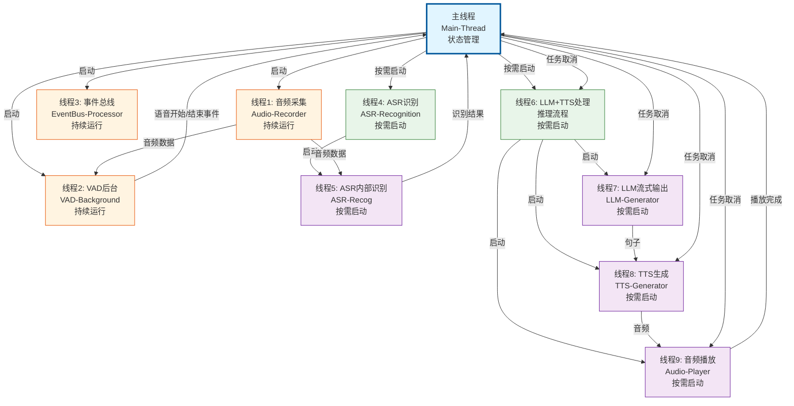

# 语音对话系统 - 线程调度文档

## 📋 文档说明

本文档详细描述了语音对话系统的线程架构、线程职责、线程生命周期和交互逻辑。

**核心场景**: 实时语音聊天交互，支持用户打断、输入合并、对话历史记录等功能。

**三方角色**:
- **用户**: 通过麦克风说话，可能随时打断机器人
- **机器人**: 关注用户是否在说话，说了什么，自己说的话会随时被用户打断
- **上帝**: 负责记录当前对话场景，忠实记录"说出来"的内容（用户说的和机器人真正播放出来的）

---

## 📊 状态定义

### 系统状态（SystemState）

系统状态分为**主系统（用户）**和**副系统（机器人LLM+TTS线程）**两类，不同状态组合用于判断逻辑变换：

#### 主系统状态（用户相关）

| 状态名称 | 状态值 | 含义 | 说明 |
|---------|--------|------|------|
| **IDLE** | `idle` | 空闲状态 | 主系统空闲，等待用户输入。此时没有正在处理的任务，可以接收新的用户输入。 |
| **LISTENING** | `listening` | 正在监听用户语音 | VAD检测到语音活动，ASR正在识别用户说话内容。此时主系统正在收集用户输入。 |
| **ROBOT_SPEAKING** | `robot_speaking` | 机器人正在说话 | 机器人正在播放生成的音频回答。此时用户可能听到机器人的声音。 |

#### 副系统状态（机器人LLM+TTS线程相关）

| 状态名称 | 状态值 | 含义 | 说明 |
|---------|--------|------|------|
| **None** | `None` | 无活动 | 副系统无活动，没有正在处理的LLM+TTS任务。 |
| **PROCESSING** | `processing` | 正在处理 | LLM正在生成回答，或TTS正在生成音频。此时副系统正在处理用户输入，但还没有开始播放。 |
| **SPEAKING** | `speaking` | 正在播放 | 第一段TTS音频生成完成，开始播放。此时副系统正在输出音频。 |
| **PAUSED** | `paused` | 处理、播放已暂停（等待验证） | 只有在主系统LISTENING + 副系统(PROCESSING or SPEAKING)状态中才会触发PAUSED，检测到用户可能打断，播放已暂停，正在等待ASR验证是否为真实用户输入。 |

**状态组合规则**:
- 主系统状态和副系统状态可以叠加
- 主系统状态内部互斥（同一时间只能有一个主系统状态）
- 副系统状态内部互斥（同一时间只能有一个副系统状态）

### 状态组合表

#### 可能的状态组合

| 主系统状态 | 副系统状态 | 说明 | 典型场景 |
|-----------|-----------|------|---------|
| **IDLE** | **NONE** | 空闲状态，系统完全空闲 | 系统启动后，等待用户输入 |
| **IDLE** | **PROCESSING** | 正在处理用户输入 | ASR识别完成，开始LLM+TTS处理 |
| **IDLE** | **SPEAKING** | 误判恢复后的状态 | 播放继续，但主系统已恢复为IDLE（误判恢复） |
| **LISTENING** | **NONE** | 正在监听用户，没有处理任务 | VAD检测到语音，ASR开始识别 |
| **LISTENING** | **PROCESSING** | 正在处理时被打断 | LLM/TTS处理中，用户开始说话 |
| **LISTENING** | **SPEAKING** | 正在播放时被打断 | 播放中，用户开始说话 |
| **LISTENING** | **PAUSED** | 暂停等待ASR验证 | 检测到打断，延迟验证通过，暂停播放/处理 |
| **ROBOT_SPEAKING** | **SPEAKING** | 正常播放状态 | 机器人正在播放音频回答 |

#### 不可能的状态组合

| 主系统状态 | 副系统状态 | 原因 |
|-----------|-----------|------|
| **IDLE** | **PAUSED** | 暂停时主系统必须是LISTENING（PAUSED只有在检测到用户打断时才会出现） |
| **ROBOT_SPEAKING** | **NONE** | 播放时副系统必须是SPEAKING（如果主系统是ROBOT_SPEAKING，说明正在播放） |
| **ROBOT_SPEAKING** | **PROCESSING** | 处理时主系统应该是IDLE（如果副系统是PROCESSING，说明正在处理） |
| **ROBOT_SPEAKING** | **PAUSED** | 暂停时主系统应该是LISTENING（如果副系统是PAUSED，说明检测到打断） |

#### 不可能状态组合的防御性处理

系统在关键位置（`_handle_asr_result`、`_audio_player_thread`、`_cancel_current_task`、`_pause_for_voice_check`）会自动检测不可能的状态组合，并尝试恢复：

| 不可能组合 | 检测到时的恢复策略 | 恢复后的状态 |
|-----------|------------------|------------|
| **IDLE + PAUSED** | 将副系统状态恢复为NONE | IDLE + NONE |
| **ROBOT_SPEAKING + NONE** | 将主系统状态恢复为IDLE | IDLE + NONE |
| **ROBOT_SPEAKING + PROCESSING** | 将主系统状态恢复为IDLE | IDLE + PROCESSING |
| **ROBOT_SPEAKING + PAUSED** | 将主系统状态恢复为LISTENING | LISTENING + PAUSED |

**恢复机制**:
- 所有状态恢复操作都会记录到日志（ERROR级别）
- 恢复操作会通过`state.set_main_state()`或`state.set_sub_state()`方法，确保状态变化有控制台输出
- 如果恢复失败，会记录错误日志

### 状态联动规则

#### 副系统状态变化带动主系统状态变化

1. **PROCESSING → SPEAKING** (首次播放时)
   - 如果主系统状态是 **IDLE** → 变为 **ROBOT_SPEAKING**
   - 如果主系统状态是 **LISTENING** → 保持 **LISTENING**（等待ASR验证）

2. **SPEAKING → NONE** (播放完成)
   - 如果主系统状态是 **ROBOT_SPEAKING** → 变为 **IDLE**
   - 如果主系统状态是 **IDLE** → 保持 **IDLE**（误判恢复后的情况）

3. **SPEAKING → PAUSED** (检测到打断)
   - 主系统状态必须是 **LISTENING**（由VAD触发）
   - 如果主系统状态不是LISTENING，不应该进入PAUSED

#### 主系统状态变化带动副系统状态变化

1. **IDLE → LISTENING** (VAD检测到语音)
   - 副系统状态不变（保持当前状态）

2. **LISTENING → IDLE** (ASR识别完成/无效输入)
   - 如果副系统状态是 **PAUSED** → 应该先处理（恢复或取消）
   - 如果副系统状态是 **NONE** → 保持 **NONE**
   - 如果副系统状态是 **SPEAKING** → 保持 **SPEAKING**（误判恢复）

3. **IDLE → ROBOT_SPEAKING** (首次播放)
   - 必须伴随副系统状态 **PROCESSING → SPEAKING**

4. **ROBOT_SPEAKING → IDLE** (播放完成)
   - 必须伴随副系统状态 **SPEAKING → NONE**

5. **ROBOT_SPEAKING → LISTENING** (检测到打断)
   - 副系统状态 **SPEAKING → PAUSED**（延迟验证通过后）

### 状态转换规则

#### 主系统状态转换（用户相关）

- **IDLE → LISTENING**: VAD检测到语音开始时（主系统状态为IDLE）
- **IDLE → ROBOT_SPEAKING**: 检测到TTS生成结果返回，开始播放（副系统状态为SPEAKING时）
- **LISTENING → IDLE**: VAD检测到语音结束时，ASR识别完成
- **ROBOT_SPEAKING → IDLE**: 所有音频播放完成（副系统状态变为None时）

#### 副系统状态转换（机器人LLM+TTS线程相关）

- **None → PROCESSING**: ASR识别到有效用户输入，开始处理LLM+TTS
- **PROCESSING → SPEAKING**: 第一段TTS音频生成完成，开始播放（同时主系统状态变为ROBOT_SPEAKING）
- **PROCESSING + 主系统LISTENING → PAUSED**: LLM或TTS处理时，检测到用户可能打断，线程处理完后直接暂停，不进行播放
- **SPEAKING + 主系统LISTENING → PAUSED**: 检测到用户可能打断，延迟验证通过后暂停播放
- **PAUSED → SPEAKING**: ASR验证失败（无效输入），恢复播放
- **PAUSED → None**: 任务被取消，或 ASR验证成功（有效输入）重新处理
- **SPEAKING → None**: 全部播放完毕，关闭线程（同时主系统状态变为IDLE）

### 任务状态（TaskStatus）

任务在处理过程中会经历以下状态：

| 状态名称 | 含义 | 说明 |
|---------|------|------|
| **listening** | 聆听中 | ASR任务专属状态，正在处理语音识别 |
| **pending** | 待处理 | 任务已创建，等待开始处理 |
| **processing** | 处理中 | LLM正在生成回答，或TTS正在生成音频 |
| **playing** | 播放中 | 音频正在播放 |
| **paused** | 暂停中 | 识别到用户输入，但是还不确定是否为真实输入 |
| **completed** | 已完成 | 任务完成，所有音频播放完毕 |
| **cancelled** | 已取消 | 任务被取消（通常因为用户打断或新输入） |

### 任务ID机制

- 每个任务有唯一的递增`task_id`
- 新任务创建时，`task_id`自动递增
- 任务被取消时，`task_id`会递增（创建新任务）
- 子线程通过检查`task_id`是否匹配来判断任务是否有效
- 如果`task_id`不匹配，子线程立即停止工作

---

## 🧵 线程列表

### 主线程（线程0）

**线程名称**: Main-Thread  
**线程类型**: 主线程（非daemon）  
**生命周期**: 系统启动到关闭  
**职责**:
- 系统初始化和配置加载
- 启动DialogueManager
- 注册信号处理（Ctrl+C）
- 保持主循环运行，等待系统关闭
- 系统关闭时清理资源

**启动时机**: 程序启动时自动创建  
**关闭时机**: 收到SIGINT/SIGTERM信号或程序异常退出

---

### 常驻后台线程

#### 线程1: 音频采集线程

**线程名称**: Audio-Recorder  
**线程类型**: daemon线程  
**生命周期**: 系统启动到关闭（持续运行）  
**父线程**: 主线程  
**职责**:
- 持续从麦克风采集音频数据
- 将音频数据发送给预缓存缓冲区（ASR）
- 将音频数据发送给VAD后台线程
- 处理回声消除（如果启用）

**启动时机**: `DialogueManager.start()` 调用时  
**关闭时机**: `DialogueManager.stop()` 调用时，或主线程退出时自动关闭（daemon）

**子线程**: 无

---

#### 线程2: VAD后台线程

**线程名称**: VAD-Background  
**线程类型**: daemon线程  
**生命周期**: 系统启动到关闭（持续运行）  
**父线程**: 主线程（通过DialogueManager启动）  
**职责**:
- 持续监控音频队列中的音频数据
- 检测语音活动（VAD检测）
- 触发语音开始/结束回调
- 记录语音时间戳

**启动时机**: `DialogueManager.start()` 调用时，通过 `vad.start_background_thread()` 启动  
**关闭时机**: `DialogueManager.stop()` 调用时，或主线程退出时自动关闭（daemon）

**子线程**: 无

---

#### 线程3: 事件总线处理线程

**线程名称**: EventBus-Processor  
**线程类型**: daemon线程  
**生命周期**: 系统启动到关闭（持续运行）  
**父线程**: 主线程（通过DialogueManager初始化时启动）  
**职责**:
- 持续处理事件队列中的事件
- 按优先级处理事件（高优先级优先）
- 通知订阅者处理事件
- 维护事件统计信息

**启动时机**: `EventBus.start_processing()` 调用时（在 `DialogueManager.initialize_modules()` 中）  
**关闭时机**: `DialogueManager.stop()` 调用时，或主线程退出时自动关闭（daemon）

**子线程**: 无

---

### 按需启动的线程

#### 线程4: ASR识别线程（管理器层）

**线程名称**: ASR-Recognition  
**线程类型**: daemon线程  
**生命周期**: 检测到语音活动时启动，用户停止说话后等待NO_SPEECH_THRESHOLD秒后停止  
**父线程**: 主线程（通过DialogueManager启动）  
**职责**:
- 启动ASR识别流程
- 等待ASR识别完成
- 管理ASR识别状态
- 处理ASR识别结果

**启动时机**: 
- VAD检测到语音开始时（`_on_vad_speech_start`）
- 主系统状态为IDLE、ROBOT_SPEAKING时，或副系统状态为PROCESSING、SPEAKING、PAUSED时
- 主系统状态为LISTENING时无法启动新的ASR线程（此线程具有唯一性）

**关闭时机**:
- **不是由VAD直接控制**，而是由`NO_SPEECH_THRESHOLD`参数控制
- 在音频采集线程中，持续检查`time.time() - last_active_time > NO_SPEECH_THRESHOLD`
- 当超过阈值时，调用`save_audio_video()` → `wait_for_streaming_asr_result()` → `stop_streaming_asr()`
- `stop_streaming_asr()`设置`streaming_asr_speaking = False`，ASR线程检测到此标志后退出
- 系统关闭时

**子线程**: 线程5（ASR内部识别线程）

**注意事项**:
- 如果当前已经存在一个ASR线程，VAD此时间段内监测到语音活动均不会唤起新的ASR进程，该进程唯一。
- 如果副系统状态为SPEAKING或PROCESSING，启动此线程，并标记副系统状态为PAUSED
- ASR的结束不是由VAD检测到静音立即触发，而是由`NO_SPEECH_THRESHOLD`控制（用户停止说话后等待一段时间），这样可以避免用户短暂停顿（如换气）时误判为结束
- ASR线程会等待内部识别线程完成（通过`join(timeout=2.0)`，带超时保护）

---

#### 线程5: ASR内部识别线程

**线程名称**: ASR-Recog  
**线程类型**: daemon线程  
**生命周期**: ASR识别启动时创建，识别完成时结束  
**父线程**: 线程4（ASR识别线程）  
**职责**:
- 从音频队列获取音频数据
- 调用FunASR模型进行流式识别
- 处理预缓存音频（VAD检测前的音频）
- 调用ASR去重器处理重复文本
- 触发部分结果回调和最终结果回调

**启动时机**: `FunASRStream.start_recognition()` 调用时（由线程4启动）  
**关闭时机**: 
- `FunASRStream.stop_recognition()` 调用时，设置`streaming_asr_speaking = False`
- 识别完成时：当音频队列为空且`streaming_asr_speaking = False`时，退出循环
- 处理剩余音频并进行最终识别（`is_final=True`）
- 父线程（线程4）关闭时自动关闭（daemon）

**子线程**: 无

**注意事项**:
- 此线程是ASR模块内部的线程，由线程4管理
- 线程内部持续从`streaming_asr_audio_queue`获取音频，当队列为空且`streaming_asr_speaking = False`时退出
- 退出前会处理剩余音频并进行最终识别，确保不丢失内容
- 如果父线程被强制关闭，此线程也会自动关闭（daemon）

**早期提交优化（Early Commit）**:

为了减少响应延迟，系统支持早期提交优化。当满足以下条件时，可以提前触发LLM推理，无需等待正式的最终识别结果：

1. **VAD已结束**: 用户停止说话，VAD检测到语音活动结束
2. **结果稳定**: 连续N次（由`asr.stable_check_count`配置，默认2次）的部分识别结果完全相同
3. **结果非空**: 识别结果文本不为空

**工作流程**:
```
[VAD] 检测到语音结束 → 通知ASR模块（set_vad_ended）
    ↓
[线程5] 每次部分识别后检查结果稳定性
    ├─ 如果连续N次结果相同 + VAD已结束
    │   ├─ 发送 ASR_STABLE_RESULT 事件
    │   └─ DialogueManager 收到事件后提前调用 _handle_asr_result()
    └─ 后续的最终结果会被跳过（已通过早期提交处理）
```

**预期效果**:
- **优化前**: VAD结束 → 等待`NO_SPEECH_THRESHOLD`秒 → 最终识别 → LLM开始
- **优化后**: VAD结束 → 检测到稳定结果（约0.3秒内）→ LLM开始

预计可节省约 **1-1.3秒** 响应时间。

**配置参数**:
- `asr.early_commit_enabled`: 是否启用早期提交优化（默认True）
- `asr.stable_check_count`: 连续多少次相同结果视为稳定（默认2次）

---

#### 线程6: LLM+TTS处理线程（推理流程）

**线程名称**: llmtts 
**线程类型**: daemon线程  
**生命周期**: 处理用户输入时启动，生成完成时结束  
**父线程**: 主线程（通过回调函数调用）  
**职责**:
- 调用LLM进行流式生成
- 启动TTS生成线程（线程7）
- 启动音频播放线程（线程8）
- 等待TTS和播放完成
- 管理句子队列和音频播放队列

**启动时机**: 
- ASR识别到有效用户输入时（`_process_user_input`）
- 主系统状态为IDLE

**关闭时机**:
- LLM生成完成，TTS和播放线程都完成后
- 任务被取消时（通过task_id检查）
- 系统关闭时

**子线程**: 线程7（LLM流式输出线程）、线程8（TTS生成线程）、线程9（音频播放线程）

**注意事项**:
- 此流程启动是独立线程，但是TTS生成和音频播放可被暂停。
- 会启动三个子线程（LLM流式输出、TTS生成和音频播放）
- 如果任务被取消，会通知子线程停止

---

#### 线程7: LLM流式输出线程

**线程名称**: LLM-Generator  
**线程类型**: daemon线程  
**生命周期**: 线程6开始时启动，所有内容生成完成时结束  
**父线程**: 线程6（LLM+TTS处理流程）  
**职责**:
- 把用户输入传给LLM，流式生成结果
- 实时判断生成内容，当满足最小句子长度的内容一出现，就调用线程8，TTS生成线程。
- 后续每当生成新的符合要求的内容，都调用线程8，TTS生成线程生成语音。
- 检查任务是否被取消（通过task_id）

**启动时机**: `_inference_flow` 调用时，通过 `threading.Thread` 启动  
**关闭时机**:
- LLM输出结束，且所有句子都已经生成对应TTS结果。
- 任务被取消时（`task_id` 不匹配）
- 父线程关闭时自动关闭（daemon）

**子线程**: 无

**注意事项**:
- 持续检查任务ID，如果任务被取消则停止生成
- 如果父线程被强制关闭，此线程也会自动关闭（daemon）

---

#### 线程8: TTS生成线程

**线程名称**: TTS-Generator  
**线程类型**: daemon线程  
**生命周期**: LLM输出第一个句子后启动，所有句子生成完成时结束  
**父线程**: 线程6（LLM+TTS处理流程）
**职责**:
- 获取待处理的LLM生成的句子
- 根据TTS引擎类型选择生成模式（流式或非流式）
- 调用TTS引擎生成音频
- 去除TTS音频的头尾多余音频（非流式）或处理音频块（流式）
- 将生成的音频放入线程9音频播放队列
- 检查任务是否被取消（通过task_id）

**生成模式**:

**非流式模式（EdgeTTS）**:
- 等待完整句子文本输入
- 调用`tts.generate()`方法，等待完整AudioSegment返回
- 一次性将完整音频放入播放队列
- 首个音频生成后启动播放线程（线程9）
- 适用于网络TTS服务，稳定性好但延迟较高

**流式模式（CosyVoice3）**:
- **直接对接LLM流式输出**，不需要等待完整句子
- LLM生成的文本token实时传递，有多少文本就生成多少音频
- 累积文本到一定长度（如10-20个字符）或时间间隔后，调用`tts.generate_stream()`方法
- 返回音频块生成器，遍历音频块生成器，逐块处理：
  - **首个音频块**：转换并放入播放队列 → 启动播放线程（线程9）
  - **后续音频块**：转换并连续放入播放队列 → 实现真正的实时播放
- LLM、TTS、播放三者并行工作，形成pipeline模式
- 每个音频块生成前后检查task_id，支持任务取消
- 适用于本地模型，响应速度快，延迟最低

**启动时机**: `_on_llm_sentence` 回调中，当第一个句子生成时，通过 `threading.Thread` 启动  
**关闭时机**:
- 当前句子队列中所有句子都TTS生成完成时
- 流式模式：所有音频块生成完成时
- 任务被取消时（`task_id` 不匹配）
- 父线程关闭时自动关闭（daemon）

**子线程**: 无

**注意事项**:
- **非流式模式**：
  - 该线程在LLM输出第一个句子后才启动，避免在还没有数据时就开始运行
  - 该线程只有一个，当句子队列中的句子开始播放后，才生成下一个句子的TTS
  - 等待完整音频生成后才放入队列
- **流式模式**：
  - **直接对接LLM流式输出**，不需要等待完整句子，与LLM线程并行启动
  - 实时接收文本流，累积到一定长度就生成音频块
  - 首个音频块生成后立即启动播放线程，后续块连续放入队列
  - **真正的pipeline模式**：LLM生成、TTS生成、播放三者并行，延迟最低
- 持续检查任务ID，如果任务被取消则停止生成（流式模式在每个块生成前后检查）
- 如果父线程被强制关闭，此线程也会自动关闭（daemon）
- 如果线程还没启动时任务被取消，`_cancel_current_task` 会直接取消任务，不需要等待线程启动

---

#### 线程9: 音频播放线程

**线程名称**: Audio-Player  
**线程类型**: daemon线程  
**生命周期**: 第一个TTS文件生成后启动，所有音频播放完成时结束  
**父线程**: 线程6（LLM+TTS处理流程）  
**职责**:
- 从音频播放队列获取TTS生成的音频
- 调用AudioPlayer播放音频
- 检查任务是否被取消（通过task_id）
- 检查用户打断标记（`pending_interrupt`）
- 记录播放状态和已播放内容
- 线程结束时记录已对话历史

**启动时机**: `_tts_generator_thread` 中，当第一个TTS文件生成后，通过 `threading.Thread` 启动  
**关闭时机**:
- 所有音频播放完成时
- 任务被取消时（`task_id` 不匹配）
- 用户打断时（`pending_interrupt=True` 且ASR验证通过）
- 父线程关闭时自动关闭（daemon）

**子线程**: 无

**注意事项**:
- 该线程在第一个TTS文件生成后才启动，避免在还没有数据时就开始运行
- 首次播放前会检查系统是否为LISTENING，如果有则等待ASR验证
- 在SPEAKING状态时，监测到LISTENING，要有个DELAY时延，不要马上PAUSED
- 模拟人类听到他人说话不会马上停止，DELAY时延是缓冲作用，使得播放进展更加流畅，判断用户是否是真实打断。
- 持续检查任务ID和打断标记
- 如果父线程被强制关闭，此线程也会自动关闭（daemon）
- 如果线程还没启动时任务被取消，`_cancel_current_task` 会直接取消任务，不需要等待线程启动


---

## 🔄 线程交互逻辑

### VAD与ASR配合机制详解

**核心机制**：VAD负责检测语音活动并启动ASR，但ASR的结束不是由VAD直接控制，而是由`NO_SPEECH_THRESHOLD`参数控制。

#### 1. ASR启动流程

```
[线程1] 音频采集线程
    ├─ 每0.5秒检测一次VAD
    ├─ 当检测到语音活动且之前是静音时：
    │   ├─ 调用 start_streaming_asr()
    │   ├─ 更新 last_active_time = time.time()
    │   └─ 设置 streaming_asr_active = True, streaming_asr_speaking = True
    └─ 启动 [线程4] ASR识别线程 → 启动 [线程5] ASR内部识别线程
```

#### 2. ASR结束流程

```
[线程1] 音频采集线程
    ├─ 持续检查 time.time() - last_active_time > NO_SPEECH_THRESHOLD
    ├─ 当检测到语音活动时，更新 last_active_time（重置计时）
    └─ 当超过阈值时：
        ├─ 调用 save_audio_video()
        └─ save_audio_video() → wait_for_streaming_asr_result()
            ├─ 调用 stop_streaming_asr()
            │   └─ 设置 streaming_asr_speaking = False
            ├─ 等待 [线程5] 完成（join(timeout=2.0)）
            └─ [线程5] 检测到 streaming_asr_speaking = False 后：
                ├─ 退出循环
                ├─ 处理剩余音频并进行最终识别（is_final=True）
                └─ 返回最终识别结果
```

#### 3. 设计优势

- **避免误判**：用户短暂停顿（如换气）时不会误判为结束
- **提高准确性**：给用户足够时间完成一句话，提高识别准确性
- **可调节性**：通过`NO_SPEECH_THRESHOLD`可调节响应速度和误判率
- **异步处理**：ASR线程独立运行，不阻塞VAD检测

#### 4. 关键参数

- `NO_SPEECH_THRESHOLD`：用户停止说话后等待多久才认为说话结束（默认1.2秒）
  - 值越大：越不容易误判，但响应会变慢
  - 值越小：响应更快，但可能在用户换气时误判为结束

---

### LLM、TTS和音频播放线程的依赖关系

**核心依赖链**: 线程7（LLM生成） → 线程8（TTS生成） → 线程9（音频播放）

#### 依赖关系说明

1. **线程7（LLM生成） → 线程8（TTS生成）**
   - **非流式模式（EdgeTTS）**：
     - TTS线程在LLM输出第一个完整句子后才启动
     - TTS线程从 `sentence_queue` 获取LLM生成的完整句子
     - 如果LLM还在生成，TTS线程会继续等待新句子
   - **流式模式（CosyVoice3）**：
     - **TTS线程与LLM线程并行启动**（或LLM开始生成时立即启动）
     - **直接对接LLM流式输出**，不等待完整句子
     - TTS线程实时接收LLM生成的文本token流
     - 累积文本到一定长度后生成音频块，实现真正的实时转换

2. **线程8（TTS生成） → 线程9（音频播放）**
   - **非流式模式（EdgeTTS）**：
     - 音频播放线程在第一个完整TTS音频生成后才启动
     - 音频播放线程从 `audio_play_queue` 获取完整的AudioSegment
     - 如果TTS还在生成，音频播放线程会继续等待新音频
   - **流式模式（CosyVoice3）**：
     - 音频播放线程在第一个音频块生成后立即启动（降低首字延迟）
     - 音频播放线程从 `audio_play_queue` 获取AudioSegment块
     - 首个块包含句子文本，后续块文本为空（表示连续播放）
     - TTS生成和播放并行进行（pipeline模式），实现低延迟响应

#### 播放完成判断条件

音频播放完成必须同时满足以下所有条件：

1. **`stream_generation_done = True`**：LLM生成完成
   - 确保所有句子都已生成，不会再有新的TTS音频

2. **`tts_generation_done = True`**：TTS生成完成
   - 确保所有句子的TTS音频都已生成并放入队列

3. **`audio_play_queue.empty() = True`**：播放队列为空
   - 确保所有生成的音频都已从队列中取出

4. **`not is_still_playing`**：音频播放器不在播放
   - 确保当前音频已播放完成

5. **`not first_audio`**：至少播放过第一个音频
   - 确保至少开始播放过音频，避免在还没播放时就误判为完成

#### 避免误判的场景

**场景1：LLM还在生成时**
- 问题：如果LLM第二个句子还没生成完，但当前队列中的TTS音频已经播放完
- 解决：检查 `stream_generation_done`，如果为False，继续等待LLM生成

**场景2：TTS还在生成时**
- 问题：如果TTS后续的句子还没生成完，但前面的句子已经播放完
- 解决：检查 `tts_generation_done`，如果为False，继续等待TTS生成

**关键原则**：
- 只有当LLM和TTS都完成生成，且队列为空且不在播放时，才认为播放完成
- 任何一方还在生成，都应该继续等待，避免误判

---

### 核心交互原则

1. **状态驱动**: 所有线程交互基于主系统状态（IDLE、LISTENING、ROBOT_SPEAKING）和副系统状态（None、PROCESSING、SPEAKING、PAUSED）
2. **事件驱动**: VAD检测结果触发主线程回调，主线程协调各子线程
3. **任务隔离**: 通过`task_id`机制确保任务独立，支持取消和替换
4. **打断验证**: 延迟验证机制避免误判，ASR验证确保真实输入
5. **历史记录**: 只记录"说出来"的内容，用户输入和机器人实际播放的内容
6. **依赖链完整性**: LLM、TTS、音频播放三个线程形成依赖链，播放完成必须等待所有上游线程完成

---

### 场景1: 正常对话流程（主系统: IDLE → LISTENING → IDLE，副系统: None → PROCESSING → SPEAKING → None）

**触发条件**: 主系统处于IDLE状态，用户开始说话

**流程步骤**:

```
[主线程] 主系统状态: IDLE，副系统状态: None
    ↓
[线程1] 持续采集音频 → 发送给 [线程2] 和 ASR预缓存
    ↓
[线程2] VAD检测到语音开始 → 触发回调
    ↓
[主线程] _on_vad_speech_start()
    ├─ 主系统状态: IDLE → LISTENING
    ├─ 更新 last_active_time = time.time()
    ├─ 启动 [线程4] ASR识别线程
    └─ 设置 ASR 状态为 listening
    ↓
[线程4] 启动 [线程5] ASR内部识别线程
    ↓
[线程5] 从预缓存和实时队列获取音频
    ├─ 调用 FunASR 流式识别
    ├─ 触发部分结果回调（可选）
    └─ 持续识别，直到 streaming_asr_speaking = False
    ↓
[线程1] 持续检查 time.time() - last_active_time > NO_SPEECH_THRESHOLD
    ├─ 当检测到语音活动时，更新 last_active_time
    └─ 当超过阈值时，调用 save_audio_video()
    ↓
[主线程] save_audio_video()
    ├─ 调用 wait_for_streaming_asr_result()
    └─ wait_for_streaming_asr_result() 调用 stop_streaming_asr()
    ↓
[主线程] stop_streaming_asr()
    ├─ 设置 streaming_asr_speaking = False
    └─ [线程5] 检测到标志后退出循环，处理剩余音频并返回最终结果
    ↓
[主线程] _handle_asr_result()
    ├─ 验证输入有效性（_validate_input）
    ├─ 如果有效 → _process_user_input()
    └─ 如果无效 → 主系统状态: LISTENING → IDLE（忽略）
    ↓
[主线程] _process_user_input()
    ├─ 主系统状态: LISTENING → IDLE
    ├─ 创建新任务（task_id递增）
    ├─ 副系统状态: None → PROCESSING
    └─ 启动 [线程6] LLM+TTS处理流程（独立线程）
    ↓
[线程6] _inference_flow()
    ├─ 重置线程启动标志（tts_thread_started, player_thread_started）
    ├─ 启动 [线程7] LLM流式输出线程
    └─ 等待所有线程完成
    ↓
[线程7] LLM流式输出线程
    ├─ 持续从 LLM 获取生成内容
    ├─ 根据TTS引擎类型选择处理方式：
    │   ├─ 非流式模式（EdgeTTS）:
    │   │   ├─ 判断句子完整性（满足最小长度）
    │   │   ├─ 将完整句子放入 sentence_queue
    │   │   └─ 第一个句子生成时 → 启动 [线程8] TTS生成线程
    │   └─ 流式模式（CosyVoice3）:
    │       ├─ **实时传递文本token流给 [线程8] TTS生成线程**
    │       ├─ 不等待完整句子，有多少文本就传递多少
    │       └─ 与 [线程8] 并行启动（或立即启动 [线程8]），实现真正的流式处理
    ↓
[线程8] TTS生成线程
    ├─ 根据TTS引擎类型选择生成模式
    │   ├─ 非流式模式（EdgeTTS）:
    │   │   ├─ 等待 [线程7] 生成完整句子
    │   │   ├─ 从 sentence_queue 获取完整句子
    │   │   ├─ 调用 tts.generate() 等待完整音频
    │   │   ├─ 去除音频头尾多余部分
    │   │   └─ 将完整音频放入 audio_play_queue
    │   │   └─ 第一个完整音频生成后 → 启动 [线程9]
    │   └─ 流式模式（CosyVoice3）:
    │       ├─ **直接对接 [线程7] LLM流式输出**（不等待完整句子）
    │       ├─ 实时接收LLM生成的文本token流
    │       ├─ 累积文本到一定长度（如10-20字符）或时间间隔
    │       ├─ 调用 tts.generate_stream() 获取音频块生成器
    │       ├─ 遍历音频块：
    │       │   ├─ 首个块：转换并放入队列（包含累积文本）→ 启动 [线程9]
    │       │   └─ 后续块：转换并连续放入队列（文本为空）
    │       ├─ 每个块生成前后检查task_id
    │       └─ **LLM、TTS、播放三者并行工作**（真正的pipeline模式）
    └─ 第一个TTS文件/块生成后 → 启动 [线程9] 音频播放线程
    ↓
[线程9] 音频播放线程（在第一个TTS文件生成后启动）
    ├─ 从 audio_play_queue 获取音频
    ├─ 首次播放前检查主系统状态
    │   ├─ 如果为 LISTENING → 等待 ASR 验证
    │   └─ 如果为 IDLE → 直接播放
    ├─ 副系统状态: PROCESSING → SPEAKING（首次播放时）
    ├─ 主系统状态: IDLE → ROBOT_SPEAKING（首次播放时）
    ├─ 调用 AudioPlayer 播放音频
    └─ 记录播放状态和已播放内容
    ↓
[线程7] LLM 生成完成
    ├─ 等待所有句子 TTS 生成完成
    └─ 线程退出
    ↓
[线程8] 所有 TTS 生成完成
    └─ 线程退出
    ↓
[线程9] 所有音频播放完成
    ├─ 记录对话历史（用户输入 + 机器人播放内容）
    └─ 线程退出
    ↓
[线程6] 流程结束
    ├─ 副系统状态: SPEAKING → None
    └─ 主系统状态: ROBOT_SPEAKING → IDLE
```

**关键点**:
- ASR线程具有唯一性，同一时间只能有一个ASR识别任务
- LLM+TTS流程是独立线程，但TTS和播放可被暂停
- 首次播放前会检查主系统状态，如果为LISTENING则等待验证
- 播放完成后记录对话历史
- 主系统状态和副系统状态可以叠加，分别管理用户输入和机器人输出

---

### 场景2: 播放时被打断（主系统: ROBOT_SPEAKING → LISTENING，副系统: SPEAKING → PAUSED）

**触发条件**: 主系统处于ROBOT_SPEAKING状态，副系统处于SPEAKING状态，用户开始说话

**流程步骤**:

```
[线程9] 正在播放音频
    ├─ 主系统状态: ROBOT_SPEAKING，副系统状态: SPEAKING
    └─ 持续检查 pending_interrupt 和 task_id
    ↓
[线程2] VAD检测到语音开始 → 触发回调
    ↓
[主线程] _on_vad_speech_start()
    ├─ 主系统状态: ROBOT_SPEAKING → LISTENING
    ├─ 设置 pending_interrupt = True
    ├─ 启动延迟验证定时器（_pause_for_voice_check）
    └─ 启动 [线程4] ASR识别线程（如果还没启动）
    ↓
延迟验证期间（AUDIO_STOP_DELAY 秒）:
    ├─ **重要**: 在此期间，所有线程继续正常运行
    │   ├─ [线程9] 继续播放音频（不受影响）
    │   ├─ [线程7] 继续LLM生成（不受影响）
    │   ├─ [线程8] 继续TTS生成（不受影响）
    │   └─ [线程4][线程5] 继续ASR识别（不受影响）
    ├─ 持续检查用户是否还在说话
    ├─ 如果检测到持续静音 → 判断为误判
    │   ├─ 取消打断
    │   ├─ 清除 pending_interrupt
    │   └─ 所有线程继续正常运行（完全不受影响）
    └─ 如果持续说话 → 延迟验证通过
    ↓
延迟验证通过 → 暂停播放
    ↓
[主线程] audio_player.pause()
    ├─ [线程9] 进入暂停状态
    ├─ 副系统状态: SPEAKING → PAUSED
    └─ 记录暂停时的播放位置
    ↓
[线程4] 启动 [线程5] ASR内部识别线程
    ↓
[线程5] 识别完成，返回结果
    ↓
[主线程] _handle_asr_result()
    ├─ 验证输入有效性（_validate_input）
    └─ 根据验证结果处理
    ↓
如果验证有效（真实用户输入）:
    ├─ 停止播放（audio_player.stop()）
    ├─ 检查播放时长
    │   ├─ 如果 >= MIN_PLAY_DURATION_TO_RECORD
    │   │   └─ 记录已播放内容到对话历史
    │   └─ 如果 < MIN_PLAY_DURATION_TO_RECORD
    │       └─ 不记录历史
    ├─ 清理播放状态
    ├─ 清除 pending_interrupt
    ├─ 副系统状态: PAUSED → None
    ├─ 等待 ASR 识别完成（如果还在识别）
    └─ _process_user_input() → 启动新的 [线程6]
    ↓
如果验证无效（误判或无效输入）:
    ├─ 恢复播放（audio_player.resume()）
    ├─ 清除 pending_interrupt
    └─ 副系统状态: PAUSED → SPEAKING
```

**关键点**:
- **延迟验证期间，所有线程继续正常运行，完全不受影响**
- 延迟验证机制避免误判（模拟人类听到他人说话不会马上停止）
- 只有验证通过后才暂停播放，如果验证失败（误判），所有操作继续正常进行
- 暂停时记录播放位置，恢复时从该位置继续
- 只有播放时长达到阈值才记录历史
- ASR验证确保是真实用户输入才真正打断

---

### 场景3: 处理时被打断（主系统: IDLE → LISTENING，副系统: PROCESSING → PAUSED → None）

**触发条件**: 主系统处于IDLE状态，副系统处于PROCESSING状态（LLM正在生成），用户开始说话

**流程步骤**:

```
[线程6] 正在处理（LLM生成中）
    ├─ 主系统状态: IDLE，副系统状态: PROCESSING
    ├─ [线程7] LLM流式输出线程运行中
    ├─ [线程8] TTS生成线程可能未启动（如果LLM还没生成第一个句子）
    └─ [线程9] 音频播放线程可能未启动（如果TTS还没生成第一个文件）
    ↓
[线程2] VAD检测到语音开始 → 触发回调
    ↓
[主线程] _on_vad_speech_start()
    ├─ 主系统状态: IDLE → LISTENING
    ├─ 设置 pending_interrupt = True
    ├─ 启动延迟验证定时器
    └─ 启动 [线程4] ASR识别线程
    ↓
延迟验证期间:
    ├─ **重要**: 在此期间，所有线程继续正常运行
    │   ├─ [线程6] 继续LLM处理（不受影响）
    │   ├─ [线程7] 继续LLM生成（不受影响）
    │   ├─ [线程8] 继续TTS生成（如果已启动，不受影响）
    │   ├─ [线程9] 继续播放音频（如果已启动且正在播放，不受影响）
    │   └─ [线程4][线程5] 继续ASR识别（不受影响）
    ├─ 持续检查用户是否还在说话
    ├─ 如果检测到持续静音 → 判断为误判
    │   ├─ 取消打断
    │   ├─ 清除 pending_interrupt
    │   └─ 所有线程继续正常运行（完全不受影响）
    └─ 如果持续说话 → 延迟验证通过
    ↓
延迟验证通过 → 取消当前任务
    ↓
[主线程] _cancel_current_task()
    ├─ task_id 递增（创建新任务ID）
    ├─ 检查线程启动状态：
    │   ├─ 如果TTS线程还没启动 → 记录日志，直接取消
    │   └─ 如果音频播放线程还没启动 → 记录日志，直接取消
    ├─ 重置线程启动标志（tts_thread_started, player_thread_started）
    ├─ 副系统状态: PROCESSING → PAUSED
    └─ 通知所有子线程任务已取消
    ↓
[线程6] 检查 task_id，发现不匹配
    ├─ 停止 LLM 生成（如果可能）
    └─ 通知子线程停止
    ↓
[线程7] 检查 task_id，发现不匹配
    ├─ 停止生成
    └─ 不再启动新的 TTS 线程（因为task_id不匹配）
    ↓
[线程8] 如果已启动，检查 task_id，发现不匹配
    └─ 停止 TTS 生成
    ↓
[线程9] 如果已启动，检查 task_id，发现不匹配
    └─ 停止播放（如果正在播放）
    ↓
[线程4] 启动 [线程5] ASR内部识别线程
    ↓
[线程5] 识别完成，返回结果
    ↓
[主线程] _handle_asr_result()
    ├─ 验证输入有效性
    └─ 如果有效 → _process_user_input(is_merge=True)
    ↓
[主线程] _process_user_input(is_merge=True)
    ├─ 合并新旧输入（如果之前有未完成的输入）
    ├─ 副系统状态: PAUSED → None
    ├─ 创建新任务（task_id递增）
    ├─ 副系统状态: None → PROCESSING
    └─ 启动新的 [线程6] LLM+TTS处理流程
```

**关键点**:
- 处理时被打断，直接取消任务，不记录历史（因为还没播放）
- task_id机制确保旧任务的所有子线程都能及时停止
- 支持输入合并，将未完成的输入与新输入合并
- **线程未启动时的处理**：如果TTS线程或音频播放线程还没启动，`_cancel_current_task` 会检查并记录日志，直接取消任务，不需要等待线程启动
- 线程启动标志会在任务取消时重置，确保新任务可以正常启动线程

---

### 场景4: 输入合并流程

**触发条件**: 用户在第一句话还没处理完时继续说话

**流程步骤**:

```
用户输入1: "你好"
    ↓
[线程4][线程5] 识别完成 → "你好"
    ↓
[主线程] _process_user_input("你好")
    ├─ 创建任务 task_id=1
    └─ 启动 [线程6]（处理"你好"）
    ↓
[线程6] 开始 LLM 生成（task_id=1）
    ├─ [线程7] 开始流式生成
    └─ 生成中...
    ↓
用户继续说话（输入2）: "我想问个问题"
    ↓
[线程2] VAD检测到语音开始
    ↓
[主线程] _on_vad_speech_start()
    ├─ 设置 pending_interrupt = True
    ├─ 启动延迟验证
    └─ 启动 [线程4] ASR识别线程
    ↓
延迟验证期间:
    ├─ **重要**: 在此期间，所有线程继续正常运行
    │   ├─ [线程6] 继续LLM处理（不受影响）
    │   ├─ [线程7] 继续LLM生成（不受影响）
    │   ├─ [线程8] 继续TTS生成（不受影响）
    │   ├─ [线程9] 继续播放音频（如果正在播放，不受影响）
    │   └─ [线程4][线程5] 继续ASR识别（不受影响）
    ├─ 持续检查用户是否还在说话
    ├─ 如果检测到持续静音 → 判断为误判
    │   ├─ 取消打断
    │   ├─ 清除 pending_interrupt
    │   └─ 所有线程继续正常运行（完全不受影响）
    └─ 如果持续说话 → 延迟验证通过
    ↓
延迟验证通过
    ↓
[主线程] _cancel_current_task()
    ├─ task_id 递增: 1 → 2
    └─ 副系统状态变为 PAUSED
    ↓
[线程6][线程7][线程8][线程9] 检测到 task_id 不匹配（期望1，实际2）
    └─ 全部停止
    ↓
[线程4][线程5] 识别输入2 → "我想问个问题"
    ↓
[主线程] _handle_asr_result()
    └─ _process_user_input("我想问个问题", is_merge=True)
    ↓
[主线程] 输入合并逻辑
    ├─ 检查是否有未完成的输入
    ├─ 如果有 → 合并: "你好" + " " + "我想问个问题"
    └─ 合并结果: "你好 我想问个问题"
    ↓
[主线程] 创建新任务（task_id=2）
    └─ 启动 [线程6]（处理合并后的输入）
    ↓
[线程6] 处理合并后的输入: "你好 我想问个问题"
    └─ 正常流程继续...
```

**关键点**:
- **延迟验证期间，所有线程继续正常运行，完全不受影响**
- 输入合并只在用户连续说话时触发
- 合并时用空格连接两个输入
- 旧任务被取消，新任务处理合并后的完整输入

---

### 场景5: 无效输入处理流程

**触发条件**: ASR识别结果为空或包含无效词

**流程步骤**:

```
[线程5] ASR识别完成，返回结果
    ↓
[主线程] _handle_asr_result()
    └─ _validate_input()
        ├─ 检查是否为空字符串
        ├─ 检查是否在无效词列表中
        └─ 返回验证结果同时主系统状态: LISTENING → IDLE
    ↓
如果验证无效:
    ↓
如果副系统状态为 PAUSED:
    ├─ 恢复播放（audio_player.resume()）
    ├─ 清除 pending_interrupt
    └─ 副系统状态: PAUSED → SPEAKING
    ↓
如果副系统状态为 PROCESSING:
    ├─ 取消当前任务（task_id递增）
    ├─ 副系统状态: PROCESSING → None
```

**关键点**:
- 无效输入不会触发LLM处理
- 如果系统处于PAUSED状态，恢复播放
- 如果系统处于IDLE状态，直接忽略

---

### 场景6: 暂停后恢复播放（PAUSED → SPEAKING）

**触发条件**: 主系统处于LISTENING状态，副系统处于PAUSED状态，ASR验证失败（无效输入）

**流程步骤**:

```
[线程9] 播放被暂停
    ├─ 主系统状态: LISTENING，副系统状态: PAUSED
    ├─ 记录暂停时的播放位置
    └─ 等待恢复或取消
    ↓
[线程5] ASR识别完成，返回结果
    ↓
[主线程] _handle_asr_result()
    └─ _validate_input() → 无效
    ↓
[主线程] 恢复播放逻辑
    ├─ audio_player.resume()
    ├─ 从暂停位置继续播放
    ├─ 清除 pending_interrupt
    └─ 副系统状态: PAUSED → SPEAKING
    ↓
[线程9] 继续播放音频
    └─ 正常播放流程继续...
```

**关键点**:
- 暂停时记录播放位置，恢复时从该位置继续
- 只有ASR验证失败（无效输入）才恢复播放
- 恢复后清除所有打断相关标记

---

## 🎯 线程权限和生命周期管理

### Daemon线程规则

| 线程类型 | Daemon设置 | 说明 |
|---------|-----------|------|
| 主线程 | 否 | 主线程退出时程序结束 |
| 所有子线程 | 是 | 主线程退出时自动终止 |

**Daemon线程特性**:
- 当主线程退出时，所有daemon线程会自动终止
- 不需要显式等待daemon线程完成（但建议在stop时等待）
- 适合后台任务和辅助线程

### 父线程关闭对子线程的影响

| 父线程 | 子线程 | 关闭影响 | 等待机制 |
|--------|--------|---------|---------|
| 主线程 | 线程1（音频采集） | 主线程关闭时自动关闭 | 通过`stop()`方法等待 |
| 主线程 | 线程2（VAD后台） | 主线程关闭时自动关闭 | 通过`stop()`方法等待 |
| 主线程 | 线程3（事件总线） | 主线程关闭时自动关闭 | 通过`stop()`方法等待 |
| 主线程 | 线程4（ASR识别） | 主线程关闭时自动关闭 | 关闭时等待线程5完成（join，带超时） |
| 线程4 | 线程5（ASR内部） | 父线程关闭时自动关闭 | 父线程通过join等待 |
| 主线程 | 线程6（LLM+TTS处理） | 主线程关闭时自动关闭 | 通过task_id检查，不等待 |
| 线程6 | 线程7（LLM流式输出） | 父线程关闭时自动关闭 | 通过task_id检查，不等待 |
| 线程7 | 线程8（TTS生成） | 父线程关闭时自动关闭 | 通过task_id检查，不等待 |
| 线程6 | 线程9（音频播放） | 父线程关闭时自动关闭 | 通过task_id检查，不等待 |

### 任务取消机制

**核心机制**:
- 每个任务有唯一的递增`task_id`
- 新任务创建时，`task_id`自动递增
- 任务被取消时，`task_id`会递增（创建新任务）
- 子线程持续检查`task_id`是否匹配当前任务
- 如果`task_id`不匹配，子线程立即停止工作

**实现细节**:
- 通过`task_lock`保护`task_id`的访问
- 所有子线程在关键循环中检查`task_id`
- 不匹配时立即退出循环，停止工作

### 线程同步机制

| 同步机制 | 用途 | 保护对象 |
|---------|------|---------|
| **task_lock** | 保护任务ID和任务状态 | `task_id`, `current_task_status` |
| **asr_lock** | 保护ASR线程状态 | `asr_thread`, `asr_status` |
| **interrupt_lock** | 保护打断标记 | `pending_interrupt` |
| **sentence_queue** | 句子队列（线程安全） | LLM生成的句子 |
| **audio_play_queue** | 音频播放队列（线程安全） | TTS生成的音频 |
| **事件总线** | 模块间通信 | 系统事件 |

**队列操作**:
- `sentence_queue`: 线程7放入，线程8取出
- `audio_play_queue`: 线程8放入，线程9取出
- 所有队列操作都是线程安全的

---

## 📊 完整交互流程图



**图例说明**:
- **蓝色**: 主线程（状态管理核心）
- **橙色**: 常驻后台线程（持续运行）
- **绿色**: 按需启动的线程（管理器层）
- **紫色**: 按需启动的线程（工作线程）

---

## ⚠️ 注意事项

### 1. 线程安全

**关键原则**:
- 所有共享状态使用锁保护（`task_lock`、`asr_lock`、`interrupt_lock`等）
- 队列操作是线程安全的（使用`queue.Queue`）
- 回调函数中注意线程安全，避免长时间阻塞

**最佳实践**:
- 锁的持有时间尽可能短
- 避免在持有锁时调用可能阻塞的操作
- 使用`with`语句确保锁的正确释放

### 2. 资源清理

**清理顺序**:
1. 停止所有常驻后台线程（线程1、2、3）
2. 等待ASR线程完成（线程4、5）
3. 取消所有进行中的任务（线程6、7、8、9）
4. 清理队列和缓存
5. 释放音频资源

**实现方式**:
- 通过`stop()`方法按顺序停止线程
- 使用`join(timeout)`等待线程完成
- 设置合理的超时时间，避免无限等待

### 3. 错误处理

**异常处理策略**:
- 线程异常时记录详细日志
- 通过`task_id`检查确保任务有效性
- 避免在回调中执行耗时操作
- 使用try-except捕获异常，防止线程崩溃

**恢复机制**:
- 任务取消后可以立即启动新任务
- 无效输入不会影响系统状态
- 播放暂停后可以恢复

### 4. 打断机制

**延迟验证**:
- 延迟时间: `AUDIO_STOP_DELAY`秒（可配置）
- 目的: 避免误判，模拟人类反应
- 机制: 持续检查用户是否还在说话
- **重要**: 在延迟验证期间，所有线程（播放、处理、生成等）继续正常运行，完全不受影响
- 只有延迟验证通过后，才会暂停播放或取消任务
- 如果延迟验证失败（检测到持续静音），所有操作继续正常进行，完全不受影响

**ASR验证**:
- 目的: 确保是真实用户输入
- 机制: 识别完成后验证输入有效性
- 结果: 有效则真正打断，无效则恢复

**播放时长判断**:
- 阈值: `MIN_PLAY_DURATION_TO_RECORD`（可配置）
- 目的: 决定是否记录对话历史
- 机制: 只有播放时长达到阈值才记录

### 5. 对话历史记录

**记录原则**:
- 只记录"说出来"的内容
- 用户说的: ASR识别结果（最终结果）
- 机器人说的: 真正播放出来的内容（不是生成的）
- 播放时长<`MIN_PLAY_DURATION_TO_RECORD`时不记录

**记录时机**:
- 用户输入: ASR识别完成后立即记录
- 机器人输出: 音频播放完成后记录（如果播放时长>=阈值）

**历史格式**:
- 用户: `{"role": "user", "content": "用户说的话"}`
- 机器人: `{"role": "assistant", "content": "实际播放的内容"}`

---

## 📝 线程状态转换表

| 线程 | 启动条件 | 停止条件 | 父线程 | 子线程 | 线程类型 |
|------|---------|---------|--------|--------|---------|
| 主线程 | 程序启动 | 程序退出 | - | 线程1,2,3 | 非daemon |
| 线程1 | 系统启动 | 系统关闭 | 主线程 | - | daemon |
| 线程2 | 系统启动 | 系统关闭 | 主线程 | - | daemon |
| 线程3 | 系统启动 | 系统关闭 | 主线程 | - | daemon |
| 线程4 | VAD检测到语音开始（主系统状态为IDLE、ROBOT_SPEAKING，或副系统状态为PROCESSING、SPEAKING、PAUSED） | VAD检测到语音结束 | 主线程 | 线程5 | daemon |
| 线程5 | ASR识别启动 | 识别完成 | 线程4 | - | daemon |
| 线程6 | 处理用户输入（主系统状态为IDLE） | 生成和播放完成 | 主线程 | 线程7,8,9 | daemon |
| 线程7 | LLM开始生成 | 所有句子生成完成 | 线程6 | 线程8 | daemon |
| 线程8 | LLM开始生成 | 所有句子TTS生成完成（非流式：完整音频生成；流式：所有音频块生成） | 线程7 | - | daemon |
| 线程9 | LLM开始生成 | 所有音频播放完成 | 线程6 | - | daemon |

**状态转换说明**:
- 线程4具有唯一性，同一时间只能有一个ASR识别任务
- 线程5（ASR内部识别）没有超时限制，用户可以一直说话直到语音结束
- 所有线程都可以通过`task_id`检查被提前终止

---

## 🔍 关键参数配置

| 参数名称 | 默认值 | 说明 | 影响 |
|---------|--------|------|------|
| `NO_SPEECH_THRESHOLD` | 1.2秒 | 无语音阈值 | 用户停止说话后等待多久才认为说话结束，触发ASR停止。值越大越不容易误判（如换气时），但响应会变慢 |
| `AUDIO_STOP_DELAY` | 0.3秒 | 延迟验证时间 | 影响打断响应速度，值越大越不容易误判。在延迟验证期间，所有线程继续正常运行 |
| `MIN_PLAY_DURATION_TO_RECORD` | 0.5秒 | 最小播放时长阈值 | 影响历史记录，播放时长小于此值不记录 |
| `TTS_TIMEOUT` | 30.0秒 | TTS生成超时时间 | 影响TTS线程等待时间 |
| `asr.early_commit_enabled` | True | 早期提交优化 | 是否启用早期提交优化。当VAD结束且ASR结果稳定时，提前触发LLM推理，可节省约1秒响应时间 |
| `asr.stable_check_count` | 2 | 稳定检测次数 | 连续多少次相同的ASR部分结果视为稳定，触发早期提交。值越大越稳定但延迟略增加 |

---

## 🏗️ 新架构组件（v3.0）

为了解决锁管理混乱、共享变量污染、线程生命周期难以追踪等问题，引入了事件驱动的新架构组件：

### 核心组件

| 组件 | 文件 | 职责 |
|-----|------|------|
| **TaskContext** | `task_context.py` | 任务上下文，隔离每个任务的状态和数据。旧任务取消时只需调用`invalidate()`，所有线程通过检查`is_valid`自动退出。 |
| **ContextManager** | `context_manager.py` | 上下文管理器，统一管理任务上下文的创建、访问和销毁。创建新任务时自动使旧任务失效。 |
| **ThreadManager** | `thread_manager.py` | 线程管理器，统一管理所有工作线程的生命周期，绑定线程到任务上下文。 |
| **StateManager** | `state_manager.py` | 状态管理器（事件驱动版），通过事件驱动实现原子性状态转换，自动验证状态组合有效性。 |

### 架构对比

| 方面 | 旧架构 | 新架构 |
|-----|--------|-------|
| **锁数量** | 4种锁，87处使用 | 每个Manager 1个锁，集中管理 |
| **共享变量** | 130处分散访问 | 集中在TaskContext，通过ContextManager访问 |
| **线程取消** | 检查task_id是否匹配 | 检查context.is_valid |
| **状态管理** | 分散在各方法 | 集中在StateManager，事件驱动 |
| **变量隔离** | 无（旧线程可能修改新任务变量） | 有（每个任务独立TaskContext） |
| **可追踪性** | 难（锁和状态分散） | 易（所有变化通过事件记录） |

### 新增事件类型

```python
# 任务生命周期
TASK_CREATED = "task_created"
TASK_CANCELLED = "task_cancelled"
TASK_COMPLETED = "task_completed"

# 线程生命周期
THREAD_STARTED = "thread_started"
THREAD_ENDED = "thread_ended"

# 打断相关
INTERRUPT_DETECTED = "interrupt_detected"
INTERRUPT_VALIDATED = "interrupt_validated"
INTERRUPT_CANCELLED = "interrupt_cancelled"
```

### 使用示例

```python
# 创建任务（自动使旧任务无效）
ctx = context_manager.create_context("用户输入")

# 工作线程中检查任务有效性
def worker(context: TaskContext):
    while True:
        context.check_valid()  # 无效时抛出TaskCancelledException
        # 做一些工作...

# 启动线程（绑定到任务上下文）
thread_manager.start_thread("llm", worker, ctx)

# 状态转换（原子性，自动发布事件）
state_manager.transition_sub(SubSystemState.PROCESSING, "开始处理")
```

---

**最后更新**: 2025-12-25  
**文档版本**: 3.0.0  
**维护者**: AI Assistant  
**更新说明**: 添加事件驱动的新架构组件（TaskContext、ContextManager、ThreadManager、StateManager），解决锁管理混乱、共享变量污染等问题

